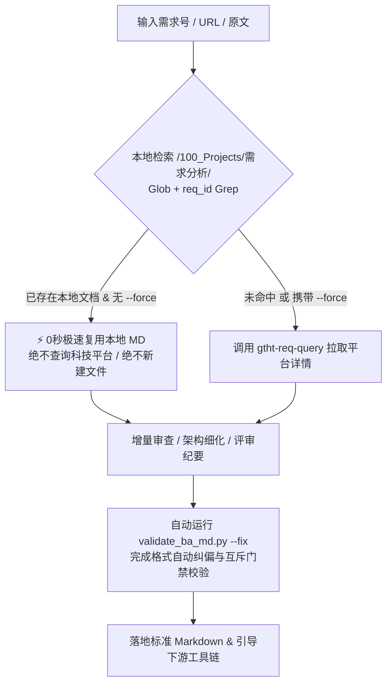

# BA-to-Dev: 业务需求转研发文档工作流

> **角色**：资深券商 IT 业务需求分析师 (BA)  
> **目标**：消除歧义、细化边界、提炼规则，产出可直接指导研发与测试的结构化 Markdown 规格说明书。

---

## 🧭 意图路由（最高优先级，2026-11-20 新增，借鉴 universal-requirement-review）

**一进来先判意图，再决定走哪条轨道**——避免把「想查询/想复用/想下发联动」误当「重新生成文档」执行，杜绝方向错误。按如下固定顺序判定（命中即分流，只进一条轨道，不再混跑后续步骤）：

| 意图 | 判定信号 | 行为（轨道） |
| :-- | :-- | :-- |
| `CONFIG_MANAGEMENT` | 用户说「配置/初始化/升级/改偏好」，或引到技能的配置/设置 | 按 [`references/config_guide.md`](file:///Users/wujin/.workbuddy/skills/ba-to-dev/references/config_guide.md) 处理配置，**不进入需求分析** |
| `FORCE_REFRESH` | 指令显式带 `--force` / `--remote` | 拉平台 → 100% 覆盖一二章 → 重跑三域 → 落盘 |
| `LOCAL_REUSE` | 给需求号 / URL、**无 `--force`**、本地 L1~L3 命中 | **0 秒读本地 MD**，增量审查，不查平台不建新文件 |
| `GENERATE_DOC` | 给原文 / URL / 明确说「生成研发文档/需求转研发/消歧」 | 全流程分析落盘 |
| `DOWNSTREAM_LINK` | 说「拆 Story / 评审 / 登记价值量 / 改排期 / 标签 / 上云」 | 直接引导对应下游 skill，不重排 BA 主流程 |

**硬性纪律**：① 仅字面 `--force`/`--remote` 才强制刷新；② 本地命中且无 `--force` 一律 0 秒复用；③ 判定歧义时先问一句（≤3 问且必给选项），不猜。

## 🔭 证据源四态留痕（配合底部证据三态 🟢🟡🔴 双维使用）

| 状态 | 含义 | 落点 |
| :-- | :-- | :-- |
| `checked_with_evidence` | 已调用并取到相关证据 | 🟢 已实证 / 🟡 可追溯 |
| `checked_no_relevant_result` | 调用成功但范围内无相关结果 | 标注「已检索、无相关」，**≠ 能力不存在** |
| `unavailable` | 源/权限/调用当前不可用 | 标注「暂不可用（原因）」，改用同角色他源 |
| `not_enabled` | 本次未启用/显式跳过 | 标注「未启用/跳过理由」，不视为故障、不伪造证据 |

---

## ⚡ 极速工作流 (Zero-Latency Workflow)



1. **Step 1：本地优先检索 & 0 秒出骨架**
   - 在 `/Volumes/Macintosh HD_Data/obsidian/100_Projects/需求分析/` 并行执行 **L1 文件名 + L2 `req_id` + L3 全文兜底**检索；命中且无 `--force` → **0 秒直接增量编辑，严禁查平台/新建文件**（批量存量少位/缺号纠偏调 `scripts/fix_reqid_filenames.py`）。
   - 未命中或携带 `--force`/`--remote` → 调 `python3 ~/.workbuddy/skills/ba-to-dev/scripts/extract_demand.py <需求号> --out <路径>` 一键生成含一、二章 100% 平台原文的骨架。
   - **`--force` 硬语义（P0）**：必须用平台最新原文 **100% 覆盖本地一、二章**（去 HTML 标签、含错别字原样保留，BA 注记移入第四章审计），严禁沿用本地已被改写的旧版原文。
2. **Step 2：三域分层并行检索与实证核对**（完整波次与跳过标准见文末「🚀 分层并行执行协议」）
   - **① 业务规则域（方向盘）**：`openviking_mcp.py` 2–3 近义词并行 `find` → 精准 `read` 规则/既有需求（详见 [`references/openviking_lookup.md`](file:///Users/wujin/.workbuddy/skills/ba-to-dev/references/openviking_lookup.md)），冒头即回灌校准代码检索词。
   - **② 代码域（发动机）**：`jzjy`/`dys`/`jzqs`/`grc`/`cszx` 多系统并行 `search_graph`，**首查优先用英文代码符号**（查 [`references/graph_lookup.md`](file:///Users/wujin/.workbuddy/skills/ba-to-dev/references/graph_lookup.md) §8 预映射字典）；0 命中须走完兜底链（换词→sqlite→funcid→grep），**严禁误标「本地无图谱」**（仅 `djgl`/`ssjs`/`jzyy` 无图谱可跳）。定位核心改造点后跑一次 `trace_path` 爆炸半径扫描（depth ≤3）写入第四章审计。
   - **③ 数据库域（质检仪，压轴）**：须有代码定位的表名/字段后再调 `dbq <profile>` 交叉验证（详见 [`references/db_lookup.md`](file:///Users/wujin/.workbuddy/skills/ba-to-dev/references/db_lookup.md)），严禁盲查。
   - **④ 接口/文件号核对 & 菜单双向反查**：原文或纪要出现接口号/文件编号时，**首选 `fwzl-mcp`** 核对基本信息与出入参，不可用/未命中再降级 `interface_query.py`；前台菜单↔接口双向反查调 `scripts/menu_interface_query.py`（详见 [`references/menu_interface_lookup.md`](file:///Users/wujin/.workbuddy/skills/ba-to-dev/references/menu_interface_lookup.md)）；核对结论同步产出三（二）数据流图（P0#26）。
   - **⑤ 溯源收敛**：定位到核心改造点（表名/字段/功能号/函数名）即转 Step 3，不无限深挖。
3. **Step 3：规范落盘与脚本硬门禁**
   - **落盘兜底红线（P0，防「只溯源不产出」）**：**无论溯源/图谱/接口核对进行到哪一步，最终必须产出落盘的 md 文件**。溯源只是手段而非目的，严禁因「溯源未完成/信息待确认」而放弃落盘或无限停留在 Step 2。定位到**核心改造点（表名/字段/功能号/函数名）**即视为溯源充分，立即进入本步落盘；仍未定位的细节统一以「(具体实现以研发设计为准)」标注，不得阻塞产出。
   - **🖐️ 三域落盘前打勾检查（P0 门禁，2026-11-12 新增，防「业务规则域被无声跳过」）**：落盘撰写第三章技术与评审纪要**前**，必须逐域核对并留痕——三域各自「已检索出证据」或「显式跳过（在文档标注理由）」两选一，**未标注跳过=默认已检索，禁止三域任一域静默略过**：
     ```text
     □ ① openviking 业务规则域：已检索出证据（引用规则编号/文档来源） ／  显式跳过（理由：无任何业务规则语义）
     □ ② 代码域 CBM/grep：已定位改造点（文件+函数+行号/功能号） ／  显式跳过（仅 djgl/ssjs/jzyy 无图谱系统）
     □ ③ 数据库域 dbq：已交叉验证表结构/字段/参数 ／  显式跳过（理由：无表结构/字段/参数变化）
     ```
     打勾结果对应写入文档：已检索证据→按章反哺；显式跳过→在对应章节或第五章备注「该域因 [理由] 作选择性跳过」。代码域定位到改造点≠三域完成，仍需跑完①③的打勾（详见「分层并行执行协议」的依赖顺序与显式跳过标准）。
   - **溯源熔断边界（P0）**：同一改造点溯源**至多 2~3 轮工具调用**（接口查询 L1.5 → 图谱检索 → 定向 grep 源码），命中即止；未命中立即在文档标注「图谱检索未定位到精确代码」+ 已试检索词，**禁止无限 grep/反复读取源码**。R2609210085 教训：在约定购回/股票质押撤单上反复深挖（多次 funcid 查询、多次 grep、多次读源码），消耗大量轮次却始终未落盘——溯源该收敛时必须收敛。
   - 生成/更新文档后，**必须自动执行脚本门禁与格式修复**：
     ```bash
     python3 /Users/wujin/.chat/skills/ba-to-dev/scripts/validate_ba_md.py <落盘文件路径> --fix
     ```
     > ⚠️ **双层校验边界**：`validate_ba_md.py --fix` 全绿（exit 0）仅代表**格式层**过关，不代表**内容层**无误；原文照搬、接口号实证、无静默跳过与源四态留痕仍须按上方打勾表与交付门禁核对。
   - **🚨 一次交付完整性门禁（P0，2026-11-20 新增，借鉴 universal-requirement-review「发送前强制检查」）**：**第一次最终回复必须携带一份"已冻结、完整、可交付"的文档**，严禁"先回答骨架/结论，等用户追问再补四章/评审纪要"。在发出最终回复前，逐条执行以下**阻断检查**，任一未过则基于同一份文档补齐后重检，**不得把"待确认后再补 XX"式半成品当作交付**：
     ```text
     □ ① 文件已落盘且 validate_ba_md.py --fix 全绿（R1~R9 无残留 FAIL）；
     □ ② 结构完整闭环：一需求背景、二需求内容、三技术实现、四需求矛盾审计、评审纪要 9 项、相关链接 六段齐全，缺一段即不可交付；
     □ ③ 评审纪要：9 项小节齐全、首行固定格式含受理人真名、预计上线日期在、第 2/8 项互斥、结束红线（预计上线日期后仅可跟评审决策日志/附件清单）；
     □ ④ 四章审计只输出确有风险维度，无「✅无/⚠️关注」占位行（P0#14）；
     □ ⑤ 文件名纯中文标题 + 标题下无「需求概要/元信息」引用块（三道硬约束）；
     □ ⑥ 若需求名词义确实不足，已在文档相应处标注「(具体实现以研发设计为准)」+ 四章「待确认事项」，而非整体欠奉；
     □ ⑦ 用户请求的是"评审/生成文档"时，回复正文**不再出现**「待你确认后再补 XX 章节」式的半成品承诺。
     ```
     与 P0#16 落盘兜底主线**不冲突**：落盘是硬产出底线（先有文件），交付完整性门禁是文件之上的"完整度底线"（必须是六段齐全的冻结版，不是残稿）。两者都过才向下游联动/向用户交付。
   - **🗣️ 评审会 1 分钟过会提词卡（2026-11-21 新增，仅放对话回复、不写入 MD 正文）**：文档落盘并过门禁后，在最终对话回复中顺手附 4 行极简提词卡（零文档膨胀），方便产品经理开评审会直接照念：
     - **核心诉求**：一句话说清解决什么业务问题；
     - **涉及系统与核心改动**：≤3 条短句；
     - **会上必须拍板**：1~2 个核心分歧或待确认项；
     - **高危红灯**：存量兼容 / 回退开关 / 对客报送 / 跨组依赖（无则写「无」）。
4. **Step 4：下游工具链闭环联动**
   - 自动引导或按指令执行后续：`/gtht-accept-review`（完成评审）、`/gtht-story-split`（拆分Story）、`/gtht-ndw-fill`（价值量登记）、`/adjust-plandate`（修改排期）、`/gtht-tag-edit`（标签同步）、`/md-to-sheet`（上云）。

---

## 💡 核心质量防线（10 条真红线，完整 P0#1–#28 编号细则见 `references/p0_details.md`）
> ⚠️ **共性基线**：权威源、三态、澄清、订阅矩阵、数据流图统一维护在 `~/.workbuddy/skills/_shared/SHARED.md`（改动先改 SHARED 再 `sync_shared.py apply && check`）。**P0#1–#28 跨技能契约编号全量保留于 [`references/p0_details.md`](file:///Users/wujin/.workbuddy/skills/ba-to-dev/references/p0_details.md)**；下方主表聚焦 10 条致命红线（其余 P1 文风/排版项 `#5/#8/#10/#11/#15/#20/#24/#25/#27` 由脚本门禁或 `p0_details.md` 承载）。

| P0 归组 | 核心硬红线 |
| :-- | :-- |
| **#1 / #7 / #22** | **忠于事实与 DB-First**：严禁捏造或凭“名字像”推断表名/字段/接口/规则；未实证一律标 `(具体实现以研发设计为准)` |
| **#2** | **需求原文字字照搬**：一、二章 100% 原文照搬并滤占位符；BA 注记统一入四章审计或评审纪要，不污染原文 |
| **#3 / #17 / #19** | **系统全称与本组边界**：匹配 `system_list.csv` 写统称；原文与纪要交叉防漏系统；第 3 项只列本组系统，厂商/他组不细化实现 |
| **#4 / #13 / #21** | **评审纪要 9 项铁律**：全业务语言禁代码符号；接口交互准确性第一（无跨系统数据流写 `无`）；写 `无` 须有判定依据 |
| **#6 / #23 / #26** | **章节顺序与两类图**：三章固定 `(一)逻辑→(二)协作+两图→(三)溯源→(四)伪代码`；图只画系统中文全称，含编号必画数据流图 |
| **#9** | **接口号/文件编号必核对**：出现即优先走 `fwzl-mcp` 核对出入参，辅以 `menu_interface_query.py` 双向反查，禁跳过照抄 |
| **#12 / #16** | **图谱兜底与熔断落盘**：仅 `djgl/ssjs/jzyy` 可标无图谱；同改造点至多 2~3 轮即熔断落盘并写明「已试检索词」，落盘是唯一硬产出 |
| **#14** | **四章审计只写风险**：无风险不输出，禁「✅无/⚠️关注」占位行；触发式必扫存量兼容/回退开关/存量复用/对客与监管报送 |
| **#18** | **三域门禁与显式跳过**：先 `openviking` → `CBM` → `dbq`（硬序 `code→db`）；任一域跳过须显式写明理由，禁静默略过 |
| **#28** | **附件全流程**：`downloadUrl` 自动拉取→判有效性→Word 转 md→图片核对留痕（见 `references/attachment_flow.md`） |

---

## 📌 命名与 Front Matter 规范速查

| 规则维度 | 标准规范 | 举例 / 提取逻辑 |
| :--- | :--- | :--- |
| **文件名规范** | 强制 `YYYYMMDD-R26xxxxxxxx-[纯中文需求标题].md`；非标历史文件更新时自动纠正 | `20260826-R2608260007-关于交易参数系统北交所新股申购代码设置任务提前的需求.md` |
| **Front Matter 结构** | 9 必填项 + 2 选填项（`receiver`, `co_receiver`） | `req_id` / `submitter` / `ndw`(多系统0.5,单系统0.3) / `created` / `updated` / `tags` / `domain` / `system` / `status` |
| **预计上线日期** | `预计上线日期：YYYY年MM月上线`（默认 = 今天 +2 个月，不取平台期望时间） | 已有文档更新时保留原日期 |

---

## 📋 评审纪要 9 项速查表（完整格式细则与范例见 [`references/review_minutes_guide.md`](file:///Users/wujin/.workbuddy/skills/ba-to-dev/references/review_minutes_guide.md)）

> 排版铁律：小节冒号 `：` 后必换行；末尾「预计上线日期」后仅可跟「评审决策日志」，禁输出冗余行。

| 序号 | 小节名称 | 一句话核心约束 | 无内容写法 |
| :-: | :--- | :--- | :---: |
| **1** | **需求补充说明** | 仅补充终端/运营等上下游交互边界（业务语言），不重复改造内容 | `无` |
| **2** | **改造范围** | 匹配 `system_list.csv` 中文全称，列完整评审范围（含非本组） | 必填 |
| **3** | **各系统改造功能** | `(N) 系统全称：`+`①②` 业务语言；**仅列本组系统**；多系统结构对称不冗余 | 必填 |
| **4** | **前端界面** | 原文含菜单必录；仅给接口号须用 `menu_interface_query.py` 反查菜单 | `无`（留依据） |
| **5** | **接口交互** | 确有跨系统接口/文件传递才填且必经 `fwzl-mcp` 核对；平行改造写 `无` | `无` |
| **6** | **业务参数** | 新增/修改的全局参数（编码、类型、默认值、开闭影响） | `无` |
| **7** | **灰度上线关注** | 默认首行 `否`，次行 `具体以后续实际开发评估为准。` | 默认两行 |
| **8** | **联测涉及系统** | **与第 2 项绝对互斥**：仅填改造范围外的外围配合系统（含非本组） | `无`（留依据） |
| **9** | **业务关注点** | 资金/头寸、事中风控、清算切日、跨系统协同四大维度，业务语言分点 | 必填 |

---

## 📐 研发 Markdown 标准输出模板
> ✏️ **生成前置（P0 第 18 条）**：「三、技术实现」与「评审纪要」必须基于 **openviking（业务规则/既有需求）→ 知识图谱（代码）→ 数据库（数据/参数）** 三域检索后的证据撰写，不得凭需求原文臆造规则口径、表名或接口号。

> 📄 **完整带注释模板与范例见 [`references/output_template.md`](file:///Users/wujin/.workbuddy/skills/ba-to-dev/references/output_template.md)**——撰写每份 BA 文档**必须先对照该模板逐节落位**，严禁缺节漏项、增删改序。主文件保留**结构骨架 + 三道硬约束**。

### 结构骨架（章节顺序固定，不得增删改序）

```markdown
---
req_id / submitter / receiver / co_receiver / ndw / created / updated / tags / domain / system / status
---
# [纯中文需求标题]
#### **一、需求背景**（100% 原文照搬，滤占位符）
#### **二、需求内容**（100% 原文照搬，滤占位符）
#### **三、技术实现**
##### （一）核心业务逻辑（现状 vs 目标对照表 + 场景变动用例矩阵）
##### （二）系统间协作与防重复机制（处理时序 + 防重复提交 + 业务时序图 + 接口/文件数据流图）
##### （三）代码溯源与改造点定位（溯源总览 → 各系统溯源 → 核心表清单 → 改造点映射 → 接口核对）
##### （四）核心伪代码与测试验收（Given/When/Then 用例）
#### **四、需求矛盾与逻辑漏洞审计**（只输出有风险维度 + 影响范围分析）
#### **五、知识积累（可选）**（接口/链路/数据字典/交易规则，无则省略）
#### **评审纪要**（9 项 + 首行固定格式 + 预计上线日期）
##### **评审决策日志**
#### **相关链接**（科技平台需求详情链接 + 关联需求 + 知识库）
```

### 三道硬约束

1. **科技平台需求链接格式（2026-11-09 固化）**：「相关链接」中科技平台需求**必须用** `https://fintech.gtht.com.cn/kjpt/DemandManage/details?demandId=R26xxxxxxxx&templateId=8888&flag=1`；**严禁** `https://fintech.gtht.com.cn/requirement/detail/R26xxxxxxxx`（旧格式已失效）。
2. **标题下严禁「需求概要/元信息」引用块（2026-10-21 固化）**：`# [标题]` 之后**直接进入** `#### **一、需求背景**`，禁止输出 `> **需求编号**：…`、`> **需求来源**：…` 等 `>` 元信息块（已由 Front Matter 属性完整承载）；存量文档有则删除并保留其后的 `---`。
3. **章节逻辑顺序硬约束**：**接口/文件数据流图归属（二）系统间协作段**（P0#6/#26，与业务时序图并列）；**(四)伪代码必须在（三）代码溯源之后**（P0#23，先溯源再写伪代码）；**四章审计只输出有风险维度**（P0#14，禁「✅无」占位）；**五章无则省略**（P0#10，禁空占位）。正文撰写全部循「💡 核心质量防线 (P0)」+「⚡/🎯/🚀」执行协议。
## 💾 文件保存与下游工具链闭环

1. **落盘路径**：`/Volumes/Macintosh HD_Data/obsidian/100_Projects/需求分析/YYYYMMDD-R26xxxxxxxx-[纯中文需求标题].md`
2. **三位一体下游快捷命令**：
   - **完成评审**：`/gtht-accept-review`（纯 MCP 版，自动提取评审纪要并提交）
   - **Story 拆分**：`/gtht-story-split`（自动解析改造范围与联测系统极速拆分）
   - **价值量登记**：`/gtht-ndw-fill`（自动读取 `ndw` 价值量极速落库）
   - **修改排期**：`/adjust-plandate [版本号]`（极速排期修改）
   - **修改标签**：`/gtht-tag-edit`（自动同步 `tags` 至科技平台）
   - **表格同步**：`/md-to-sheet` / `/sheet-to-md`（腾讯文档双向联动）
3. **性能分析模式 (`--profile`)**：仅当指令显式包含 `--profile` / `--debug` 时，才在末尾输出各步骤耗时与优化点表格；日常执行默认保持纯净产出（后续建议逐步沉淀轻量耗时日志，为“3–5 分钟”目标补齐批量实测样本）。

---

## ⚡ 性能优化与检索命中率（工程复盘，2026-11-20 外置）

> 性能优化（耗时排序 / 瓶颈对策）与检索命中率优化（已实测 / 经验值 / 执行纪律）的**完整工程复盘见 [`references/engineering_notes.md`](file:///Users/wujin/.workbuddy/skills/ba-to-dev/references/engineering_notes.md)**。
> 本节为**作者调优复盘**，非技能运行时强制指令；其可执行条款（并行 / 熔断 / 收敛 / 显式跳过）已整合进下方「🚀 分层并行执行协议」与 Step 2 / P0 门禁，此处不再重复。一句话要点：**主动首查最高命中率方法，并行替代串行，溯源收敛、失败熔断、只查实涉业务。**

---

## 🚀 分层并行执行协议（设计依据与对照见 [`references/engineering_notes.md`](file:///Users/wujin/.workbuddy/skills/ba-to-dev/references/engineering_notes.md)）

> **一句话**：业务规则域=方向盘（抢先半步引路）、代码域=发动机（居中）、数据库域=质检仪（压轴）。**唯一硬序是 `code→db`**；跨系统/多近义词/多符号全部并行；`--force` 时骨架生成与第 1 层并行。

| 波次 | 检索动作 | 依赖 |
| :--- | :--- | :--- |
| **第 0 层** | 需求原文解析 + 本地三级检索（L1/L2/L3 并行） | 无 |
| **第 1 层** | `openviking find`（2–3 近义词）+ 多系统 `CBM search_graph`（预映射符号）+ 接口查询 + `demand_dep_find.py` | 无（并行发枪） |
| **第 1.5 层** | `openviking` 冒头即**回灌校准** CBM 检索词（业务语义→英文符号） | 第 1 层 find |
| **第 2 层** | `openviking read` + CBM 0 命中走兜底链（换词→grep） | 第 1 层结果 |
| **第 3 层（压轴）** | `dbq` 数据库交叉验证（表结构/字典/参数）+ `trace_path` 爆炸半径扫描 | CBM 定位结果 |

**显式跳过标准（P0，未标注跳过=默认已检索，禁静默略过）**：
- **openviking 业务规则**：仅纯 UI/纯技术重构且无任何业务规则语义可跳；涉维保/强平/担保/权限/还款/质押/回购必查。
- **数据库 dbq**：仅无新增/修改表结构/字段/参数可跳（文档写明跳过理由）。
- **代码域 CBM**：仅 `djgl`/`ssjs`/`jzyy` 无图谱系统可跳（P0#12）。

---

## 🔗 共性规范基线（单一事实源：_shared/SHARED.md）

> ⚠️ 本章由 `sync_shared.py apply` 自动同步，**禁止手工编辑块内内容**；共性改动一律先改 `~/.workbuddy/skills/_shared/SHARED.md` 再 `apply` + `check`。本章之外的内容是本技能特有的场景化扩展。

<!-- SHARED:authority_sources START -->
### 🔗 权威源注册表（两技能共用，DB-First）

| 检索域 | 权威源 | 路径 / 命令 | 口径 |
| :--- | :--- | :--- | :--- |
| L0 需求依赖反查 | `demand_dep_find.py` | `~/.workbuddy/skills/ba-to-dev/scripts/demand_dep_find.py <需求号> [概念...]` | 本地需求 MD 全库反查；反查词用**业务概念**，禁用 `ipoavl` 等特化字段名 |
| L1 接口/功能号契约（**首选**） | **fwzl-mcp**（服务治理 MCP） | `mcp__fwzl-mcp__functionQueryServiceByKeyWord` / `queryServiceParameterByFuncCode` / `queryParentFunction` / `queryChildFunction`；端点为 `https://sg.gtht.com.cn/api/v1/mcp/byApplication/fwzlMcpServer/mcp`（streamable_http，无需浏览器/登录态） | **默认首选**：按功能号/关键字查存在性、基本信息（功能号/名称/类型/所属系统/负责人）、出入参(IN/OT/HD)、调用链；本地库未收录的纯数字功能号也可命中；判定存在只用 `functionQueryServiceByKeyWord`（查不到仅=未收录，不反证不存在） |
| L1 本地接口知识库（**兜底**） | SQLite | `/Volumes/Macintosh HD_Data/WorkBuddy/需求分析/rules-raw/.interface_store.db`（`interfaces` / `interface_fields`） | **仅当 fwzl-mcp 不可用（401/403/网关不可达/工具未加载）或未命中时**：毫秒级 3257 接口/82421 字段明细；**参数/菜单类概念**（如「融资规模设置」「净资本比例」）在 `name/code/description` 常 0 命中，须改按 `table_name` 回查（→ S24 信用交易规模参数 `creditscale`），不得退化成「融资」等泛词做同族扩展 |
| L1.4 接口号↔菜单双向反查库（**2026-11-20 新增**） | `menu_interface_query.py` + SQLite | 脚本 `~/.workbuddy/skills/ba-to-dev/scripts/menu_interface_query.py`；源 `/Volumes/Macintosh HD_Data/WorkBuddy/需求分析/rules-raw/菜单调用接口汇总.md`；索引 `.menu_interface.db`（首次自动建，源更新自动重建） | **接口↔前台菜单双向反查**：①接口→菜单（`--code`/`--extract`，供 ba-to-dev 评审纪要第 4 项「前端界面」）；②菜单→接口（`--menu <名>` / `--menu-extract "<原文>"` 出完整去重接口号清单，供后续 fwzl-mcp 检索/第 5 项接口交互）。718 Web 平台菜单/1.1 万调用，毫秒级。**体系边界**：仅覆盖 qyyx/Web 平台菜单（5 位业务代码）；集中清算/营运 C++ 柜台菜单（6 位功能号如 504015）、低延时功能号（739xxxx）属另一体系、无 ESB 接口号，改走 CBM；8 位综合理财号+外围号可反查，公共接口命中多菜单按业务语义筛选、泛词多命中用 `--menu <精确名>` 收敛。与 L1 fwzl-mcp **互补**（前者答"接口↔前台菜单功能号"，fwzl-mcp 答"接口入参出参/所属系统"） |
| L1.5 订阅矩阵库 | SQLite | 同目录 `.subscription_matrix.db`，见下方「订阅矩阵库」块 | 文件编号 → 输出系统 / 消费者方向 |
| L2 代码知识图谱 | `codebase-memory-mcp` | `~/.local/bin/codebase-memory-mcp cli` 或 MCP `search_code` / `get_code_snippet` / `trace_path` | 项目 `jzjy` / `dys` / `jzqs` / `grc` / `cszx`；**中文业务词 0 命中是常态**，改英文符号 + `--path-filter` |
| L3 数据库实证 | `dbq <profile>` | `/usr/local/bin/dbq`；profile `jzjy_sit` / `dys95` / `jzqs_sit` / `cszx_sit` / `jzqs_comm_sit` | `--table` / `--search-table` / `--sql`；**字典表真名 `run.dbo.dictindex` + `run.dbo.dictvalue`，不是 `t_dict`** |
| L4 业务规则 / 既有需求 | `openviking_mcp.py` | `~/.workbuddy/skills/openviking-query/openviking_mcp.py find\|glob\|read` | 必须 `NO_PROXY=csgl.gtht.com.cn,fintech.gtht.com.cn` |
| 系统名称清单 | `system_list.csv` | `/Volumes/Macintosh HD_Data/WorkBuddy/需求分析/rules-raw/system_list.csv` | 中文全称；BA 正文写统称，括号域归属留给拆 Story 阶段 |
| 本地需求 MD | Obsidian | `/Volumes/Macintosh HD_Data/obsidian/100_Projects/需求分析/` | 需求号优先本地三级检索，命中即 0 秒复用 |

**DB-First 优先级（P0）**：`dbq 直查 > 权威清单(system_list.csv / 接口库 / 订阅矩阵) > 代码图谱符号级溯源 > 需求原文`。凡**客观事实**（表名 / 字段名 / 字段类型 / 参数编码 / 系统中文全称 / 接口号 / 规则条文编号）必须先实证再落盘，**严禁「名字像 / 关键词像 / 函数名像」推断语义**。典型反例：`comm_secuid_total` 实为计数表（标准名称源是 `comm_stock.stkname`）、`zy_debts` 实为股票质押（非两融负债表）。

**路径约定**：`.chat/skills` 是指向 `.workbuddy/skills` 的软链接，改一处即生效；所有脚本一律只用 `~/.workbuddy/skills/` 下的版本，不用临时副本。
<!-- SHARED:authority_sources END -->

<!-- SHARED:evidence_grading START -->
### 🔗 证据可信度三态与诚实原则（两技能共用）

每条结论 / 每条证据必须标注三态之一，**严禁混为一谈、严禁凭记忆编造**：

| 分级 | 含义 | 权威来源 |
| :--- | :--- | :--- |
| 🟢 **已实证** | 客观可查、可直接引用 | 接口库 / 订阅矩阵库 / `dbq` 表结构与 SQL / 需求 MD 原文 / 源码文件+行号 |
| 🟡 **可追溯** | 索引或语义命中，次可靠 | CBM `search_graph` / `trace_path` 调用链 / openviking `find` 命中 |
| 🔴 **待确认** | 未命中，需人工 / 研发确认 | 熔断结果，**严禁臆断补全** |

**诚实原则**：未检索到证据就如实标注「待确认」，绝不猜测系统行为；需求文档写「(具体实现以研发设计为准)」，问答结论写「未命中 / 需确认」。对齐 `ba-to-dev` P0#22 DB-First 与 P0#1 绝对忠于事实、`biz-logic-query`「证据链可信度分级（P0 铁律）」。

**落点**：`ba-to-dev` → 第四章审计「待确认事项」+ P0#26 数据流图箭头三态标注 + 图下「证据出处」；`biz-logic-query` → 证据链表格 `confidence` 列 + 结论段「仍待确认」清单。二者对同一事实的三态判定必须一致，出现冲突时以上表权威源优先级裁决。
<!-- SHARED:evidence_grading END -->

<!-- SHARED:clarification START -->
### 🔗 交互澄清协议（用户 2026-11-13 明确要求，两技能共用）

> 用户原话：「如遇到疑惑，可以随时向我咨询，以补充确认项，以便使得搜索关键词更精准」。
> **原则：仅在歧义 / 未命中时问，顺畅查询不打断；一次最多 3 问且必须给候选选项；答案必须回灌成检索参数，不得只记在对话里。**

**触发信号（任一命中即问）**：概念 0 命中 / 同族接口 ≥4 条或自动扩展 ≥12 条（短词多义）/ 中文概念未映射出英文标识符 / 代码层多域 0 命中或超时 / 本地需求库未命中 / 需求原文出现未核对的接口号或文件编号 / 业务规则口径冲突。

**回灌映射（拿到答案后必做）**：

| 用户补充的信息 | 回灌为 |
| :--- | :--- |
| 英文函数名 / 字段名 | 作为检索词重跑；补进 `KEYWORD_MAP` / `DB_KEYWORD_MAP` |
| 功能号 / 文件编号 | `biz_logic_query.py "<编号>" --code` 或 `interface_query.py <编号>` 核对 |
| 系统域 | `--project <域>` / `--projects a,b`；BA 侧写进改造范围 |
| 表名 / 搜表词 | `--db-table` / `--db-search-table "%xxx%"` |
| 需求号 | 作为 `question` 重跑 + `openviking glob "*<需求号>*"` |
| 「只要快」/「数据刚更新」 | `--fast` / `--refresh`（BA 侧 `--force` / `--remote` 强制平台原文覆盖） |

**已确认字典（用户当场确认，勿重复问）**：① 默认策略＝全量并行 + 缓存（证据链不打折，`--fast` 手动跳过深度域）；② 澄清时机＝仅歧义 / 未命中时；③ 默认系统域＝自动多域并行 `jzjy,dys,jzqs`。

**豁免**：`question` 精确等于已登记的 ≥5 字明确概念（如「指定合约还款」）时视为明确，展示同族概览但不触发澄清。

**场景差异（各自在本技能内展开，不属于共享块）**：`biz-logic-query` 以脚本 `--json` 的 `clarification` 数组非空为准；`ba-to-dev` 在需求原文歧义、系统域/编号未核对、业务规则口径冲突、评审纪要「无」判定无依据时发起，且澄清不得阻塞 Step 3 落盘（P0#16）。
<!-- SHARED:clarification END -->

<!-- SHARED:subscription_matrix START -->
### 🔗 订阅矩阵库（文件编号 → 消费者，两技能共用权威源）

- **库**：`/Volumes/Macintosh HD_Data/WorkBuddy/需求分析/rules-raw/.subscription_matrix.db`（与 `.interface_store.db` 并列）
- **脚本**：`~/.workbuddy/skills/biz-logic-query/scripts/subscription_matrix.py`
- **唯一数据源**：`文件接口明细/新一代文件交互接口订阅矩阵.xlsx`（Sheet1，文件 × 系统打勾矩阵，`√` = 订阅）。**原 xlsx 只读，绝不回写**；库可随时 `build` 重建（temp + 原子替换）。
- **命令**：`build` 重建｜`query <编号>` 消费者 + 实证｜`consumer <系统>` 反查｜`stats` 总览｜`sql "<SQL>"` 自由查询。
- **规模**：`files` 498 / `consumers` 18 / `subscriptions` 743 条 / `evidence` 14 条；接口库关联 492/498（98.8%）。视图 `v_file_consumers` / `v_a37_consumers`。
- **状态口径**：`🟢 矩阵原样`＝仅来自矩阵；`🟢 多源实证`＝另有接口库 / 源码 / dbq / 需求佐证；`🔴待确认`＝见 `evidence` 表。
- **A37 权威结论**：**唯一消费者 = 低延时交易系统(虚拟)**，输出系统 = 集中清算系统；反向 **Q49** 输出 = 低延时，消费者 = 集中清算系统 + 集中交易系统。已核销「源码注释接收方是集中交易」的口径差异。
- **联动**：`biz-logic-query` L1.5 `query_subscription()` 在命中文件编号时自动附加消费者证据；`ba-to-dev` P0#26 数据流图铁律⑥ 以本库判定**输出系统 / 消费者方向**，与 P0#9 接口核对、P0#22 DB-First 共同构成编号与方向的三重实证，不照抄需求原文。
<!-- SHARED:subscription_matrix END -->

<!-- SHARED:dataflow_diagram START -->
### 🔗 接口/文件数据流图（两图分工，两技能共用口径）

| | 业务时序图 | 接口/文件数据流图 |
| :--- | :--- | :--- |
| 语法 | `sequenceDiagram` | `flowchart LR` |
| 视角 | 客户 → 系统，谁先谁后 | 系统 ↔ 系统通道 |
| 回答 | 各系统改了什么 | 走哪条接口/文件、承载什么字段、落在哪张表 |
| 触发 | 每份 BA 需求（`ba-to-dev` P0#6） | **仅含接口号 / 文件编号且已核对**（`ba-to-dev` P0#26）；无交互整节省略 |

**6 条绘制铁律**：① 节点**只画业务系统中文全称**（`system_list.csv`），DB 表 / 内存表 / 缓存只能写成节点内注记或箭头标签，严禁画成外部节点；② 每条箭头带**编号 + 中文名 + 方向（下发/回流/调用）**，编号必须经接口核对，未核对标 🔴 并写入第四章，**严禁编造编号与方向**；③ 标签补**字段承载**（如 `extstr 承载对手方股东账户`）与是否下发口径，「不下场」用图下文字注记、不画箭头；④ 三态标注 🟢/🟡/🔴，图下附「证据出处」（接口库 / 源码文件:行号 / dbq 库表 / 需求号）；⑤ `ba-to-dev` 中**只置于三（二）系统间协作段**，严禁进评审纪要（P0#4），不与五章「知识积累」重复；⑥ 编号、方向、字段以 **接口核对 + DB-First + 订阅矩阵库** 三重实证为准。

**落点**：`ba-to-dev` → 三（二）模板与 A37/Q49 范例（`validate_ba_md.py` R1–R9 不校验 Mermaid，加图不改变门禁）；`biz-logic-query` → 查到文件编号 / 接口族时，用会话可视化卡片呈现同一张图，编号与方向直接取订阅矩阵与接口核对结论。
<!-- SHARED:dataflow_diagram END -->
