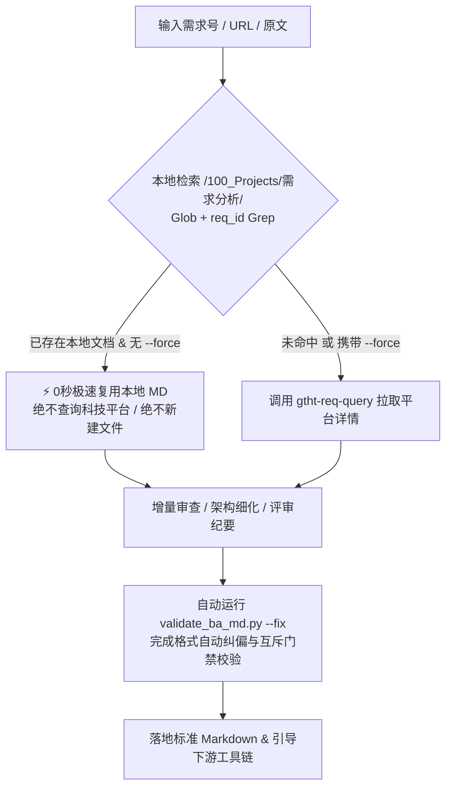
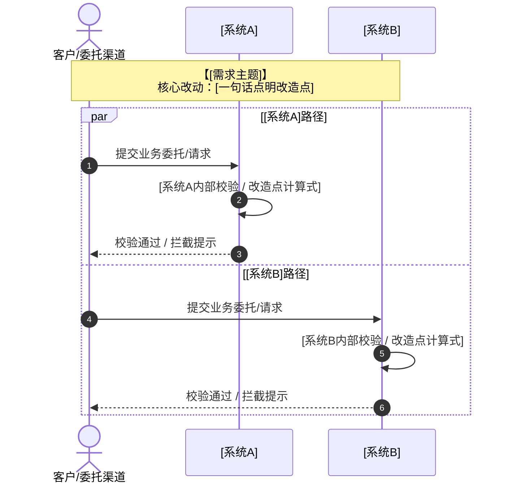
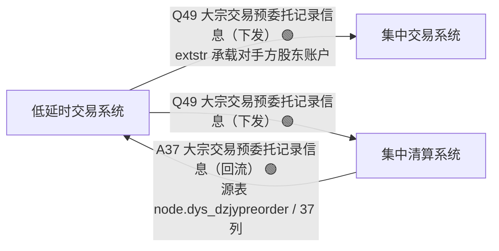

# BA-to-Dev: 业务需求转研发文档工作流

> **角色**：资深券商 IT 业务需求分析师 (BA)  
> **目标**：消除歧义、细化边界、提炼规则，产出可直接指导研发与测试的结构化 Markdown 规格说明书。

---

## ⚡ 极速工作流 (Zero-Latency Workflow)



1. **Step 1：本地优先检索（Local-First Scan，三级并行）**
   - 优先检索 `/Volumes/Macintosh HD_Data/obsidian/100_Projects/需求分析/`；
   - **⚡ L1+L2+L3 三级并行（2026-11-10 优化）**：三级检索**同时发起**，合并去重取命中文件（无需串行等待 L1→L2→L3 级联）：
     - **L1 文件名 Glob**：`rg --files | grep -i "R26xxxxxxx"` 或 `find ... -name "*R26xxxxxxx*"`；
     - **L2 Front Matter Grep**：`rg "^req_id: R26xxxxxxx" "/Volumes/Macintosh HD_Data/obsidian/100_Projects/需求分析/"`；
     - **L3 全文内容兜底**：`rg -l "R26xxxxxxx" "/Volumes/Macintosh HD_Data/obsidian/100_Projects/需求分析/"`——覆盖**文件名不规范**（缺日期前缀/缺需求编号）或 **Front Matter 缺失 `req_id`** 的历史文件；命中后自动纠正文件名与 Front Matter（联动 Step 3 落盘时修复）；
   - **命中即 0 秒复用**：直接读取本地文档进行增量编辑，**严禁发起远程 API 查询，严禁新建文件**；仅当三级均未命中或指令包含 `--force` / `--remote` 时才拉取科技平台。
   - **⚡ 未命中/`--force` 时的 0 秒出骨架**：拉取平台详情后直接调 `extract_demand.py` 一键生成 MD 骨架（Front Matter 9 字段 + `# 标题` + 一、二章 100% 平台原文 + 属性速览附录），免手工解析 28 万字节平台 JSON：`python3 /Users/wujin/.chat/skills/ba-to-dev/scripts/extract_demand.py <需求号> --out <落盘路径>`（自动读 `.chat/tmp_<需求号>_req.json` 缓存，缓存缺失时经 kjptai MCP 直连拉取；省略 `--out` 输出 stdout 预览；骨架的 `system` 置 `[] # TODO` 待 Step 2 三域检索后补全，一/二章为平台原文可放心作为 `--force` 覆盖基准）。
   - **⚠️ `--force` / `--remote` 强制刷新的核心语义=P0（2026-10-28 R2609220085 教训）**：携带 `--force` 时，**必须用平台最新原文 100% 覆盖本地一、二章（需求背景 + 需求内容）**，而非仅做增量编辑（改 Front Matter / 删引用块）——本地既有的一、二章可能是 BA 改写过的旧版（非原文照搬），**严禁直接复用**。执行要点：① 拉取平台详情后，**逐字提取平台原文的一、二章**（去 HTML 标签、保留原文结构、含错别字原样保留）；② 与本地一、二章**逐条比对**（如 2.1~2.8 是否逐字一致）；③ **有差异即以平台原文覆盖**，删除 BA 在原文区添加的「注：原文…错别字」注释（错别字说明移入第四章审计）；④ 再更新 Front Matter / 技术实现 / 审计 / 评审纪要。教训：R2609220085 本地 2.5 被 BA 改写为「批量修改审批通过后下一交易日同步」，而平台原文为「参数中心每日将参数同步至各个交易系统及集中清算系统」，--force 未覆盖导致需求内容与平台不一致。
2. **Step 2：架构细化与三域知识检索（按需，首查命中率优先）**
   - **⚡ 分层并行执行协议（2026-11-12 定稿，最大并发优化）**：三域检索按「业务规则抢先半步 + 代码居中 + 数据库压轴」分层并行：
     - **先发（第 0~1 层，零依赖）**：需求原文解析 + 本地三级检索先行；随后 openviking 多近义词并行 find + CBM 多系统多符号并行 search_graph（jzjy/dys/jzqs/grc/cszx 各系统独立查询全部并行）+ 接口查询 + 需求依赖反查 `demand_dep_find.py` 同时发枪；
     - **回灌校准（第 1.5 层）**：openviking `find`（秒回粗筛）冒头即**回灌校准 CBM 检索词**（业务语义→换英文符号再查），提升代码域首查命中率；
     - **依赖感知（第 2~3 层）**：openviking read（依赖 find 定位） + 数据库交叉验证 `dbq`（**依赖 CBM 定位表名，db 压轴，须有表名才查库**） + 源码 grep 兜底（CBM 0 命中后先回灌 openviking 业务词再 fallback）；
   - **🎯 影响范围核验（第 3.5 层，P0#25，2026-11-13 新增，补「改这点影响谁」）**：第三章溯源定位到核心改造函数后，对每涉及系统的核心函数各跑一次 CBM `trace_path` 爆炸半径扫描（`--direction inbound` 优先看入口调用面，必要时补 `outbound` 数据流出口，`--risk-labels` 看风险分级，depth ≤3，见 [`references/graph_lookup.md`](file:///Users/wujin/.chat/skills/ba-to-dev/references/graph_lookup.md)「trace_path 爆炸半径/影响范围扫描」）→ 结论写入第四章审计「影响范围分析」专项；熔断 1~2 次/改造点，失败不阻塞落盘（标注待复核）。
     - **省时效果**：第 1 层三域同时跑，总耗时 ≈ max(openviking, CBM) 而非 sum(openviking + CBM)；多系统 CBM 并行后 3 系统串行 30-120s×3 → 并行 ≈ 单系统耗时 30-120s。详见文末「🚀 分层并行执行协议」。
   - **① openviking 业务规则/需求知识检索（三域之首）**：撰写第三章技术实现与评审纪要前，**先**到 openviking 开放知识库检索**交易所业务规则原文、既有需求/方案、业务用例**，校准业务口径与边界，**杜绝凭空推断交易所规则/业务语义**（详见 [`references/openviking_lookup.md`](file:///Users/wujin/.chat/skills/ba-to-dev/references/openviking_lookup.md)）：`openviking_mcp.py find "<业务概念>"` 语义粗筛 → 定位交易所资源 → 限定目录 `glob`/`read` 读规则/用例正文；**交易所规则首检索「行业测试大模型语料库」**（深交所/上交所/北交所/深港通/沪港通/股转），**既有需求/方案检索 `requirement.zip` 与「科技平台需求知识」**；命中规则直接引用原文编号（如《深圳证券交易所融资融券交易实施细则》第X条），检索失败/命中噪声按熔断标注「(具体规则口径以业务确认为准)」，**不阻塞落盘**（与 P0 第 16/18 条联动）；
     - **🎯 多近义词并行 find（2026-11-09 新增，首查命中率 +50%）**：单一业务概念 `find` 受语义偏向影响（如「担保品返还」偏向「机构」高频近义词），**改为 2-3 个近义词并行 find**，合并 Top15 结果去重后定位最高相关度文档；近义词选取规则=**同义词**（返还/退还/划转）+ **上位词**（担保品/担保物）+ **业务动作变体**（转出/返还/退还）；示例：`find "担保品返还"` + `find "担保品划转"` + `find "担保物转出"` 三路并行；详见 [`references/openviking_lookup.md`](file:///Users/wujin/.chat/skills/ba-to-dev/references/openviking_lookup.md) §7「业务域近义词速查表」。
   - **② 代码知识图谱逆向**：接入代码知识图谱的系统（`jzjy`/`dys`/`jzqs`/`grc`/`cszx`）可定向逆向真实源文件（详见 [`references/graph_lookup.md`](file:///Users/wujin/.chat/skills/ba-to-dev/references/graph_lookup.md)）；
     - **🎯 首查代码符号（2026-11-09 新增，首查命中率 +60%）**：CBM `search_graph` 用**业务中文词检索 0 命中是常态**（FTS 仅索引符号四列 name/qualified_name/label/file_path），**首查优先用代码符号**（英文函数名/类名/文件名）而非业务中文：根据需求业务域查 [`references/graph_lookup.md`](file:///Users/wujin/.chat/skills/ba-to-dev/references/graph_lookup.md) §8「业务概念→代码符号预映射字典」，用映射的代码符号直接 `search_graph --query <英文符号>`；映射表未收录时才降级为业务中文 + fallback 链（§7 兜底复核链）；**多关键词并行**：同一批独立的 `search_graph` 调用并行发起（如 `CROrderGuaranty` + `CreditGetStockDbzc` + `perCROrderGuaranty` 同时查），禁止串行等待。
   - **③ 数据库交叉验证**：代码图谱定位到**表名/字段/参数编码/存储过程**后，须对**同一系统数据库**（调用「数据库查询」SKILL /db-schema-query，命令 `dbq <profile>`，系统图谱↔系统库一一对应）做交叉验证（详见 [`references/db_lookup.md`](file:///Users/wujin/.chat/skills/ba-to-dev/references/db_lookup.md)）：表结构、参数当前值、字典中文名、影响范围；
   - **需求原文（第二章）或评审纪要明确出现接口号（数字功能号如 `7300780`）或文件编号（字母编号如 `T13`/`A51`/`L28`）时，必须调用 `接口查询` SKILL 核对接口入参/出参**：执行 `/Users/wujin/.chat/skills/接口查询/scripts/interface_query.py <接口号> [文件编号]`（本地毫秒级命中 3257 接口/82421 字段；本地未命中退出码 10 时追加 `--source auto` 升级服务治理平台）。核对**方向（调用方→提供方）、所属系统、入参/出参字段明细**，确认需求描述的接口字段真实存在、语义匹配改造点，核对结论写入第三章「接口核对与字段映射」小节，并反哺评审纪要【接口交互】项；**同一批核对结论须按 P0#26 在三（二）输出「接口/文件数据流图」**（编号/方向/字段承载/实证状态直接取本次核对结果，不二次臆造）；
   - **图谱检索 0 命中 ≠ 无图谱（P0，防误标）**：CBM BM25 符号检索只索引代码符号（name/qualified_name/label/file_path），**业务中文词、纯数字功能号 0 命中是常态**，严禁据此标注「本地无图谱，待开发确认」；必须走完兜底链（CBM 换词重试 → sqlite 直连 `file_path LIKE` → 接口查询 L1.5 功能号注册表反查 → 定向 grep 源码），仅 [`references/graph_lookup.md`](file:///Users/wujin/.chat/skills/ba-to-dev/references/graph_lookup.md) 第 1 节标注「⚪ 暂无图谱」的系统（`djgl`/`ssjs`/`jzyy`）才允许省略溯源；
   - **快速路由（L1 级 / 无图谱系统）**：轻量需求或无图谱系统（`djgl`/`ssjs`/`jzyy`，见 graph_lookup.md 第 1 节「⚪ 暂无图谱」）**直接跳过图谱检索与数据库验证**，技术实现小节整体省略（（三）代码溯源、（四）伪代码整节省略）——R2610270069 顶点两融柜台 99_10 节点下线实证：厂商系统无图谱 + 纯配置式改造，三域检索收敛为「openviking 业务规则 + 需求原文驱动」即可快速落盘；改造范围仍须按 P0 第 17 条与评审纪要交叉核对，接口/文件号仍按 P0 第 9 条核对，涉及厂商/他组系统（顶点厂家、账户中心、集中营运）的改造描述按 P0 第 19 条排查核对并标注责任方。
   - **溯源收敛门禁（P0，与 Step 3 联动）**：溯源目标是**定位核心改造点**而非穷尽所有相关代码。定位到目标表/字段/功能号/函数名即完成本步，**立即转入 Step 3 落盘**；严禁在溯源阶段反复深挖同一业务（如约定购回撤单反复 funcid 查询 + 多次 grep + 多次读源码），导致轮次耗尽仍不产出 md。
3. **Step 3：规范落盘与脚本硬门禁**
   - **落盘兜底红线（P0，防「只溯源不产出」）**：**无论溯源/图谱/接口核对进行到哪一步，最终必须产出落盘的 md 文件**。溯源只是手段而非目的，严禁因「溯源未完成/信息待确认」而放弃落盘或无限停留在 Step 2。定位到**核心改造点（表名/字段/功能号/函数名）**即视为溯源充分，立即进入本步落盘；仍未定位的细节统一以「(具体实现以研发设计为准)」标注，不得阻塞产出。
   - **🖐️ 三域落盘前打勾检查（P0 门禁，2026-11-12 新增，防「业务规则域被无声跳过」）**：落盘撰写第三章技术与评审纪要**前**，必须逐域核对并留痕——三域各自「已检索出证据」或「显式跳过（在文档标注理由）」两选一，**未标注跳过=默认已检索，禁止三域任一域静默略过**：
     ```text
     □ ① openviking 业务规则域：已检索出证据（引用规则编号/文档来源） ／  显式跳过（理由：无任何业务规则语义）
     □ ② 代码域 CBM/grep：已定位改造点（文件+函数+行号/功能号） ／  显式跳过（仅 djgl/ssjs/jzyy 无图谱系统）
     □ ③ 数据库域 dbq：已交叉验证表结构/字段/参数 ／  显式跳过（理由：无表结构/字段/参数变化）
     ```
     打勾结果对应写入文档：已检索证据→按章反哺；显式跳过→在对应章节或第五章备注「该域因 [理由] 作选择性跳过」。代码域定位到改造点≠三域完成，仍需跑完①③的打勾（详见「分层并行执行协议」的依赖顺序与显式跳过标准）。
   - **溯源熔断边界（P0）**：同一改造点溯源**至多 2~3 轮工具调用**（接口查询 L1.5 → 图谱检索 → 定向 grep 源码），命中即止；未命中立即在文档标注「图谱检索未定位到精确代码」+ 已试检索词，**禁止无限 grep/反复读取源码**。R2609210085 教训：在约定购回/股票质押撤单上反复深挖（多次 funcid 查询、多次 grep、多次读源码），消耗大量轮次却始终未落盘——溯源该收敛时必须收敛。
   - 生成/更新文档后，**必须自动执行脚本门禁与格式修复**：
     ```bash
     python3 /Users/wujin/.chat/skills/ba-to-dev/scripts/validate_ba_md.py <落盘文件路径> --fix
     ```
4. **Step 4：下游工具链闭环联动**
   - 自动引导或按指令执行后续：`/gtht-accept-review`（完成评审）、`/gtht-story-split`（拆分Story）、`/gtht-ndw-fill`（价值量登记）、`/adjust-plandate`（修改排期）、`/gtht-tag-edit`（标签同步）、`/md-to-sheet`（上云）。

---

## 💡 核心质量防线 (P0 必须严格遵守)

> ⚠️ **共性基线（2026-11-13 新增）**：本技能与 `biz-logic-query` 共用的**权威源注册表、证据可信度三态、交互澄清协议、订阅矩阵库、接口/文件数据流图口径**统一维护在 `~/.workbuddy/skills/_shared/SHARED.md`（见文末「🔗 共性规范基线」，已内嵌全文）。**优化任一技能时若触及共性项，必须先改 SHARED.md → `sync_shared.py apply` → `sync_shared.py check`，校验未通过不得收尾**；本技能 P0#9 / P0#22 / P0#26 是 BA 侧执行落点，与共性基线口径冲突时以基线为准并同步修正。

> [!IMPORTANT]
> 1. **绝对忠于事实**：严禁凭空捏造英文表名/字段名；未提供具体表名时统一使用中文业务概念名称（如 `集中清算融券权益变动流水表`），并注明 `(具体表名以研发设计为准)`。
> 2. **需求原文字字照搬**：一、二章节必须 **100% 原样照搬用户输入原文**（物理隔离备查）；彻底过滤平台系统模板占位符（如 `【填写需求背景:...】`），无内容写 `无`；BA 初评注记不得污染原文，统一写入评审纪要。
> 3. **系统名称规范全称（P0，防多域陷阱）**：系统名称**必须匹配权威系统清单第一列中文全称**，清单位于 `/Volumes/Macintosh HD_Data/WorkBuddy/需求分析/rules-raw/system_list.csv`（UTF-8 编码，`validate_ba_md.py` 的 R7 门禁会自动比对）。**必须实际读取该 CSV 核对，严禁凭记忆写系统名**。⚠️**多域陷阱**：同一系统在清单有多个括号细分域，如「低延时交易系统」含 `(虚拟)/(两融创新域)/(大集中-信创域)/(期权域)/(收益互换域)/(创新域)` 等 7 域，且另有独立系统「低延时全局风控系统」「华锐ATP两融交易系统」。**域归属严禁凭业务场景臆断**：括号细分域与业务场景并无推理规则（如"两融柜台"未必是"两融创新域"）。**⚠️关键规则（2026-11-12 修订，域归属后移）**：**BA 生成的 md 文档正文/评审纪要一律写统称「低延时交易系统」**（不带括号域），凡清单含域变体的系统（低延时交易系统等）在 BA 阶段不区分具体域；**实际域归属在拆 Story 阶段（`gtht-story-split`）由用户/BA 确认并承接**。因此：① md 正文与评审纪要写统称，「低延时交易系统」是合法写法（R7 已对清单含域变体的统称豁免）；② Front Matter `story` 字段可带域（如 `lowLatencyDomain: 低延时交易系统(大集中-信创域)`），用于拆 Story 时对标；③ 严禁在 md 正文凭空写死某个括号域（域未确认时写死即臆断），也严禁自行添加清单外缩写/注记。**实测教训（R2609160118，2026-11-12 修订）**：此前按强调"必须精确带域"把正文全篇写为「低延时交易系统(大集中-信创域)」，用户明确 BA 文档先不区分域、拆 Story 时再区分——故 md 正文改回统称，仅故事拆解侧带域。**（历史）** R2608110032 两融负债减免曾误判「两融创新域」被纠正为「大集中-信创域」，但此为拆 Story 域归属决策，不影响 md 正文统称写法。
> 4. **评审纪要 9 项铁律**：
>    - **业务维度表达（P0 核心）**：评审纪要面向**开发、测试、业务三方**共同查阅，**必须全程从业务角度表述，严禁干涉开发实现逻辑**。业务语言回答"做什么/为什么"（改造目标、业务规则、边界），开发语言回答"怎么做"（数据结构、字段、流水、幂等拦截、算法实现）。因此：**评审纪要全文（9 项，含【接口交互】第 5 项【业务关注点】第 9 项）严禁出现 C++ 函数名等代码符号**——接口一律用**业务接口名 + 接口号**表述（如 `信用客户资金资产查询 121335`），严禁写 `unictrCustFundAssetQry` 这类函数名；第 3 项【各系统改造功能】、第 9 项【业务关注点】等**严禁直接暴露接口号、表名、函数名、底层数据结构/流水/幂等拦截等开发细节**（技术细节仅置于第三章）；用"资金/持仓变动记录"而非"扣减动作/流水"、用"灰度及未升级环境"而非"灰度95节点"；
>    - **多系统改造结构 100% 对称**：多系统业务逻辑相同时，各系统功能点分点**数量、顺序、粒度必须逐条对应**（严禁漏点、合并或偷懒只写「同A系统」），保证测试/开发可逐条对号入座；对称指**功能点结构对称**，不要求逐字复述；
>    - **精炼简洁、三方可读（P1 评审纪要专属）**：评审纪要面向业务/测试/开发三方，**一条功能点一句话**（动词开头、句号结尾），删除「正确/严格/全部」等冗余修饰；公共口径与公共规则**出现一次即止**——「功能同沪深」「业务口径与XX一致」等**每系统至多声明一次（置于该系统分点首行）**，分点内严禁逐条追加；长规则（如价格区间数值、算法口径）只在首个涉及系统或【业务关注点】展开一次，其余系统引用规则名称即可；评审纪要不与三章/五章重复展开数值与字段细节；
>    - **联测涉及系统绝对互斥**：第 8 项【联测涉及系统】仅填改造范围外的外围配合系统，**改造范围（第2项）内的系统严禁在此重复出现**；
>    - **首行固定格式不分状态（P0，禁止出现「经与」/带方括号等问题）**：统一为 `YYYY年MM月DD日经**受理人姓名**与**[业务部门]**[提交人]和**技术研发部**[研发人员/×××]沟通评审通过`（未评审时研发人员保留 ×××）。**「经与」后紧跟受理人真实姓名，严禁只写「经与」不带人名**；当前受理人=**吴进**（从 Front Matter `receiver` 取真实姓名，去除工号后缀，如 `吴进-125360` → 写「吴进」）。实测教训（R2611120045）：曾写成 `[2026年11月12日]经与**融资融券部**孙鹰…`，多出方括号且漏写受理人「吴进」，正确应为 `2026年11月12日经吴进与**融资融券部**孙鹰和**技术研发部**×××沟通评审通过`。
> 5. **Front Matter 产出门禁**：必须包含 9 项属性（`req_id`, `submitter`, `ndw`, `created`, `updated`, `tags`, `domain`, `system`, `status`）；多系统改造时 `ndw` 默认 **`0.5`**（单系统 `0.3`）；`tags` 结合业务领域自动推断（详见 [`references/review_minutes_guide.md`](file:///Users/wujin/.chat/skills/ba-to-dev/references/review_minutes_guide.md)）；若平台存在共同受理人必须写入 `co_receiver`。
> 6. **纯系统维度数据流转图**：Mermaid 时序图参与者必须严格以**业务系统**为颗粒度，**严禁将系统内部 DB 实体表、内存缓存单独画为外部泳道**，内部查询与校验一律在系统内部（`sys->>sys:`）体现。**简洁聚焦原则（P1）**：参与者收敛为**客户 + 各改造系统**（3~N 个），删除网关/处理器/回报结构体等实现细节泳道；`Note` 首行点明**核心改动**（如「无需判断担保品标的，统一剔除融资数量及融券买入数量」），各系统内部 `sys->>sys` 高亮**本系统的修改点**（关键计算式/口径）；**多系统平行独立改造用 `par ... and ... end` 并行块逐系统展示**（每系统 `客户->>系统X` + `系统X->>系统X` 内部改造 + `系统X-->>客户` 结果），串行接力改造保留原时序链；**⚡ 客户动作准则（P0，禁止把系统判定倒装进客户动作）**：`客户->>系统` 箭头是**客户端动作**，必须写**客户真正发起的请求原语**（如「发起委托」「发起撤单」「发起查询」），**严禁把系统侧的判定/业务结果（平仓/拦截/强制平仓/报错）倒装进客户动作**；业务场景只以括号注记出现（如 `发起委托（维保过低平仓场景）`）——同一份委托是「平仓/普通/撤单」由柜台判，客户端发起的都是「委托」，把结果写进动作即错（实测教训 R2611120045：误写「发起平仓委托」，应写「发起委托（维保过低平仓场景）」）；目标=一张图看清「改了什么、在哪个系统改、怎么改」，而非罗列全部处理细节。
> 7. **表名语义核对（P0）**：代码图谱/数据库定位到表名后，**必须核对表名前缀语义是否匹配本需求业务**（`zy`=质押、`gqjl`=约定购回、`credit`=融资融券信用），严禁仅凭表名含 `debt`/`credit`/`loan` 关键词判定为目标表——曾把股票质押 `zy_debts` 误当融资融券负债表导致改造点判断错误；多系统需求须对**每个涉及系统**的库做交叉验证（负债表+委托表关键字段），严禁只验证主系统照搬结论；溯源文件只保留直接支撑改造点的条目（详见 [`references/graph_lookup.md`](file:///Users/wujin/.chat/skills/ba-to-dev/references/graph_lookup.md) 第 6 节「溯源精准性红线」）。
> 8. **通用改造模式（跨需求可复用）**：
>    - **跨系统新增字段决策**：优先采用「现有委托补充可选字段」方案（兼容性最好、改动面最小），备选「新增独立委托/类型」方案（语义清晰但改动面更大）；
>    - **幂等防重双保险**：上游入口以「业务唯一键」拦截重复提交，下游消费侧按同一唯一键去重，保证对账无差异（典型组合：`合约发生日期 + 合约流水号 + 委托序号`）；
>    - **多套相似模块收敛统一**：同域功能多套实现并存时，优先「统一处理时序/口径」而非「重写/合并代码」（如两套直接还款模块→统一清算时序），业务边界明确，改动面小、风险低。
>    - **委托表合约编号复用 bankfrzsno**：三系统（dys/jzjy/jzqs）委托表均无独立 `contract_date`/`contract_sno` 字段，统一**复用 `bankfrzsno`(varchar32) 字段存储合约编号**（合约发生日期+合约流水号，如 20260907160000002），与评审纪要 Q23 委托下场文件一致。新增合约标识字段时优先复用 `bankfrzsno`，而非新增字段（2026-11-09 R2609160118 实测确认）。
> 9. **接口号/文件编号必核对（P0）**：需求原文（第二章）或评审纪要【接口交互】明确出现**接口号（数字功能号如 `7300780`）或文件编号（字母编号如 `T13`/`A51`/`L28`）**时，必须调用 `接口查询` SKILL 对该接口做**入参/出参核对**（命令 `/Users/wujin/.chat/skills/接口查询/scripts/interface_query.py <接口号>`，本地毫秒级命中；本地未命中退出码 10 须追加 `--source auto` 升级服务治理平台，**严禁跳过核对或直接按原文照抄接口号**）；核对结论（方向、所属系统、入参/出参字段是否真实存在且语义匹配改造点）写入技术实现「接口核对与字段映射」小节，并反哺评审纪要【接口交互】项填写的接口名/接口号/调用方向准确性；**该核对结论同时是 P0#26 接口/文件数据流图的唯一编号与方向来源**（未经核对的编号不得入图）。
> 10. **知识积累章节（P1，可选）**：分析过程中经接口核对 / 代码图谱溯源 / 数据库交叉验证 / 会议沟通确认的**高价值知识**——接口文件交互（编号、方向、字段承载）、跨系统数据链路（流向、落库位置、是否下发）、交易规则（口径、适用场景、规则来源）——须沉淀至「**五、知识积累（可选）**」章节（**紧接第四章之后**），供同类需求复用；该章节**有则记录、无则省略**，严禁输出空模板占位；**不进入评审纪要、不影响下游工具链解析**（gtht-accept-review 只读「评审纪要」标题到「相关链接」标题之间区域，第五章位于评审纪要之前故不误报、不误解析；validate_ba_md.py 校验区域亦始于「评审纪要」，零改动零误报）；示例见 R2610120043「五、知识积累（可选）」小节。
> 11. **语言精炼简洁（P1 文风）**：除一、二章节**原文照搬**外，BA 撰写的三、四、五章与评审纪要一律**精炼简洁、通俗易懂**——短句优先、删除修饰性套话与语义重复表达、避免拗口难懂；术语首次出现写全称并括注简称，后文统一用简称；同段落内不重复同一概念（如不写「防重复处理（防止重复处理/扣款）」）；评审纪要面向开发/测试/业务三方阅读，用业务大白话讲清「做什么/为什么」，技术细节仅置于第三章且同样遵循简洁原则。
> 12. **「本地无图谱」标注资格门禁（P0，防误标）**：**只有 `graph_lookup.md` 第 1 节映射表标注「⚪ 暂无图谱（跳过）」的系统（`djgl`/`ssjs`/`jzyy`）才允许在文档中写「本地无图谱，待开发确认」**；`jzjy`/`dys`/`jzqs`/`grc`/`cszx` 五系统图谱真实存在（38万/6.5万/42万/1.85万/27.6万节点），**CBM 业务词/功能号检索 0 命中一律不得判为「无图谱」**——nodes_fts 仅索引符号四列，整数常量/行注释/XML 属性/SQL 值均不建索引（数字功能号必然检索不到），必须以 **funcid_index.db（L1.5 功能号注册表）+ 源码 grep 兜底**复核是否存在该业务功能；实测教训=曾用中文词检索 jzjy 担保物转出 0 命中误标「集中交易本地无图谱」，实际集中交易有担保品返还功能（121315 `unictrCROrderGuaranty`/420415 `perCROrderGuaranty`/600212 `CreditGetStockDbzc`，详见 [`references/graph_lookup.md`](file:///Users/wujin/.chat/skills/ba-to-dev/references/graph_lookup.md) 第 7 节）；兜底复核路径：`接口查询` SKILL L1.5（`interface_query.py <功能号>` 毫秒级命中）→ grep `--include=*.cpp/*.h/*.xml/*.sql`（优先核对 KCBPSPD.xml / sysfunc_init.sql / BusTag.h 注释行）→ test -f 校验文件存在后可挂 file:// 链接。
> 13. **跨系统需求【接口交互】准确性优先（P0）**：**评审纪要【接口交互】填写以业务事实为准，准确性第一，严禁为满足格式硬套/编造**——跨系统需求**确有系统间接口/文件交互（含复用现有接口）**时必须填写交互内容：`系统A与系统B，[接口/文件中文名称] [接口号/文件编号]，[承载字段与交互内容]`（复用现有接口写明`复用`字样 + 编号 + 承载字段）；**但平行系统各自独立改造、确无系统间数据传递时（如低延时与集中交易分别在本系统内改校验公式）【接口交互】写 `无` 即可，不得强行编造接口号**；判定标准=是否真实存在跨系统数据流（委托/回报/文件/参数传递），不在于改造系统数量；凡填写接口号必须先经 `接口查询` SKILL 核对（第 9 条）。
> 14. **第四章审计只输出风险维度（P0）**：「四、需求矛盾与逻辑漏洞审计」**只关注并输出存在风险的维度**——凡评估结果为「无 / 不涉及 / 无需 / 无风险 / 未发现」的维度一律不输出（含逻辑硬冲突为「无」、业务软缺失无风险、10 维扫描中无风险的维度），**严禁为凑齐模板输出「✅ 无」「⚠️ 关注」占位行**；逻辑硬冲突未发现时「1. 逻辑硬冲突」小节整节省略；仅保留确有风险或有待澄清的维度（S1 高风险 / S2 建议优化），详见第四章模板「审计聚焦原则」。
> 15. **需求依赖发现（P1，防依赖漏判）**：分析完成后，对需求**标题 + 原始需求正文（一、需求背景 / 二、需求内容）**中出现的**核心业务概念**做本地全库反查，列出所有提及同一业务概念的需求，标注「口径定义方/修改方、上下游关系」，供 BA 人工确认依赖并写入「相关链接」。**核心业务概念 = 业务对象 / 业务行为 / 场景词**（如「指定合约还款」「担保品返还」「融资偿还」「中签可用资金」等），**严禁用特化字段名（`ipoavl`/`day_total_repay_amt`/表名字段）作反查词**——实测教训：R2609160118（指定合约直接还款）与 R2607240079（IPO缴款金额提示）共享「指定合约还款」业务概念，但 R2609160118 原始正文不含 `ipoavl`/`day_total_repay_amt` 等特化字段，若只反查特化字段则**发现不了关联**；反查业务概念则自动命中（R2609160118 原文「指定合约直接还款」↔ R2607240079「指定合约还款金额」）；反查方式=`极速雷达` / `search_relative` 全库检索 `/需求分析` 目录；命中多个需求时重点甄别「口径定义方 vs 口径修改方 / 上下游数据依赖」类关系，避免漏判。**脚本辅助（v2）**：`python3 /Users/wujin/.chat/skills/ba-to-dev/scripts/demand_dep_find.py <需求号> [更通用业务概念...]`（自动从标题提取业务概念反查——标题三级回退：Front Matter `title:` → 首个 `# ` H1（剥离 `YYYYMMDD-R26xxxxxxx-` 前缀）→ 文件名，修掉 v1 把整个文件名当标题的缺陷；剥离「直接/普通/批量」等修饰词生成通用子概念；`rg -F -l` 秒级定位命中文件再逐行取行号）。本地无 MD 时：`--summary "平台标题"` 自动提取概念反查，或 `--concept 概念1 概念2` 纯概念模式，`--req-dir <目录>` 指定扫描目录（默认 `/100_Projects/需求分析`）。
> 16. **落盘兜底与溯源熔断（P0，防「只溯源不产出」）**：**无论溯源/图谱/接口核对进行到哪一步，最终必须产出落盘的 md 文件**；溯源只是手段而非目的，严禁因「溯源未完成/信息待确认」放弃落盘或无限停留在溯源阶段。同一改造点溯源**至多 2~3 轮工具调用**（接口查询 L1.5 → 图谱检索 → 定向 grep 源码），**定位到核心改造点（表名/字段/功能号/函数名）即视为溯源充分，立即转入 Step 3 落盘**；仍未定位的细节统一以「(具体实现以研发设计为准)」标注，不得阻塞产出。**实测教训（R2609210085）**：在约定购回/股票质押撤单上反复深挖（多次 funcid 查询 + 多次 grep + 多次读源码），溯源轮次耗尽仍未落盘，最终未产出 md——溯源该收敛时必须收敛，落盘是唯一硬产出。
> 17. **改造范围系统交叉核对（P0，防漏系统）**：改造范围判定**必须将需求原文（一、需求背景 / 二、需求内容）中出现的所有系统与评审纪要改造范围交叉核对**，严禁只沿用评审纪要。**凡需求原文明确为「同步/下发至X系统」「实时更新至X系统」「与X系统交互」的目标系统，且需适配新参数/新字段结构的，均应纳入改造范围**（或至少列为接收方），不得因评审纪要未列而漏掉。实测教训（R2609220085）：需求原文 2.5「参数中心每日将参数同步至各个交易系统**及集中清算系统**」，集中清算系统是同步目标且需适配新增「导入批次」字段（真实改造点），但本地 2.5 被 BA 改写为「同步至各个交易系统」（丢失「及集中清算系统」），改造范围又直接沿用评审纪要（仅列交易参数管理后台/前台/集中交易 3 系统），导致集中清算系统漏识别——评审时补充为 4 系统。
> 18. **三域知识检索门禁（P0，openviking/知识图谱/数据库）**：撰写**第三章技术实现**与**评审纪要**前，**必须先完成三域知识检索、让检索结论带证据进入分析上下文**（详见 [`references/openviking_lookup.md`](file:///Users/wujin/.chat/skills/ba-to-dev/references/openviking_lookup.md) / [`graph_lookup.md`](file:///Users/wujin/.chat/skills/ba-to-dev/references/graph_lookup.md) / [`db_lookup.md`](file:///Users/wujin/.chat/skills/ba-to-dev/references/db_lookup.md)）：**① openviking 业务规则域**——检索交易所业务私域规则/既有需求/方案/用例（`openviking_mcp.py find` 语义粗筛 + 限定资源 `glob`/`read`，交易所规则首检索「行业测试大模型语料库」，既有需求检索 `requirement.zip`），**校准业务口径与边界，严禁凭空推断交易所规则**；**② 知识图谱代码域**——CBM 定位真实函数/模块/表名（`jzjy`/`dys`/`jzqs`/`grc`/`cszx`）；**③ 数据库数据域**——调用「数据库查询」SKILL（/db-schema-query，`dbq <profile>`，profile 取值 jzjy_sit/dys95/jzqs_sit/cszx_sit）交叉验证表结构/参数当前值/字典中文名。三域结论反哺：核心业务逻辑（规则口径/边界/触发条件）、改造点定位（表名/字段/函数）、评审纪要 9 项业务化表述（【业务参数】/【业务关注点】/【接口交互】）。**熔断红线（与第 16 条同源）**：任一域检索失败（openviking 超时/NO_PROXY 遗漏/网络异常）或命中噪声**不得阻塞落盘**——同改造点三域合计至多 2~3 轮检索，命中即止；openviking 命中规则引用原文编号，检索不到归一化写「(具体规则口径以业务确认为准)」；**严禁凭记忆编造规则条文与表名**（第 1 条绝对忠于事实同样适用）。**检索顺序（2026-11-12 分层并行定稿）**：① openviking 抢先半步发枪（秒回粗筛及时回灌校准 CBM 检索词）→ ② CBM 居中（定位表名后触发 dbq）→ ③ dbq 压轴（**唯一硬顺序 code→db**，须有表名才查库，严禁 blind 查库）。**显式跳过标准（三域任一跳过必须留痕，禁止静默略过；未标注跳过=默认已检索）**：① openviking 仅当需求纯 UI/纯技术重构、无任何业务规则语义时方可跳（凡涉维保/强平/担保/权限/还款/质押/回购等业务词必须检索）；② dbq 仅当无新增/修改表结构/字段/参数时方可跳（跳时文档写明「该域因无表结构变化作选择性跳过」）；③ CBM 仅 djgl/ssjs/jzyy 无图谱系统可跳（P0 #12）。实测教训（R2611120045）：因 CBM 定位功能号即"溯源收敛"落盘、无声跳 openviking，而"维保过低触发平仓"正是需业务规则印证的——补查 openviking 命中 130%/110% 强平规则；代码域收敛≠三域完成，落盘前须走三域打勾（见 Step 3）。
> 19. **非本组负责系统改造描述处理（P0，防越界细化/防不准确）**：**识别非本组负责系统**——①厂商系统：如**顶点两融交易系统**（2019 年引入的厂商「顶点」系统，不在 `system_list.csv` 且无本地图谱，改造由厂商发包执行）；②他组负责系统：如**账户中心**、**集中营运系统**（`jzyy`，前端/接口分别由对应研发组与营运管理部负责）。**评审纪要第 3 项【各系统改造功能】只列本组负责系统的改造功能点；非本组负责系统（厂商/他组）的改造描述不在此展开**（2026-11-01 用户要求：非本组系统不是本组负责系统，第 3 项直接不体现）；第 2 项【改造范围】仍照列评审确认的完整范围（含非本组系统，是评审边界）；非本组系统的改造事项如需提及，以**责任方标注**形式置于第 4 项【前端界面】/第 6 项【业务参数】/第 9 项【业务关注点】或「评审决策日志」待确认事项（如「前端需修改配置，具体待营运管理部提供需求后评估」）；**只写业务目标「做什么」，严禁替厂商/他组细化「怎么做」的实现细节（不编造接口号、字段、配置项名、前端菜单路径），严禁照抄需求原文模糊表述或替其他组补全**；三域检索门禁（第 18 条）对这些系统可跳过代码图谱/数据库域（无图谱，见第 12 条），但**「系统归属与责任部门」必须在落盘前核实清楚**。实测范例（R2610270069 顶点两融柜台 99_10 节点下线）：第 3 项仅列集中交易、集中清算（本组系统）功能点，顶点两融/账户中心/集中营运改造描述不在第 3 项展开，其改造事项在第 4 项前端界面、第 5 项接口交互、第 6 项业务参数及评审决策日志中以「待营运管理部/账户中心对应研发/厂商发包清单确认」标注。
> 20. **伪代码-溯源一一对应门禁（P1，防伪代码凭空编造）**：**(四)核心伪代码中出现的每个函数名/变量名/常量，必须能回溯到 (三)代码溯源与改造点定位表，一一对应**——伪代码是对溯源出的真实函数/字段的提炼，非另行创作的示意。写伪代码时逐一核对：伪代码里每个标识符，在（三）溯源表/数据字典里都有出处（函数签名、源文件+行号、功能号、字段名）；**凡溯源表中不存在的标识符，禁止写进伪代码**（要么补充溯源使对应，要么从伪代码删去）。准则：`变量 = 待改字段名（溯源表列名）`、`函数 = 已定位权限/主参数入口（源文件:行号）`、`报错码/常量 = 数据字典已登记值`。落盘后以 `grep`/`test -f` 复核伪代码引用的源文件+行号是否存在（与 validate R8 联动）。
> 21. **「无」判定留痕规范（P1，防漏判/防未核实的「无」）**：评审纪要第 1/4/5/6/8 项写「无」时，**必须既有判定依据且可自证，禁止凭感觉写「无」**——每个「无」须在记忆中过一遍对应域证据：①需求补充说明「无」（前端/集中运营无交互依赖）、②前端界面「无」、③接口交互「无」（无跨系统数据传递，依据三域检索无调用链）、④业务参数「无」（数据库域无新增参数，已查表）、⑤联测涉及系统「无」（改造范围单一系统无外围配合）。**凡涉及预设必有项（如纯报错提示类需求的接口交互、单系统改造的联测项），「无」的判定必须在文档留一句依据**（置于对应项 `无` 后以 `；依据：...` 或评审决策日志说明），**未检索未核实不得写「无」，严禁用「无」掩盖未做的三域检索**（与三域打勾门禁联动）。
> 22. **DB-First 权威源优先铁律（P0，2026-11-12 新增，防"望文生义"）**：凡**客观事实**——表名、字段名、字段类型/含义、参数编码/默认值、系统中文全称、接口号/功能号、规则条文编号、证券主参数表等——**必须以权威源实证后方可落盘，严禁凭"名字像/关键词像/函数名像"推断其语义与归属**。权威源优先级：数据库直查（`dbq`，`information_schema`）> 权威清单（`system_list.csv`/接口知识库）> 代码图谱符号级溯源（CBM/源码文件+行号）> 需求原文。**可被权威源证实或证伪/证伪的结论，一律先查询权威源再写**。**典型陷阱（名不副实）**：`comm_secuid_total` 表名带 "secuid" 实为**计数表**（仅 partid/nodeid/market/secuid/htcnt/gjcnt 等，无证券名称字段），而真正的标准名称源是 `comm_stock.stkname`；`zy_debts` 曾因含 "debt" 被误判为融资融券负债表（实为股票质押）。**写表名/字段前先问一句「有 dbq/清单实证吗」，拿不出就在标记存疑并实际操作 dbq 实证**。`validate_ba_md.py` 的 R8 会校验 file:// 链接存在性，R7 校验系统名；表名语义核对该类"名不副实"由本条 P0 门禁约束（数据库域打勾门禁要求 dbq 已实证）。**实测教训（R2611110028，2026-11-12）**：文档曾把 `comm_secuid_total` 当证券主参数表（因表名+同名函数 `SelectPtrByindex_market_secuid` 像），标准名称写错来源；dbq 直查 `jzqs_comm_sit` 证实其为计数表，正确主参数表为 `comm_stock`（含 `stkname`），已修正。
> 23. **「三、技术实现」章节顺序固定（P0，2026-11-12 新增，防章节错序）**：「三、技术实现」**子章节必须严格按模板固定顺序输出**，逻辑递进为「先讲业务怎么做 → 再讲系统间如何协作 → 再讲代码在哪改 → 最后讲怎么实现验证」：
>    ```text
>    （一）核心业务逻辑            → 业务主线 / 场景矩阵（做什么/为什么）
>    （二）系统间协作与防重复机制   → 处理时序 + 防重复提交 + 数据流转图 Mermaid
>    （三）代码溯源与改造点定位     → 溯源总览 / 各系统小节 / 数据库交叉验证 / 接口核对（编号 1→2→3→4 递增）
>    （四）核心伪代码与测试验收     → 伪代码 + Given/When/Then（必须在（三）溯源之后）
>    ```
>    铁律要点：①**伪代码必须置于（四）溯源之后**（先溯源定位真实函数/表结构，伪代码才能贴近真实实现，严禁在溯源前凭空臆造）；②**两类数据流转图（P0#6 业务时序图 + P0#26 接口/文件数据流图）均归属（二）系统间协作段**，严禁塞进（三）溯源段或评审纪要；③**（三）溯源段内部编号必须 1→2→3→4 递增**（溯源总览→各系统小节→数据库交叉验证→接口核对），严禁出现重复编号（如两个「**3.**」）；④**（四）审计章节**按 P0#14 只输出有风险维度，逻辑硬冲突未发现时「1. 逻辑硬冲突」小节**整节省略**，严禁输出「经审计未发现」占位行。**实测教训（R2608110032，2026-11-12）**：曾按「（二）伪代码→（三）流水防重→（四）代码溯源」错序输出，且溯源段出现两个「**3.**」（数据流转图+接口核对）编号重复、数据流转图误放入溯源段（实际应在协作段）、四章含「逻辑硬冲突未发现」占位——已按上述顺序调整并 validate --fix 全绿。
> 24. **文档去冗余精简准则（P0，2026-11-12 新增，防重复/占位/低价值堆砌）**：BA 文档**默认精炼，主动剔除重复信息、占位性内容与低价值推断**，不留纯为凑模板的内容（语言精炼见 P1 第 11 条，本章专门针对「结构性冗余」）。**删减判据（命中任一即可删/简）**：
>    ```text
>    ① 跨章节信息重复：同一事实（接口表/接口号/溯源结论）在多个章节出现 → 仅保留一次，其余删（如「五、知识积累」的接口表若与「三（三）接口核对」完全重复则整节删除；N 重冗余只留核心位置一处）
>    ② 撰写过程性说明/元注释：给写作者看的「此节为何在此/溯源方式说明」等模板注释 → 直接删除（如 `> 🔑 位置说明（P0）：本小节置于...`）
>    ③ 占位行/无风险行：按 P0#14 的「无/未发现/不涉及」占位 → 整节省略，严禁输出「经审计未发现」「无需」等充数行
>    ④ 低价值推断：需求原文未提、无法实证的主观推测/量级假设（如「日均N笔无高并发」「预计影响量级小」）→ 删除（DB-First P0#22 同理，未实证不落盘）
>    ⑤ 冗余文字表达：同一流转/时序被文字+图重复描述 → 保留更直观者（多为图），文字压缩为一句总起；多段可并为一段
>    ```
>    修剪原则：**一、二章平台原文**与**评审纪要 9 项**（业务交付核心）**绝不删**；删减以「信息零损失」为前提——重复/占位/元注释删掉不丢任何业务事实，低价值推断删掉反而更严谨。落盘后用 `validate_ba_md.py --fix` 复核（R1-R9 不受删减影响）。**实测教训（R2608110032，2026-11-12）**：文档存在①五章接口表与三章接口核对完全重复（整节删除）、②（四）伪代码位置说明元注释、③四章逻辑硬冲突「经审计未发现」占位、④（一）非功能性约束「日均50笔内无高并发」低价值推测、⑤（二）处理时序文字与 Mermaid 图重复——均按以上判据集约化处理，validate --fix 全绿（244 行 → ~230 行）。
> 25. **爆炸半径/影响范围分析门禁（P1，2026-11-13 新增，补「改这点影响谁」缺口）**：第三章溯源**定位到核心改造点（函数/模块/入口）后**，须对定位到的**关键函数**做一次 CBM `trace_path` 调用链爆炸半径扫描，评估「改动该点会波及哪些上下游模块/系统」，结论反哺第四章审计以支撑开发者/测试评估改动影响范围。**先定位、后扫描**——先经 (三)溯源定位核心改造函数，再以该函数为起点跑 `trace_path`，严禁无起点全边扫描。
>    ```bash
>    # 命令形态（--help 已核实的真实参数）
>    # direction: inbound=向上游「谁调用我」(改动的入口影响面) / outbound=向下游「我调用谁」(改动的数据流出面)；depth 扫描深度；--risk-labels 加跳数风险分级
>    ~/.local/bin/codebase-memory-mcp cli trace_path --project <CBM项目名> \
>      --function-name <核心函数> --direction inbound --depth 3 --risk-labels --limit 20 --format tree
>    ~/.local/bin/codebase-memory-mcp cli trace_path --project <CBM项目名> \
>      --function-name <核心函数> --direction outbound --depth 2 --limit 20 --format tree
>    ```
>    **执行要点**：① 对**每个涉及系统的核心改造函数**各扫一次（达标 map：核心函数 1 个 ↔ 扫描 1 次，禁止反复深扫）；② 优先 `--direction inbound` 看改动入口的调用方数量与层数（调用方越多=影响面越广），必要时补 `outbound` 看数据流出口；③ `--risk-labels` 启用后可引用跳数风险分级（CRITICAL/HIGH/MEDIUM/LOW）评估波及程度；④ **扫描结论写入第四章审计「影响范围分析」专项**（新增小节），用业务+开发两维语言描述「改动点 → 波及的上游/下游模块 → 风险等级 → 需重点回归验证的范围」；⑤ **熔断**：同改造点至多 scan 1~2 次（每次单 direction 一层），命中上下游模块即止，不穷尽；扫描失败/超时不阻塞落盘，未扫到则第四章该项以「(影响范围待实现阶段结合调用链复核)」标注。**与第 16 条区别**：第 16 条「溯源熔断」管"往上找改造点"；本条管"找到改造点后往下/往上评估影响面"，是落盘前新增的一步影响面核验，非重复溯源。

> 26. **接口/文件数据流图（P0，2026-11-13 新增；与 P0#6 业务时序图互补）**：需求原文（第二章）或评审纪要【接口交互】出现**接口号（数字功能号）或文件编号（字母编号）**时，须在**三（二）系统间协作段**、紧随业务时序图之后输出一张 `flowchart LR` **接口/文件数据流图**；**无编号交互时整节省略**（P0#24，严禁空图占位）。两图分工：**业务时序图**（`sequenceDiagram`）= 客户视角、纯系统维度，讲「谁先谁后、各系统改了什么」；**接口/文件数据流图**（`flowchart LR`）= 系统↔系统通道视角，讲「走哪条接口/文件通道、承载什么字段、落在哪张表」。
>    **绘制铁律**：① 节点**只画业务系统**（写 `system_list.csv` 中文全称，P0#3），**严禁把 DB 表/内存表/缓存画成外部节点**——落库表写成节点内括号注记或箭头标签；② 每条箭头带 **编号 + 中文接口/文件名 + 方向（下发/回流/调用）**，**编号必须已按 P0#9 核对**；查无实据或未核对的标 🔴 并写入第四章待确认，**严禁编造编号与方向**；③ 箭头标签补 **字段承载**（如 `extstr 承载对手方股东账户`）与 **是否下发/不下场**等关键口径；「不下场」等非数据流口径用图下文字注记，**不画成箭头**；④ 实证状态三态标注 🟢已实证 / 🟡可追溯 / 🔴待确认，图下附一行「证据出处」（接口库 / 源码文件:行号 / dbq 库表 / 需求号）；⑤ **只置于第三章（二）**，严禁进入评审纪要（P0#4 评审纪要全文禁接口号/表名/函数名），严禁与「五、知识积累」跨系统数据链路表重复展开（P0#24）；⑥ 编号、方向、字段三者以 **P0#9 接口核对 + P0#22 DB-First 权威源 + 订阅矩阵库 `.subscription_matrix.db`**（文件编号 → 输出系统/消费者方向，见 `biz-logic-query` 技能「🗂️ 订阅矩阵库」章节）实证为准，不照抄需求原文；
>    **落盘**：模板与 A37/Q49 实证范例见下方「📐 研发 Markdown 标准输出模板」三（二）段；`validate_ba_md.py` 的 R1–R9 均不校验 Mermaid 代码块，新增图不改变门禁结果、无需改脚本；图中若挂 `file://` 链接仍受 R8 约束。**实测来源（2026-11-13）**：`R2610120043` 北交所信用账户大宗交易的 Q49/A37 双向回流链路（接口库 + jzqs 导出脚本 + jzqs_sit 抽样 + 本地需求 MD 四源实证）。

---

## 📌 命名与 Front Matter 规范速查

| 规则维度 | 标准规范 | 举例 / 提取逻辑 |
| :--- | :--- | :--- |
| **文件名规范** | 强制 `YYYYMMDD-R26xxxxxxx-[纯中文需求标题].md`；非标历史文件在更新时自动纠正重命名 | `20260826-R2608260007-关于交易参数系统北交所新股申购代码设置任务提前的需求.md` |
| **Front Matter 结构** | 9 必填项 + 2 选填项（`receiver`, `co_receiver`） | `req_id: R2608210051`<br>`submitter: 杜伟毅 (融资融券部)`<br>`ndw: 0.5` # 多系统改造默认 0.5<br>`created: 2026-08-21`<br>`updated: 2026-10-10`<br>`tags: [需求, 信用两融, CX-信用-两融]`<br>`domain: 信用两融`<br>`system: [dys, jzjy]`<br>`status: 需求分析` |
| **预计上线日期** | 精简截取至月份：`预计上线日期：YYYY年MM月上线` | **强制默认 = 今天 +2 个月**（如今天 2026-10 → `2026年12月上线`）；**严禁取平台期望时间**（平台期望时间只作参考，不作为预计上线日期）；已有文档更新时保留原日期 |

---

## 📋 评审纪要 9 项速查表

> ✍️ **三域知识检索前置（P0 第 18 条）**：撰写评审纪要前，先经 **openviking（业务规则/既有需求）→ 知识图谱（代码）→ 数据库（数据/参数）** 三域检索校准口径与边界；openviking 检索出的交易所规则/业务用例，用**业务语言**体现在第 3 项改造功能、第 6 项业务参数、第 9 项业务关注点中（规则引用原文编号），技术细节（表名/函数/接口号）仅置第三章。

| 序号 | 小节名称 | 格式约束与规范要点 | 无内容标准写法 |
| :-: | :--- | :--- | :---: |
| **1** | **需求补充说明** | 仅用于补充终端/集中运营等上下游交互依赖，绝不重复改造内容；用**业务语言**表述交互边界（不规定数据结构/接口怎么改）；多依赖分点书写 | `无` |
| **2** | **改造范围** | 匹配 `system_list.csv` 中文全称，直接干净输出，严禁带缩写或注记；**评审确认的完整范围照列（含非本组负责系统），非本组系统改造功能不在此展开**（详见 P0 第 19 条） | 必须填改造系统 |
| **3** | **各系统改造功能** | 格式 `(N) 系统全称：`，内部 `①` `②` 分点以句号结尾；业务语言表述；**只列本组负责系统的改造功能点**；**非本组负责系统（厂商系统如顶点两融交易系统、他组系统如账户中心/集中营运系统）不在此展开改造描述**，其改造事项以责任方标注置于第 4/6/9 项或评审决策日志（详见 P0 第 19 条）；**多系统逻辑相同 → 分点结构 100% 对称逐条对应，但一条功能点一句话、公共口径每系统至多声明一次、不逐字重复**（详见 P0 第 4 条） | 必须填功能点 |
| **4** | **前端界面** | 涉及集中营运系统写：`(1) 集中营运系统：【XXX】菜单。`；涉及终端提示另提需求 | `无` |
| **5** | **接口交互** | **准确性第一：确有系统间接口/文件交互（新增/修改/复用均写明，含复用现有接口）才填写**：`系统A与系统B，[接口/文件名称] [接口号/文件编号]，[承载字段与交互内容]`（如`集中交易与集中清算，委托文件 Q23，bankfrzsno 字段存储合约编号，用于区分指定合约直接还款`）；**平行系统各自独立改造、确无系统间数据传递时写 `无`，严禁硬套/编造接口号**（如低延时与集中交易分别在本系统内改校验公式，两系统间无委托/回报/文件交互）；判定基于真实跨系统数据流而非改造系统数量；**填写前必须用接口查询 SKILL 核对该接口号/接口名/调用方向与入参出参**（`interface_query.py <接口号>`），严禁照抄未经验证的接口号 | 确无系统间交互时`无` |
| **6** | **业务参数** | 新增/修改的全局参数（编码、类型、默认值、开闭影响） | `无` |
| **7** | **灰度上线关注** | 默认首行写 `否`，次行写 `具体以后续实际开发评估为准。` | `否`<br>`具体以后续实际开发评估为准。` |
| **8** | **联测涉及系统** | **绝对互斥门禁**：仅填改造范围外的外围配合系统，**改造范围内的系统严禁重复出现** | `无` |
| **9** | **业务关注点** | 四大维度（资金/头寸变动、事中风控拦截、清算切日对账、跨系统协同一致），按 `(1)` `(2)` 分点；**用业务语言表述关注点**（不规定幂等怎么拦、流水怎么记） | 必须填关注点 |

> ⚠️ **排版铁律**：所有小节标题冒号 `：` 后**必须换行**，内容独立成行；末尾保留「预计上线日期」，之后**仅可跟「评审决策日志（可选）」小节**（2026-10-12 用户要求：决策日志在预计上线日期之后），**严禁输出「涉及系统：…」或「预计完成时间：…」等冗余行**。

---

## 📐 研发 Markdown 标准输出模板

> ✏️ **生成前置（P0 第 18 条）**：以下模板中的 **「三、技术实现」**（核心业务逻辑/改造点/伪代码）与 **「评审纪要」**（9 项）必须基于 **openviking（业务规则/既有需求）→ 知识图谱（代码）→ 数据库（数据/参数）** 三域知识检索后的证据撰写，不得直接凭需求原文臆造规则口径、表名或接口号；三域检索结论按 Step 2 / P0 第 18 条融入对应章节。

```markdown
---
req_id: R26xxxxxxx
submitter: 姓名 (部门全称)
receiver: 姓名-工号
co_receiver: 姓名-工号
ndw: 0.5
created: YYYY-MM-DD
updated: YYYY-MM-DD
tags: [需求, 业务领域, CX-业务标签]
domain: 业务领域
system: [系统简称A, 系统简称B]
status: 需求分析
---

# [纯中文需求标题]

#### **一、需求背景**
[100% 原文照搬，过滤模板占位符]

#### **二、需求内容**
[100% 原文照搬，过滤模板占位符]

---

#### **三、技术实现**

> ⚠️ **章节固定顺序（P0#23）**：以下（一）→（二）→（三）→（四）顺序**严禁调整**——先业务、再协作、再溯源、最后伪代码（先溯源定位真实代码，伪代码才能贴近实现）；数据流转图归属（二），（三）溯源段内部编号 1→2→3→4 递增，伪代码必须在溯源之后。

##### （一）、核心业务逻辑
**1. 核心优化方案（通则逻辑）**：
(1) [业务主线描述]；
(2) [数据流与状态流转]；
(3) **业务边界**：[明确不改动的算法/流程/范围]。

**2. 场景变动用例矩阵（具体实例化场景）**：

| 上一状态 / 触发条件 | 核心校验规则 | 目标状态 / 处理动作 | 系统交互 / 资金影响 |
| :--- | :--- | :--- | :--- |
| [场景A] | [前置校验] | [目标状态] | [可用资金扣减/放行] |

> 💡 **避免重复**：现状对比/改造目标信息只在一处展开，勿再单独设与「核心优化方案 + 测试验收用例」重复的场景矩阵小节。

##### （二）、系统间协作与防重复机制（含数据流转图）
本需求由[相关系统数]个系统接力完成，同一笔操作重复提交不会被重复处理。
1. **处理时序（谁先谁后）**：[跨系统流转顺序 + 关键处理时序 + 结果回执路径，用通俗语言描述，说明客户侧可见结果口径一致]。
2. **防重复提交**：[业务唯一标识组成 + 各系统防重机制，拆分为柜台侧/清算侧等维度]。

**数据流转图**：
> 📐 **绘制原则（P1）**：参与者收敛为**客户 + 各改造系统**（3~N 个），删除网关/处理器/回报结构体等实现细节泳道；`Note` 点明**核心改动**，各系统内部 `sys->>sys` 高亮**本系统修改点**；**多系统平行独立改造用 `par ... and ... end` 并行块**逐系统展示，串行接力改造保留原时序链（详见 P0 第 6 条）。



**接口/文件数据流图**（仅当需求含接口号/文件编号且已按 P0#9 核对时输出；无编号交互则**整节省略**，P0#24）：
> 📐 **绘制原则（P0#26）**：节点只画业务系统（系统清单中文全称），DB 表写成节点注记或箭头标签；每条箭头带「编号 + 中文接口/文件名 + 方向」，补字段承载与下发口径；🟢/🟡/🔴 标实证状态；图下附证据出处与口径注记。**严禁进入评审纪要**。
> ⬇️ 实证范例（A37/Q49，实际使用时按 P0#9 核对结果替换编号与方向）



> **证据出处**：接口库 `.interface_store.db`（A37 39 字段 / Q49 35 字段）、`jzqs` 导出脚本 `node_dzjypreorder_out_file.sql`、`jzqs_sit` 抽样、需求 `R2610120043`。
> **口径注记**：集中交易日间预委托**不下场**给集中清算（非数据流口径，不画箭头）；`cjs_dzjypreorder` SIT 0 行、A37 回流通道暂无测试数据（🔴 待确认）→ 写入第四章审计。

##### （三）、代码溯源与改造点定位（按需保留，无图谱系统省略）

> 溯源方式：codebase-memory-mcp（CBM）代码知识图谱检索（本地图谱：jzjy 38 万节点 / dys 6.5 万节点 / jzqs 42.4 万节点），BM25 语义检索 + 符号级 qn 定位 + 源码回读验证，非 grep。

**1. 溯源总览（多系统时推荐，单系统可省略）**：

| 系统 | 代码图谱 | 核心模块 / 入口 | 关键结论（与本需求关联） |
|------|---------|----------------|--------------------------|
| [系统名] | [节点数] 万节点 | [核心模块/入口路径] | [关键结论，标注改造点] |

**2. 各系统溯源小节（每个涉及系统一节，结构统一）**：

> 源路径：`[源码绝对路径]`（源码 GBK 编码；文件列超链接可直接跳转源码）

**核心模块**：`[模块路径]`

> 📌 **映射表精简原则（P1）**：只输出**直接支撑改造点**的文件/函数，每系统建议 **1-4 行**。保留：改造点所在核心交易处理、主校验/计算函数、查询/提示口径函数、需口径一致的外部入口。删除：网关层（AGW）委托解析/ER 回报处理、委托预处理器、业务执行器、辅助/外部/未处理管理器、纯回报/请求结构体（无字段增减时）、报文标签定义（BusTag.h 等，无字段增减时）、参照类、同构副本。详见 [`references/graph_lookup.md`](file:///Users/wujin/.chat/skills/ba-to-dev/references/graph_lookup.md) 第 6 节 ③。

| 文件 | 关键函数 | 职责 |
|------|---------|------|
| [文件名.cpp](file:///绝对路径/文件名.cpp) | `函数名`（:起始-结束行） | 核心职责描述（须写明与本需求改造点的直接关联） |

**关键结论**：
- [结论1]；
- [结论2]。

**数据库交叉验证**（「数据库查询」SKILL `dbq [profile]` → [表结构说明]）：
- [负债表/核心表] 为 `[表名]`（[字段说明]）；
- **实测有/无 `contract_date/contract_sno` 等关键字段**，[佐证改造点结论]。
- ⚠️ dys 字典表须查 `tradingconfigdb.t_dict`（完整版 48 条 BusinessType），非 `tradingdb.t_dict`（仅 17 条）；字段名为 `category_code`/`code`/`value`/`name`（详见 [`references/db_lookup.md`](file:///Users/wujin/.chat/skills/ba-to-dev/references/db_lookup.md) 第 7 节）。

**3. 核心表清单（代码溯源 + 数据库交叉验证汇总）**：

**1. 负债表（还款对象核心）**：

| 业务实体 | 集中交易 jzjy（run.dbo） | 低延时 dys | 集中清算 jzqs |
|---------|------------------------|-----------|--------------|
| 融资融券负债表（还款对象） | `creditdebts` | `t_credit_debts` | `node_creditdebts` |
| 负债明细 | `creditdebtsdetail` | `t_credit_debts_detail` | `node_creditdebtsdetail` |
| 已结清负债 | `creditdebtsclosed` | `t_credit_debts_closed` | `node_creditdebtsclosed` |
| 信用资金 | `creditfund` | `t_credit_fund` | `node_creditfund` |
| 锁券/持仓 | `DYS_fundstk_frzlog` | `t_credit_stk_lock` | `node_creditstklock` |
| 息费 | （`creditdebts` 内含 `debtskind`） | `t_credit_fee` | `node_creditfee` |

**2. 委托表（还款委托链路）**：

| 系统 | 委托表 | 说明 |
|------|--------|------|
| 集中交易 jzjy | `orderrec`（委托记录表） | [委托组装/导出/落库说明] |
| 低延时 dys | `t_order` / `t_orderrec` / `t_orderrec_ext` / `t_gw_entrusts` / `t_order_status` | [合约标识承载与落库映射说明] |
| 集中清算 jzqs | `node_orderrec` / `node_match` / `node_closeorder` / `node_entrustdebts` / `node_frzorderrec` / `cjs_credit_orderrec` | [委托记录与清算关联说明] |

**关键字段验证结论**：[跨系统委托主表是否含 `contract_date/contract_sno`，与改造点的一致性结论]。

**明确排除**：[易混淆表名（如 `zy_debts`=股票质押）及其排除理由]。

**4. 改造点与溯源映射清单**：

| 系统 | 改造点 | 说明 |
|------|--------|------|
| [系统名] | [改造点描述] | 图谱已定位：[文件.cpp](file:///绝对路径/文件.cpp) `函数名`（:行号，[关键说明]） |

**5. 接口核对与字段映射（需求明确含接口号/文件编号时必填，否则整节省略）**：

> 接口核对：调用 `接口查询` SKILL（`/Users/wujin/.chat/skills/接口查询/scripts/interface_query.py <接口号> [文件编号]`）核对方向/所属系统/入参出参；本地未命中（退出码 10）追加 `--source auto` 升级服务治理平台。

| 接口号/文件编号 | 接口名 | 方向（调用方→提供方） | 所属系统 | 入参关键字段 | 出参关键字段 | 与本需求改造点核对结论 |
|---------------|--------|---------------------|----------|-------------|-------------|------------------------|
| [7300780 / T13] | [中文接口名] | [系统A→系统B] | [系统B] | [字段1、字段2…] | [字段3、字段4…] | [字段是否真实存在、语义是否匹配改造点] |

##### （四）、核心伪代码与测试验收

> 🔑 **位置说明（P0）**：本小节必须置于（三）代码溯源**之后**撰写——先对现有代码做精准溯源分析，定位真实模块/函数/表结构，**伪代码才能贴近真实实现**；严禁在溯源前凭空臆造伪代码。无图谱系统（标注「待开发确认」）或纯界面/参数类需求可省略本小节。

> 📐 **精准性原则（P1，贴近实际代码）**：伪代码必须**逐一映射（三）溯源定位的真实代码**——真实函数签名（函数名/入参/返回类型）、核心计算式（变量名与业务语义一致）、校验分支（拦截条件与提示口径）均以溯源源码为准，**严禁泛化为「业务处理入口」「执行核心计算」等空泛占位**；与溯源文件/函数行号形成「溯源 → 伪代码 → 测试用例」三环呼应，测试验收的数值边界基于伪代码核心算式推导。

```cpp
// [改造系统A] 核心伪代码——紧接（三）溯源定位的真实模块 [文件.cpp] `真实函数名`（:行号）提炼
// === 改造点：XXX ===
// 原逻辑：[原行为一句话] / 新逻辑：[新行为一句话]

int64_t [真实函数名](
    string customerId,   // 客户号（语义同源码）
    int64_t holdQty,     // 持有数量
    int64_t finQty,      // 融资数量
    ...
) {
    // 核心计算式（与源码一致；改动行注释标注「改造后」）
    int64_t maxQty = holdQty - finQty - marginBuyQty;
    return max(0, maxQty);
}

// 校验主流程（[真实校验类/函数名]）
// 1. [校验1：改造后规则]：...
// 2. [校验2：与改造相关的拦截条件]：... → 拦截并提示「[真实提示文案]」
```

**Given / When / Then 测试验收用例**（数值基于伪代码核心算式推导，Then 给出精确数量边界）：
> - **场景 1（正向逻辑）**：[Given 真实业务数值] ➔ [When 动作] ➔ [Then 计算式代入结果 + 放行/拦截结论]。
> - **场景 2（异常/边界）**：[Given 边界数值（如全额负债）] ➔ [When 动作] ➔ [Then 精确边界（如 maxQty=0）+ 拦截提示]。

---

#### **四、需求矛盾与逻辑漏洞审计**
> 💡 **审计聚焦原则（P0）**：本审计**只输出存在风险的维度**——凡评估结果为「无 / 不涉及 / 无需 / 无风险 / 未发现」的维度**一律不列出**（含逻辑硬冲突为「无」、业务软缺失无风险、10 维扫描中无风险的维度），严禁为凑齐模板输出「✅ 无」「⚠️ 关注」等占位行；仅保留确有风险或有待澄清的维度，保持审计聚焦、可读。

**1. 逻辑硬冲突**（仅当发现硬冲突时输出本小节；未发现硬冲突则本小节整节省略）：
- **【[冲突点]】**：[冲突现象精准描述] `[S1 高风险 / S2 建议优化]`
  - **技术风险**：[具体隐患]。
  - **BA 澄清建议**：推荐方案 A / 备选方案 B。

**2. 业务软缺失与风险归因**（仅列出有风险的维度）：
- **【[维度名称]】**：[漏洞现象精准描述] `[S1 高风险 / S2 建议优化]`
  - **技术风险**：[具体隐患]。
  - **BA 澄清建议**：推荐方案 A / 备选方案 B。

**3. 影响范围分析（爆炸半径，P0#25，溯源定位改造点后必做）**：
> 基于 `trace_path` 调用链扫描产出，用业务+开发两维评估改动点波及范围。多系统各扫一次；扫描失败/超时标注「(影响范围待实现阶段结合调用链复核)」，不阻塞落盘。

| 改造系统 | 核心改造函数 | 扫描方向 | 波及上游/下游模块 | 风险分级 | 需重点回归验证范围 |
| :--- | :--- | :--- | :--- | :--- | :--- |
| [系统A] | `[核心函数]` | callers(入口面) | [上游调用方模块清单，如 X 委托入口/Y 批量入口] | [CRITICAL/HIGH/MEDIUM/LOW] | [业务场景回归：如委托→清算→对账全链路] |

> 补充说明：[波及面收敛/确认无跨系统外溢的判断；涉及核心高频路径时提示灰度与逐步回归]。

**4. 风险维度扫描结果**（只保留存在风险的维度行，无风险维度一律不列出）：
| 维度 | 评估 | 说明 |
|------|------|------|
| [有风险维度1] | [S1 高风险 / S2 建议优化] | [风险说明] |
| [有风险维度2] | [评估] | [说明] |

---

#### **五、知识积累（可选）**
> **有则记录，无则整节省略**。本章节沉淀 BA 分析过程中经接口核对 / **openviking 业务规则检索** / 代码图谱溯源 / 数据库交叉验证 / 会议沟通确认的**高价值知识**——接口文件交互、跨系统数据链路、交易规则等——供同类需求复用。**不进入评审纪要、不参与下游工具链解析**；无沉淀内容时整节省略，严禁输出空模板占位。

##### 接口文件交互
| 接口号/文件编号 | 接口名 | 方向（调用方→提供方） | 关键字段承载 | 核对结论 |
|---------------|--------|---------------------|-------------|---------|
| [Q49 / A37 / 7300780 / T13] | [中文接口名] | [系统A→系统B] | [extstr 等字段承载方案] | [字段真实存在、语义匹配改造点] |

##### 跨系统数据链路
- [起点系统 → 中间系统 → 终点系统]：[数据流向、落库位置、是否下发/不下场说明]；

##### 数据字典
> 沉淀需求分析中经数据库交叉验证确认的关键枚举值/字典映射，供同类需求复用。有则记录、无则省略。

| 系统 | 字典表 | 分类 | 值 | 名称 | 说明 |
|------|--------|------|-----|------|------|
| [系统] | [库.表] | [category_code] | [value] | [name] | [业务含义] |

##### 交易规则
- [规则名]：[确认规则内容 + 适用场景 + 口径来源（如《北京证券交易所交易规则》第3.6.5条，经 openviking 交易所知识库检索确认）]；

---

#### **评审纪要**

[YYYY年MM月DD日]经**受理人姓名**与**[业务部门]**[提交人]和**技术研发部**[研发人员/×××]沟通评审通过

1. **需求补充说明**：
   无
2. **改造范围：**
   [系统中文全称A, 系统中文全称B]
3. **各系统改造功能：**
   (1) [系统中文全称A]：如涉口径一致可在系统首行声明一次（例如「功能行为与沪深一致」），分点内勿逐条重复。
       ① [改造功能点1：动词开头、一句话、句号结尾]；
       ② [改造功能点2]。
   (2) [系统中文全称B]：多系统功能点结构对称逐条对应，公共规则引用名称即可、不重复展开。
       ① [功能点1]；
       ② [功能点2]。
4. **前端界面**：
   无
5. **接口交互：**
   [准确性第一：确有系统间接口/文件交互（含复用现有接口）必须填写：`系统A与系统B，[接口/文件名称] [接口号/文件编号]，[承载字段与交互内容]`，复用现有接口写明`复用`；平行系统各自独立改造、确无跨系统数据传递写`无`，严禁硬套/编造接口号]
6. **业务参数**：
   无
7. **灰度上线关注**：
   否
   具体以后续实际开发评估为准。
8. **联测涉及系统**：
   无
9. **业务关注点：**
   (1) [资金与头寸变动关注点]；
   (2) [事中风控与拦截关注点]；
   (3) [清算与切日对账关注点]；
   (4) [跨系统协同与口径一致关注点]。

预计上线日期：[YYYY年MM月上线]

##### **评审决策日志（可选）**
> - **决策 1**：[核心方案选项] ➔ [最终选择方案及推荐理由]。

---

#### **相关链接**
- **科技平台需求**：[R26xxxxxxx](https://fintech.gtht.com.cn/kjpt/DemandManage/details?demandId=R26xxxxxxx&templateId=8888&flag=1)
- **关联需求**：[[YYYYMMDD-R26xxxxxxx-需求标题]]（关联说明）
- **公司项目**：[项目编号-项目名称]
- **知识库关联**：[[领域标签1]]、[[领域标签2]]
```

> ⚠️ **科技平台需求链接格式（2026-11-09 固化）**：「相关链接」中科技平台需求**必须使用** `https://fintech.gtht.com.cn/kjpt/DemandManage/details?demandId=R26xxxxxxx&templateId=8888&flag=1` 格式（`demandId` 替换为实际需求编号）；**严禁使用** `https://fintech.gtht.com.cn/requirement/detail/R26xxxxxxx` 旧格式（该路径已失效）。

> ⚠️ **标题下严禁「需求概要/元信息」引用块（2026-10-21 用户固化）**：`# [标题]` 之后**直接进入** `#### **一、需求背景**`，禁止输出 `> **需求编号**：…`、`> **需求来源**：…`、`> **受理人**：…` 等 `>` 引用代码块——该类元信息已由 Front Matter 属性（`req_id`/`submitter`/`receiver`/`co_receiver`/`ndw`/`status`/`domain`/`system` 等）完整承载，重复输出冗余。清理存量文档时若存在此类代码块，一律删除（保留其后的 `---` 分隔线）。

---

## 💾 文件保存与下游工具链闭环

1. **落盘路径**：`/Volumes/Macintosh HD_Data/obsidian/100_Projects/需求分析/YYYYMMDD-R26xxxxxxx-[纯中文需求标题].md`
2. **三位一体下游快捷命令**：
   - **完成评审**：`/gtht-accept-review`（纯 MCP 版，自动提取评审纪要并提交）
   - **Story 拆分**：`/gtht-story-split`（自动解析改造范围与联测系统极速拆分）
   - **价值量登记**：`/gtht-ndw-fill`（自动读取 `ndw` 价值量极速落库）
   - **修改排期**：`/adjust-plandate [版本号]`（极速排期修改）
   - **修改标签**：`/gtht-tag-edit`（自动同步 `tags` 至科技平台）
   - **表格同步**：`/md-to-sheet` / `/sheet-to-md`（腾讯文档双向联动）
3. **性能分析模式 (`--profile`)**：仅当指令显式包含 `--profile` / `--debug` 时，才在末尾输出各步骤耗时与优化点表格；日常执行默认保持纯净产出。

---

## ⚡ 性能优化（2026-11-05 R2610290057 实测固化）

> **目标**：单需求全流程分析控制在 **5-8 分钟**（R2610290057 实测基线 15-20 分钟，优化后提速 50%+）。
> **耗时排序**：CBM 串行检索 >> 数据库直连失败重试 > openviking 多轮往返 ≈ 无谓方向检索。

| 优先级 | 瓶颈 | 实测 | 对策 |
|--------|------|------|------|
| P0 | CBM `search_graph` 多次**串行** | 单次 30-120s、约 5-8 次 | ① 多关键词**并行**发起（同一批独立检索并行，勿串行等待）；② 按改造主题**合并查询**（如「行权融资还款」一次命中 stkOrder/gqjl 全部函数，勿逐函数反复搜）；命中核心改造点即止，细节由源码 grep 秒级补位 |
| P0 | 数据库直连失败重试 | 2 次全失败（TLS 握手/权限受限）纯浪费 | **直连前置预判**：非白名单库/无可用凭据**直接跳过**，表结构以代码引用为准；失败一次即熔断不再重试（本次 jzjy-sit64/jzqs 教训） |
| P1 | openviking 多轮 find/list/read 往返 | 单次 2-4s × 6-10 次 | 一次路由定位（交易所规则 vs 既有需求 vs 用例）后**精准 read 命中文件**，检索词预判命中，减少全量 find |
| P1 | 无谓方向检索（如行权融资强关联两融） | 若干次 | 三域检索**只查需求原文实涉业务**；原文未提及的相关业务**一律不检索**，严禁按「可能相关」扩检索（本次教训：两融方向全为低价值输入） |

**执行纪律（与既有 P0 门禁联动）**：
1. **检索并行化**：同一批独立的 search_graph / openviking 调用并行发起，禁止串行等待；
2. **溯源收敛**：定位到表名/字段/函数/功能号即转落盘（联动 Step 2「溯源收敛门禁」），CBM 单主题至多 2-3 次查询；
3. **失败熔断**：数据库直连/图谱接口异常一次即熔断，转代码引用/源码 grep 兜底，不重试、不阻塞落盘；
4. **检索纪律**：只查需求实涉业务方向，杜绝「可能相关」的扩展检索。

---

## 🎯 检索命中率优化（2026-11-09 沉淀）

> **目标**：三域检索首查命中率从 ~30% 提升至 ~70%+，减少 fallback 往返。**主动首查**（先用最高命中率方法）替代**被动 fallback**（0 命中后才走兜底链）。

| 检索域 | 旧策略命中率 | 新策略 | 新命中率 | 优化要点 |
| :--- | :---: | :--- | :---: | :--- |
| **本地 MD** | ~95% | L1 Glob → L2 Front Matter Grep → **L3 全文 content grep 兜底** | ~99% | `rg -l "R26xxxxxxx"` 覆盖非标文件名/缺 front matter 历史文件 |
| **OpenViking** | ~40% | **多近义词并行 find**（2-3 个同义词合并 Top15 去重） | ~70% | 同义词+上位词+动作变体三路并行 |
| **CBM 代码图谱** | ~10% | **首查代码符号**（业务概念→符号预映射字典 §8） | ~70% | 代码符号替代业务中文，多关键词并行 search_graph |
| **数据库** | ~60% | **表名模式速查**（常见表名 pattern 先试） | ~85% | 系统特定 pattern（见 db_lookup.md §4/§7） |
| **接口查询** | ~85% | 本地 DB（3257 接口）→ `--source auto` 服务治理平台 | ~95% | 已有 fallback，保持现状 |
| **需求依赖** | ~50% | **多概念并行反查**（2-3 个业务概念同时搜） | ~80% | 标题概念+正文概念并行，避免单概念遗漏 |

### 执行纪律

1. **首查命中率优先**：每个检索域**首次查询即用最高命中率方法**，不走默认低命中率路径再 fallback：
   - CBM 首查用代码符号（§8 预映射），不用业务中文；
   - OpenViking 首查用 2-3 近义词并行 find，不用单一概念；
   - 本地 MD 首查用 Glob+Grep，L3 兜底自动追加；
2. **并行替代串行**：同一批独立的检索调用（多近义词 find / 多符号 search_graph / 多概念反查）**并行发起**，禁止串行等待；
3. **命中率自检**：每个检索域完成后快速自检——首查命中即进入下一域；首查 0 命中才走 fallback 链（≤2 轮）；fallback 全未命中按熔断标注后继续，**不阻塞落盘**；
4. **预映射字典持续积累**：每次溯源定位到新代码符号后，自动追加到 `graph_lookup.md` §8 预映射字典，供后续需求首查复用。

---

## 🚀 分层并行执行协议（2026-11-12 定稿：openviking 抢先半步 + db 压轴）

> **目标**：三域检索从串行 sum(耗时) 降至并行 max(耗时)，同时让业务规则口径**抢先半步**校准代码检索方向，提升 CBM 首查命中率。单需求全流程目标 **3-5 分钟**（2026-11-10 基线 5-8 分钟）。
> **与既有章节关系**：本节是「⚡ 性能优化」与「🎯 检索命中率优化」的**执行编排层**——前者定义瓶颈与对策，后者定义首查命中率策略，本节定义**何时发起、哪些并行、哪些等待**。

### 三域依赖与最优顺序（设计依据）

| 依赖 | 强度 | 说明 |
|------|------|------|
| 代码域(CBM) → 数据库域(dbq) | **强（必须）** | db 域是**交叉验证**，须先有 CBM 定位出的**表名/字段**才有东西可查，blind 查库无效。**数据库域必然压轴** |
| 业务规则域(openviking) → 代码域(CBM) | **软（该用）** | openviking 给业务口径（阈值/边界/触发条件）→ 可**反推更准的代码符号**，提升 CBM 首查命中率。**openviking 天然抢先半步** |
| 业务规则域(openviking) → 数据库域(dbq) | 间接 | 规则口径可指导"查哪个字段/参数"，非前置 |
| 代码域(CBM) → 业务规则域(openviking) | 无 | 符号检索不需规则先行 |

**一句话**：业务规则域=方向盘（最先出结论引路）、代码域=发动机（居中）、数据库域=质检仪（压轴验证）。唯一硬顺序是 code→db。

### 执行波次（分层并行）

| 层 | 检索动作 | 依赖 | 并行粒度 |
|----|----------|------|----------|
| **第 0 层** | 需求原文解析 + 本地三级检索（L1/L2/L3） | 无，先行 | 三级并行 |
| **第 1 层** | **openviking find（2-3 近义词）** + CBM search_graph（预映射符号）+ 接口查询 + 需求依赖反查 | 无 | **三域并行发枪**；近义词间并行 + 跨系统跨符号并行 |
| **第 1.5 层（回灌/软协作）** | openviking `find`（粗筛秒回）冒头即**回灌校准 CBM 检索词**（业务语义→换英文符号再查） | 第 1 层 openviking find | 不等完成，先冒头即触发 |
| **第 2 层** | openviking `read` 规则正文 + **CBM 0 命中→用 openviking 业务词回灌→grep 源码兜底** + CBM 定位表名→触发 dbq | 第 1 层结果 | 命中文件并行 read / 多系统 dbq 并行 |
| **第 3 层（压轴）** | **数据库交叉验证 dbq**（表结构/字典/参数当前值；code→db 硬链） | 第 1/2 层 CBM 表名 | 多系统 dbq 并行 |

### 并行与顺序规则

1. **业务规则域抢先半步**：`openviking find`（秒回粗筛）与 CBM **同时发枪**，但 openviking 先冒头的语义**立即回灌**校准 CBM 检索词——既省时又不牺牲命中率（解决纯并行时 CBM 首查命中低的痛点）；
2. **openviking→CBM 软协作**：CBM 0 命中时**必须**用 openviking 业务词反推英文符号换词重试 + grep 兜底，禁止直接判无图谱（P0 #12）；
3. **db 压轴（唯一硬顺序）**：`dbq` 必须有 CBM 表名后才发，**严禁 blind 查库**；纯报错提示/纯 UI 类无表结构变化需求按 `显式跳过标准` 标注跳过；
4. **跨域并行**：第 1 层三域同时发起，不等任一域完成才启动另一域；
5. **跨系统并行**：CBM 多系统（jzjy/dys/jzqs/grc/cszx）search_graph **全部同时发起**；多系统 dbq 并行；
6. **同域多词并行**：openviking 多近义词 find、CBM 多代码符号、接口多接口号**同时发起**；
7. **熔断不阻塞**：任一域失败/超时按既有熔断（P0 #16/#18），不影响其它域继续并行；
8. **`--force` 路径并行**：拉取平台详情后，**骨架生成**（extract_demand.py）与**三域检索（第 1 层）同时启动**——三域依赖需求原文（已随平台详情返回），不依赖骨架文件。

### 显式跳过标准（三域任一跳过必须留痕，禁止静默略过）

> **落地门禁（P0）**：跳过的域必须在文档显式标注「此域因 [理由] 作选择性跳过」；未标注跳过=默认已检索。

| 域 | 允许跳过的唯一标准 |
|----|-------------------|
| openviking 业务规则 | 需求纯 UI / 纯技术重构，**无任何业务规则/阈值/口径语义**（如"按钮样式调整"）才可跳；凡涉「维保/强平/担保/权限/还款/质押/回购」等有业务语义的词**必须检索** |
| 数据库 dbq | **无新增/修改表结构/字段/参数**才可跳（如纯报错提示类）；跳时文档写明「该域因无表结构变化作选择性跳过」 |
| 代码域 CBM | 仅 `djgl/ssjs/jzyy` 无图谱系统可跳（P0 #12），其余必做 |

> **实测教训（R2611120045，2026-11-12）**：曾因 CBM 定位到功能号即"溯源收敛"直接落盘，**无声跳过了 openviking**（未显式评估），而该需求"维保过低触发平仓限制"正是需要业务规则印证的——事后补查 openviking 命中 130%/110% 强平规则（R2607070027）。根因=把「代码域收敛」混同「三域完成」，且「报错提示类需求=无业务规则」的主观低估。落盘前必须走三域打勾检查（见 Step 3）。

### 串行→并行对照

| 场景 | 旧串行耗时 | 新并行耗时 | 省时 |
|------|-----------|-----------|------|
| 三域检索（openviking 8s + CBM 60s + DB 5s） | ~73s | ~60s（max） | ~13s |
| 3 系统 CBM（jzjy 60s + dys 40s + jzqs 50s） | ~150s | ~60s（max） | ~90s |
| 本地三级检索（L1 0.1s + L2 0.1s + L3 0.1s） | ~0.3s | ~0.1s（max） | ~0.2s |
| `--force` 骨架 + 三域（骨架 3s + 三域 60s） | ~63s | ~60s（max） | ~3s |

---

## 🔗 共性规范基线（单一事实源：_shared/SHARED.md）

> ⚠️ 本章由 `sync_shared.py apply` 自动同步，**禁止手工编辑块内内容**；共性改动一律先改 `~/.workbuddy/skills/_shared/SHARED.md` 再 `apply` + `check`。本章之外的内容是本技能特有的场景化扩展。

<!-- SHARED:authority_sources START -->
### 🔗 权威源注册表（两技能共用，DB-First）

| 检索域 | 权威源 | 路径 / 命令 | 口径 |
| :--- | :--- | :--- | :--- |
| L0 需求依赖反查 | `demand_dep_find.py` | `~/.workbuddy/skills/ba-to-dev/scripts/demand_dep_find.py <需求号> [概念...]` | 本地需求 MD 全库反查；反查词用**业务概念**，禁用 `ipoavl` 等特化字段名 |
| L1 接口知识库 | SQLite | `/Volumes/Macintosh HD_Data/WorkBuddy/需求分析/rules-raw/.interface_store.db`（`interfaces` / `interface_fields`） | 功能号、文件编号、字段明细以本库为准 |
| L1.5 订阅矩阵库 | SQLite | 同目录 `.subscription_matrix.db`，见下方「订阅矩阵库」块 | 文件编号 → 输出系统 / 消费者方向 |
| L2 代码知识图谱 | `codebase-memory-mcp` | `~/.local/bin/codebase-memory-mcp cli` 或 MCP `search_code` / `get_code_snippet` / `trace_path` | 项目 `jzjy` / `dys` / `jzqs` / `grc` / `cszx`；**中文业务词 0 命中是常态**，改英文符号 + `--path-filter` |
| L3 数据库实证 | `dbq <profile>` | `/usr/local/bin/dbq`；profile `jzjy_sit` / `dys95` / `jzqs_sit` / `cszx_sit` / `jzqs_comm_sit` | `--table` / `--search-table` / `--sql`；**字典表真名 `run.dbo.dictindex` + `run.dbo.dictvalue`，不是 `t_dict`** |
| L4 业务规则 / 既有需求 | `openviking_mcp.py` | `~/.workbuddy/skills/openviking-query/openviking_mcp.py find\|glob\|read` | 必须 `NO_PROXY=csgl.gtht.com.cn,fintech.gtht.com.cn` |
| 系统名称清单 | `system_list.csv` | `/Volumes/Macintosh HD_Data/WorkBuddy/需求分析/rules-raw/system_list.csv` | 中文全称；BA 正文写统称，括号域归属留给拆 Story 阶段 |
| 本地需求 MD | Obsidian | `/Volumes/Macintosh HD_Data/obsidian/100_Projects/需求分析/` | 需求号优先本地三级检索，命中即 0 秒复用 |

**DB-First 优先级（P0）**：`dbq 直查 > 权威清单(system_list.csv / 接口库 / 订阅矩阵) > 代码图谱符号级溯源 > 需求原文`。凡**客观事实**（表名 / 字段名 / 字段类型 / 参数编码 / 系统中文全称 / 接口号 / 规则条文编号）必须先实证再落盘，**严禁「名字像 / 关键词像 / 函数名像」推断语义**。典型反例：`comm_secuid_total` 实为计数表（标准名称源是 `comm_stock.stkname`）、`zy_debts` 实为股票质押（非两融负债表）。

**路径约定**：`.chat/skills` 是指向 `.workbuddy/skills` 的软链接，改一处即生效；所有脚本一律只用 `~/.workbuddy/skills/` 下的版本，不用临时副本。
<!-- SHARED:authority_sources END -->

<!-- SHARED:evidence_grading START -->
### 🔗 证据可信度三态与诚实原则（两技能共用）

每条结论 / 每条证据必须标注三态之一，**严禁混为一谈、严禁凭记忆编造**：

| 分级 | 含义 | 权威来源 |
| :--- | :--- | :--- |
| 🟢 **已实证** | 客观可查、可直接引用 | 接口库 / 订阅矩阵库 / `dbq` 表结构与 SQL / 需求 MD 原文 / 源码文件+行号 |
| 🟡 **可追溯** | 索引或语义命中，次可靠 | CBM `search_graph` / `trace_path` 调用链 / openviking `find` 命中 |
| 🔴 **待确认** | 未命中，需人工 / 研发确认 | 熔断结果，**严禁臆断补全** |

**诚实原则**：未检索到证据就如实标注「待确认」，绝不猜测系统行为；需求文档写「(具体实现以研发设计为准)」，问答结论写「未命中 / 需确认」。对齐 `ba-to-dev` P0#22 DB-First 与 P0#1 绝对忠于事实、`biz-logic-query`「证据链可信度分级（P0 铁律）」。

**落点**：`ba-to-dev` → 第四章审计「待确认事项」+ P0#26 数据流图箭头三态标注 + 图下「证据出处」；`biz-logic-query` → 证据链表格 `confidence` 列 + 结论段「仍待确认」清单。二者对同一事实的三态判定必须一致，出现冲突时以上表权威源优先级裁决。
<!-- SHARED:evidence_grading END -->

<!-- SHARED:clarification START -->
### 🔗 交互澄清协议（用户 2026-11-13 明确要求，两技能共用）

> 用户原话：「如遇到疑惑，可以随时向我咨询，以补充确认项，以便使得搜索关键词更精准」。
> **原则：仅在歧义 / 未命中时问，顺畅查询不打断；一次最多 3 问且必须给候选选项；答案必须回灌成检索参数，不得只记在对话里。**

**触发信号（任一命中即问）**：概念 0 命中 / 同族接口 ≥4 条或自动扩展 ≥12 条（短词多义）/ 中文概念未映射出英文标识符 / 代码层多域 0 命中或超时 / 本地需求库未命中 / 需求原文出现未核对的接口号或文件编号 / 业务规则口径冲突。

**回灌映射（拿到答案后必做）**：

| 用户补充的信息 | 回灌为 |
| :--- | :--- |
| 英文函数名 / 字段名 | 作为检索词重跑；补进 `KEYWORD_MAP` / `DB_KEYWORD_MAP` |
| 功能号 / 文件编号 | `biz_logic_query.py "<编号>" --code` 或 `interface_query.py <编号>` 核对 |
| 系统域 | `--project <域>` / `--projects a,b`；BA 侧写进改造范围 |
| 表名 / 搜表词 | `--db-table` / `--db-search-table "%xxx%"` |
| 需求号 | 作为 `question` 重跑 + `openviking glob "*<需求号>*"` |
| 「只要快」/「数据刚更新」 | `--fast` / `--refresh`（BA 侧 `--force` / `--remote` 强制平台原文覆盖） |

**已确认字典（用户当场确认，勿重复问）**：① 默认策略＝全量并行 + 缓存（证据链不打折，`--fast` 手动跳过深度域）；② 澄清时机＝仅歧义 / 未命中时；③ 默认系统域＝自动多域并行 `jzjy,dys,jzqs`。

**豁免**：`question` 精确等于已登记的 ≥5 字明确概念（如「指定合约还款」）时视为明确，展示同族概览但不触发澄清。

**场景差异（各自在本技能内展开，不属于共享块）**：`biz-logic-query` 以脚本 `--json` 的 `clarification` 数组非空为准；`ba-to-dev` 在需求原文歧义、系统域/编号未核对、业务规则口径冲突、评审纪要「无」判定无依据时发起，且澄清不得阻塞 Step 3 落盘（P0#16）。
<!-- SHARED:clarification END -->

<!-- SHARED:subscription_matrix START -->
### 🔗 订阅矩阵库（文件编号 → 消费者，两技能共用权威源）

- **库**：`/Volumes/Macintosh HD_Data/WorkBuddy/需求分析/rules-raw/.subscription_matrix.db`（与 `.interface_store.db` 并列）
- **脚本**：`~/.workbuddy/skills/biz-logic-query/scripts/subscription_matrix.py`
- **唯一数据源**：`文件接口明细/新一代文件交互接口订阅矩阵.xlsx`（Sheet1，文件 × 系统打勾矩阵，`√` = 订阅）。**原 xlsx 只读，绝不回写**；库可随时 `build` 重建（temp + 原子替换）。
- **命令**：`build` 重建｜`query <编号>` 消费者 + 实证｜`consumer <系统>` 反查｜`stats` 总览｜`sql "<SQL>"` 自由查询。
- **规模**：`files` 498 / `consumers` 18 / `subscriptions` 743 条 / `evidence` 14 条；接口库关联 492/498（98.8%）。视图 `v_file_consumers` / `v_a37_consumers`。
- **状态口径**：`🟢 矩阵原样`＝仅来自矩阵；`🟢 多源实证`＝另有接口库 / 源码 / dbq / 需求佐证；`🔴待确认`＝见 `evidence` 表。
- **A37 权威结论**：**唯一消费者 = 低延时交易系统(虚拟)**，输出系统 = 集中清算系统；反向 **Q49** 输出 = 低延时，消费者 = 集中清算系统 + 集中交易系统。已核销「源码注释接收方是集中交易」的口径差异。
- **联动**：`biz-logic-query` L1.5 `query_subscription()` 在命中文件编号时自动附加消费者证据；`ba-to-dev` P0#26 数据流图铁律⑥ 以本库判定**输出系统 / 消费者方向**，与 P0#9 接口核对、P0#22 DB-First 共同构成编号与方向的三重实证，不照抄需求原文。
<!-- SHARED:subscription_matrix END -->

<!-- SHARED:dataflow_diagram START -->
### 🔗 接口/文件数据流图（两图分工，两技能共用口径）

| | 业务时序图 | 接口/文件数据流图 |
| :--- | :--- | :--- |
| 语法 | `sequenceDiagram` | `flowchart LR` |
| 视角 | 客户 → 系统，谁先谁后 | 系统 ↔ 系统通道 |
| 回答 | 各系统改了什么 | 走哪条接口/文件、承载什么字段、落在哪张表 |
| 触发 | 每份 BA 需求（`ba-to-dev` P0#6） | **仅含接口号 / 文件编号且已核对**（`ba-to-dev` P0#26）；无交互整节省略 |

**6 条绘制铁律**：① 节点**只画业务系统中文全称**（`system_list.csv`），DB 表 / 内存表 / 缓存只能写成节点内注记或箭头标签，严禁画成外部节点；② 每条箭头带**编号 + 中文名 + 方向（下发/回流/调用）**，编号必须经接口核对，未核对标 🔴 并写入第四章，**严禁编造编号与方向**；③ 标签补**字段承载**（如 `extstr 承载对手方股东账户`）与是否下发口径，「不下场」用图下文字注记、不画箭头；④ 三态标注 🟢/🟡/🔴，图下附「证据出处」（接口库 / 源码文件:行号 / dbq 库表 / 需求号）；⑤ `ba-to-dev` 中**只置于三（二）系统间协作段**，严禁进评审纪要（P0#4），不与五章「知识积累」重复；⑥ 编号、方向、字段以 **接口核对 + DB-First + 订阅矩阵库** 三重实证为准。

**落点**：`ba-to-dev` → 三（二）模板与 A37/Q49 范例（`validate_ba_md.py` R1–R9 不校验 Mermaid，加图不改变门禁）；`biz-logic-query` → 查到文件编号 / 接口族时，用会话可视化卡片呈现同一张图，编号与方向直接取订阅矩阵与接口核对结论。
<!-- SHARED:dataflow_diagram END -->

<!-- SHARED:sync_protocol START -->
### 🔄 共性同步协议（后续优化 SKILL 时必执行）

**共性项清单**（改动任一即视为「共性改动」，必须双技能同步）：

| # | 共性项 | 块 ID |
| :--- | :--- | :--- |
| 1 | 权威源路径 / profile / CBM 项目名 / 字典表真名 / DB-First 优先级 / 软链接约定 | `authority_sources` |
| 2 | 证据可信度三态与诚实原则 | `evidence_grading` |
| 3 | 交互澄清协议与已确认字典 | `clarification` |
| 4 | 订阅矩阵库路径 / 命令 / A37 结论 / 联动方式 | `subscription_matrix` |
| 5 | 接口/文件数据流图两图分工与 6 铁律 | `dataflow_diagram` |
| 6 | 业务概念 → 英文标识符 / 表名词映射、实测字典中的**跨技能通用结论**、共享脚本路径、复盘固化机制 | 见 `shared_registry.json` 的 `constants` |

**执行动作（智能体在任一次技能优化收尾时必做）**：

1. **判定**：本次优化是否触及上表任一项或 `constants` 中的共享常量？否 → 只改本技能，无需同步。
2. **改源**：改 `~/.workbuddy/skills/_shared/SHARED.md` 对应块（必要时同步 `shared_registry.json` 的 `constants`）。**不要直接改两份 SKILL.md 的共性块**。
3. **推送 + 校验**：
   ```bash
   P=/Users/wujin/.chat/runtimes/darwin-x64/python/versions/3.13.12/bin/python3
   S=~/.workbuddy/skills/_shared/sync_shared.py
   $P $S apply && $P $S check
   ```
   `apply` 自动备份并把块推送到两份 `SKILL.md`；`check` 有任何漂移返回退出码 1，**未通过不得结束本轮**。
4. **复盘留痕**：按「技能完成复盘机制」输出稳定性 / 质量 / 速度三维优化点，并把共性改动记入当天工作日志；单边特有改动（如 P0 编号、性能基线、实测映射细节）只记本技能，不推送。

**规则**：① 共性块内容两边**严格一致**（由 `check` 哈希比对保证），场景差异写在块外的本技能章节；② 单边新增的权威结论若对另一技能有价值（如新的文件编号消费者、新的字典真名），须提升为共性项并写进 SHARED.md；③ 新增第三个共用技能时，在 `shared_registry.json` 的 `targets` 追加后重跑 `apply --init`；④ 禁止用「复制粘贴」代替同步，禁止手工删改 `<!-- SHARED:... -->` 标记；⑤ **副本镜像**：`.chat/skills/biz-logic-query` 是独立真实目录（非软链接），其 `SKILL.md` 为独立副本 —— `apply` 自动把权威版镜像过去、`check` 校验逐字一致；`ba-to-dev` 已是软链接、`scripts/` 为硬链接，均无需处理；新增独立副本时登记到 registry 的 `mirrors`。
<!-- SHARED:sync_protocol END -->
