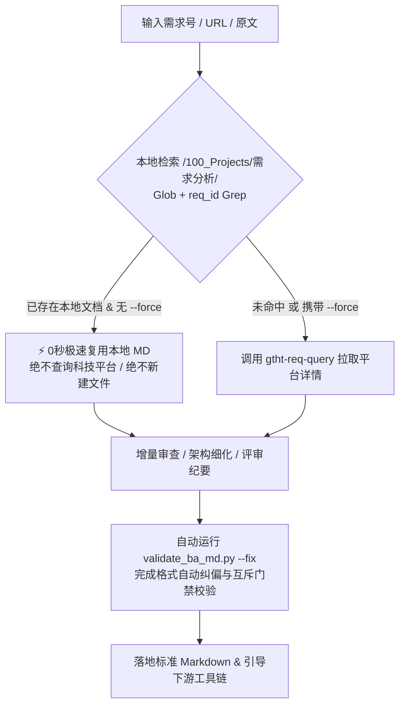

# BA-to-Dev: 业务需求转研发文档工作流

> **角色**：资深券商 IT 业务需求分析师 (BA)  
> **目标**：消除歧义、细化边界、提炼规则，产出可直接指导研发与测试的结构化 Markdown 规格说明书。

---

## 🧭 意图路由（最高优先级，2026-11-20 新增，借鉴 universal-requirement-review）

**一进来先判意图，再决定走哪条轨道**——避免把「想查询/想复用/想下发联动」误当「重新生成文档」执行，杜绝方向错误。按如下固定顺序判定（命中即分流，只进一条轨道，不再混跑后续步骤）：

| 意图 | 判定信号 | 行为（轨道） |
| :-- | :-- | :-- |
| `CONFIG_MANAGEMENT` | 用户说「配置/初始化/升级/改偏好」，或引到技能的配置/设置 | 处理配置，**不进入需求分析** |
| `FORCE_REFRESH` | 指令显式带 `--force` / `--remote` | 拉平台 → 100% 覆盖一二章 → 重跑三域 → 落盘 |
| `LOCAL_REUSE` | 给需求号 / URL、**无 `--force`**、本地 L1~L3 命中 | **0 秒读本地 MD**，增量审查，不查平台不建新文件 |
| `GENERATE_DOC` | 给原文 / URL / 明确说「生成研发文档/需求转研发/消歧」 | 全流程分析落盘 |
| `DOWNSTREAM_LINK` | 说「拆 Story / 评审 / 登记价值量 / 改排期 / 标签 / 上云」 | 直接引导对应下游 skill，不重排 BA 主流程 |

**硬性纪律**：
1. **字面 `--force`/`--remote` 才是强制刷新，绝不因"用户提了需求号"就默认刷新**；
2. **本地命中且无 `--force` → 一律 0 秒复用**，即便用户语气像是在"要文档"——增量审查即可，不触碰平台与文件重建；
3. 判定歧义时向用户确认一句（≤3 问，须给选项），不猜。
4. 该路由只决定"走哪条轨道"，进入轨道后 `LOCAL_REUSE`/`GENERATE_DOC`/`FORCE_REFRESH` 均复用下方「极速工作流」的 Step 1~4。

---

## 🧰 配置与偏好（外部持久化，2026-11-20 初稿，借鉴 universal-requirement-review）

**原则：配置永远放在外部持久目录，升级 Skill 本体不丢用户偏好、不重问旧字段。**

- **配置路径（固定）**：`~/.workbuddy/skill-data/ba-to-dev/config.json`（配置存独立 `skill-data` 目录、与技能安装目录分离；`.chat`↔`.workbuddy` 的 `skill-data` 由同一用户主目录承载，改一处即生效）。
- **绝不写入 Skill 安装目录**（`SKILL.md` / `scripts/` 下不落任何用户配置）。
- **当前 `config_version = 1`**，默认键：
  | 键 | 类型 | 含义 |
  | :-- | :-- | :-- |
  | `search.business_rule` | bool | openviking 业务规则域开关（默认 true）|
  | `search.code_lookup` | bool | CBM 代码图谱域开关（默认 true）|
  | `search.data_verify` | bool | dbq 数据库域开关（默认 true）|
  | `system_list` | str | 权威系统清单 CSV 路径 |
  | `template` | obj | 预留模板偏好（当前空）|
- **命令**：`python3 ~/.workbuddy/skills/ba-to-dev/scripts/config_manager.py --init / --status / --get <key> / --set <key> <val>`。
- **升级迁移**：探测到 `config_version` 旧时自动 `.bak_v旧版本` 备份并迁移（**旧字段保留，仅补新字段默认值，绝不重问已存在字段**）；迁移逻辑见 `config_manager.py`。
- **普通用户只需对话提供偏好，不需要手改 JSON**——运行时按需 `--get` 读默认值，用户要求调整再 `--set`。
- ⚠️ `search.*` 三开关**只在调整这三域检索时生效**；默认不初始化也不影响 ba-to-dev 正常运行（未初始化时按默认全开处理，不报错）。

## 🔭 能力按角色抽象与证据四态（2026-11-20 初稿，借鉴 universal-requirement-review）

**能力抽象成三个角色**，SKILL 流程只认角色、靠配置映射到具体源——换知识库/代码库不需改流程，只改配置：

| 角色 | 当前实现源 | 命令/能力 |
| :-- | :-- | :-- |
| `business_rule` 业务规则 | openviking | `openviking_mcp.py find/glob/read` |
| `code_lookup` 代码 | codebase-memory-mcp | `search_graph` / `get_code_snippet` / `trace_path` |
| `data_verify` 数据 | database | `dbq <profile>` |

**证据四态（每个源独立记录，未启用/查无/失败严格区分）**：

| 状态 | 含义 | ba-to-dev 落点 |
| :-- | :-- | :-- |
| `checked_with_evidence` | 已调用并取到相关证据 | 🟢 已实证 / 🟡 可追溯 |
| `checked_no_relevant_result` | 调用成功但范围内无相关结果 | 三章/四章标注「该域已检索、无相关」，**≠ 能力不存在** |
| `unavailable` | 已启用但源/权限/调用当前不可用 | 标注「该源暂不可用（失败原因）」，继续用同角色其他源 |
| `not_enabled` | 未启用 / 绑定停用，本次未调用 | 标注「该源未启用」，不视为故障，不伪造证据 |

**融合既有证据三态（🟢🟡🔴）**：合成「结论可信度（🟢/🟡/🔴）」+「源可用性（上表四态）」双维留痕——既说结论可不可信，也说"当时这个源是没查 / 查无 / 坏掉"，杜绝把源失效静默当成已检索。落地为第三章溯源表与四章审计的可选「证据覆盖」行（**本稿未改既有 P0 检索逻辑，仅新增留痕约定，供渐进采用**）。

---

## ⚡ 极速工作流 (Zero-Latency Workflow)



1. **Step 1：本地优先检索（Local-First Scan，三级并行）**
   - 优先检索 `/Volumes/Macintosh HD_Data/obsidian/100_Projects/需求分析/`；
   - **⚡ L1+L2+L3 三级并行（2026-11-10 优化）**：三级检索**同时发起**，合并去重取命中文件（无需串行等待 L1→L2→L3 级联）：
     - **L1 文件名 Glob**：`rg --files | grep -i "R26xxxxxxxx"` 或 `find ... -name "*R26xxxxxxxx*"`；
     - **L2 Front Matter Grep**：`rg "^req_id: R26xxxxxxxx" "/Volumes/Macintosh HD_Data/obsidian/100_Projects/需求分析/"`；
     - **L3 全文内容兜底**：`rg -l "R26xxxxxxxx" "/Volumes/Macintosh HD_Data/obsidian/100_Projects/需求分析/"`——覆盖**文件名不规范**（缺日期前缀/缺需求编号）或 **Front Matter 缺失 `req_id`** 的历史文件；命中后自动纠正文件名与 Front Matter（联动 Step 3 落盘时修复）；
   - **命中即 0 秒复用**：直接读取本地文档进行增量编辑，**严禁发起远程 API 查询，严禁新建文件**；仅当三级均未命中或指令包含 `--force` / `--remote` 时才拉取科技平台。
   - **⚡ 未命中/`--force` 时的 0 秒出骨架**：拉取平台详情后直接调 `extract_demand.py` 一键生成 MD 骨架（Front Matter 9 字段 + `# 标题` + 一、二章 100% 平台原文 + 属性速览附录），免手工解析 28 万字节平台 JSON：`python3 /Users/wujin/.chat/skills/ba-to-dev/scripts/extract_demand.py <需求号> --out <落盘路径>`（自动读 `.chat/tmp_<需求号>_req.json` 缓存，缓存缺失时经 kjptai MCP 直连拉取；省略 `--out` 输出 stdout 预览；骨架的 `system` 置 `[] # TODO` 待 Step 2 三域检索后补全，一/二章为平台原文可放心作为 `--force` 覆盖基准）。
   - **⚠️ `--force` / `--remote` 强制刷新的核心语义=P0（2026-10-28 R2609220085 教训）**：携带 `--force` 时，**必须用平台最新原文 100% 覆盖本地一、二章（需求背景 + 需求内容）**，而非仅做增量编辑（改 Front Matter / 删引用块）——本地既有的一、二章可能是 BA 改写过的旧版（非原文照搬），**严禁直接复用**。执行要点：① 拉取平台详情后，**逐字提取平台原文的一、二章**（去 HTML 标签、保留原文结构、含错别字原样保留）；② 与本地一、二章**逐条比对**（如 2.1~2.8 是否逐字一致）；③ **有差异即以平台原文覆盖**，删除 BA 在原文区添加的「注：原文…错别字」注释（错别字说明移入第四章审计）；④ 再更新 Front Matter / 技术实现 / 审计 / 评审纪要。教训：R2609220085 本地 2.5 被 BA 改写为「批量修改审批通过后下一交易日同步」，而平台原文为「参数中心每日将参数同步至各个交易系统及集中清算系统」，--force 未覆盖导致需求内容与平台不一致。
2. **Step 2：架构细化与三域知识检索（按需，首查命中率优先）**
   - **⚡ 分层并行执行协议（2026-11-12 定稿，最大并发优化）**：三域检索按「业务规则抢先半步 + 代码居中 + 数据库压轴」分层并行：
     - **先发（第 0~1 层，零依赖）**：需求原文解析 + 本地三级检索先行；随后 openviking 多近义词并行 find + CBM 多系统多符号并行 search_graph（jzjy/dys/jzqs/grc/cszx 各系统独立查询全部并行）+ 接口查询 + 需求依赖反查 `demand_dep_find.py` 同时发枪；
     - **回灌校准（第 1.5 层）**：openviking `find`（秒回粗筛）冒头即**回灌校准 CBM 检索词**（业务语义→换英文符号再查），提升代码域首查命中率；
     - **依赖感知（第 2~3 层）**：openviking read（依赖 find 定位） + 数据库交叉验证 `dbq`（**依赖 CBM 定位表名，db 压轴，须有表名才查库**） + 源码 grep 兜底（CBM 0 命中后先回灌 openviking 业务词再 fallback）；
   - **🎯 影响范围核验（第 3.5 层，P0#25，2026-11-13 新增，补「改这点影响谁」）**：第三章溯源定位到核心改造函数后，对每涉及系统的核心函数各跑一次 CBM `trace_path` 爆炸半径扫描（`--direction inbound` 优先看入口调用面，必要时补 `outbound` 数据流出口，`--risk-labels` 看风险分级，depth ≤3，见 [`references/graph_lookup.md`](file:///Users/wujin/.chat/skills/ba-to-dev/references/graph_lookup.md)「trace_path 爆炸半径/影响范围扫描」）→ 结论写入第四章审计「影响范围分析」专项；熔断 1~2 次/改造点，失败不阻塞落盘（标注待复核）。
     - **省时效果**：第 1 层三域同时跑，总耗时 ≈ max(openviking, CBM) 而非 sum(openviking + CBM)；多系统 CBM 并行后 3 系统串行 30-120s×3 → 并行 ≈ 单系统耗时 30-120s。详见文末「🚀 分层并行执行协议」。
   - **① openviking 业务规则/需求知识检索（三域之首）**：撰写第三章技术实现与评审纪要前，**先**到 openviking 开放知识库检索**交易所业务规则原文、既有需求/方案、业务用例**，校准业务口径与边界，**杜绝凭空推断交易所规则/业务语义**（详见 [`references/openviking_lookup.md`](file:///Users/wujin/.chat/skills/ba-to-dev/references/openviking_lookup.md)）：`openviking_mcp.py find "<业务概念>"` 语义粗筛 → 定位交易所资源 → 限定目录 `glob`/`read` 读规则/用例正文；**交易所规则首检索「行业测试大模型语料库」**（深交所/上交所/北交所/深港通/沪港通/股转），**既有需求/方案检索 `requirement.zip` 与「科技平台需求知识」**；命中规则直接引用原文编号（如《深圳证券交易所融资融券交易实施细则》第X条），检索失败/命中噪声按熔断标注「(具体规则口径以业务确认为准)」，**不阻塞落盘**（与 P0 第 16/18 条联动）；
     - **🎯 多近义词并行 find（2026-11-09 新增，2026-11-19 复核：定性有效，比例未实测）**：单一业务概念 `find` 受语义偏向影响（如「担保品返还」偏向「机构」高频近义词），**改为 2-3 个近义词并行 find**，合并 Top15 结果去重后定位最高相关度文档；近义词选取规则=**同义词**（返还/退还/划转）+ **上位词**（担保品/担保物）+ **业务动作变体**（转出/返还/退还）；示例：`find "担保品返还"` + `find "担保品划转"` + `find "担保物转出"` 三路并行；详见 [`references/openviking_lookup.md`](file:///Users/wujin/.chat/skills/ba-to-dev/references/openviking_lookup.md) §7「业务域近义词速查表」。
   - **② 代码知识图谱逆向**：接入代码知识图谱的系统（`jzjy`/`dys`/`jzqs`/`grc`/`cszx`）可定向逆向真实源文件（详见 [`references/graph_lookup.md`](file:///Users/wujin/.chat/skills/ba-to-dev/references/graph_lookup.md)）；
     - **🎯 首查代码符号（2026-11-09 新增，2026-11-19 复核：零命中现象稳定复现，提升比例未实测）**：CBM `search_graph` 用**业务中文词检索 0 命中是常态**（FTS 仅索引符号四列 name/qualified_name/label/file_path），**首查优先用代码符号**（英文函数名/类名/文件名）而非业务中文：根据需求业务域查 [`references/graph_lookup.md`](file:///Users/wujin/.chat/skills/ba-to-dev/references/graph_lookup.md) §8「业务概念→代码符号预映射字典」，用映射的代码符号直接 `search_graph --query <英文符号>`；映射表未收录时才降级为业务中文 + fallback 链（§7 兜底复核链）；**多关键词并行**：同一批独立的 `search_graph` 调用并行发起（如 `CROrderGuaranty` + `CreditGetStockDbzc` + `perCROrderGuaranty` 同时查），禁止串行等待。
   - **③ 数据库交叉验证**：代码图谱定位到**表名/字段/参数编码/存储过程**后，须对**同一系统数据库**（调用「数据库查询」SKILL /db-schema-query，命令 `dbq <profile>`，系统图谱↔系统库一一对应）做交叉验证（详见 [`references/db_lookup.md`](file:///Users/wujin/.chat/skills/ba-to-dev/references/db_lookup.md)）：表结构、参数当前值、字典中文名、影响范围；
   - **需求原文（第二章）或评审纪要明确出现接口号（数字功能号如 `7300780`）或文件编号（字母编号如 `T13`/`A51`/`L28`）时，必须核对接口入参/出参，优先走 `fwzl-mcp`（服务治理 MCP）**：
     - **主路径（首选，无浏览器/登录态）**：直接调用 `mcp__fwzl-mcp__functionQueryServiceByKeyWord({keyWord: <接口号/关键字>})` 判定存在性与基本信息（功能号/名称/类型/所属系统/负责人），再 `mcp__fwzl-mcp__queryServiceParameterByFuncCode({funcCode: <接口号>})` 取 IN/OT/HD 出入参明细，需要调用链时 `mcp__fwzl-mcp__queryParentFunction` / `queryChildFunction`。
     - **兜底（仅 fwzl-mcp 不可用(401/403/网关不可达/工具未加载)或未命中时）**：执行 `/Users/wujin/.chat/skills/接口查询/scripts/interface_query.py <接口号> [文件编号]`（本地毫秒级命中 3257 接口/82421 字段；本地未命中退出码 10 时追加 `--source auto` 升级服务治理平台）。
     - **🔍 接口号 ↔ 前台菜单 双向反查（2026-11-20 新增，同一脚本两个方向）**：脚本 `python3 ~/.workbuddy/skills/ba-to-dev/scripts/menu_interface_query.py`（数据源 `菜单调用接口汇总.md`，718 菜单/1.1 万调用，毫秒级）。
       - **接口→菜单（供评审纪要第 4 项「前端界面」）**：需求只给接口号没写菜单名时，`--code <接口号>` / `--extract "<原文>"` 反查其前台菜单（名称+功能号）填第 4 项；公共接口命中多菜单时结合业务语义筛选；7 位低延时/集中交易内部号（`739xxxx`/`749xxxx`）无前台菜单属正常、写 `无` 留依据。
       - **菜单→接口（供后续检索/第 5 项接口交互核对）**：需求只写菜单名、要知道它调用哪些接口号时，`--menu <菜单名>` 出**完整去重接口号清单**（综合理财号/外围号/serviceId 分类），或 `--menu-extract "<第二章原文>"` 从原文抽【菜单】/功能号批量反查并给汇总清单，供后续喂 fwzl-mcp/interface_query 检索；多命中用 `--menu <精确名>` 收敛，严禁拿泛词（如「融资融券」）命中一堆菜单就汇总。
       - **体系边界（P0#22）**：本库仅覆盖 **qyyx/Web 平台菜单**（5 位业务代码如 20000 联合开户）。需求里常见的**集中清算/营运 C++ 柜台菜单**（6 位功能号如 504015 历史仓单资券变动）与**低延时功能号**（739xxxx）属另一体系、**无 ESB 接口号**，反查不到时改走 CBM 代码图谱按功能号定位函数，严禁编造接口号。
       - 与 fwzl-mcp **互补**：fwzl-mcp 答"接口是什么/入参出参"，本脚本答"接口↔前台菜单挂在哪个功能号"。
     核对**方向（调用方→提供方）、所属系统、入参/出参字段明细**，确认需求描述的接口字段真实存在、语义匹配改造点，核对结论写入第三章「接口核对与字段映射」小节，并反哺评审纪要【接口交互】项；**同一批核对结论须按 P0#26 在三（二）输出「接口/文件数据流图」**（编号/方向/字段承载/实证状态直接取本次核对结果，不二次臆造）；
   - **图谱检索 0 命中 ≠ 无图谱（P0，防误标）**：CBM BM25 符号检索只索引代码符号（name/qualified_name/label/file_path），**业务中文词、纯数字功能号 0 命中是常态**，严禁据此标注「本地无图谱，待开发确认」；必须走完兜底链（CBM 换词重试 → sqlite 直连 `file_path LIKE` → 接口查询 L1.5 功能号注册表反查 → 定向 grep 源码），仅 [`references/graph_lookup.md`](file:///Users/wujin/.chat/skills/ba-to-dev/references/graph_lookup.md) 第 1 节标注「⚪ 暂无图谱」的系统（`djgl`/`ssjs`/`jzyy`）才允许省略溯源；
   - **快速路由（L1 级 / 无图谱系统）**：轻量需求或无图谱系统（`djgl`/`ssjs`/`jzyy`，见 graph_lookup.md 第 1 节「⚪ 暂无图谱」）**直接跳过图谱检索与数据库验证**，技术实现小节整体省略（（三）代码溯源、（四）伪代码整节省略）——R2610270069 顶点两融柜台 99_10 节点下线实证：厂商系统无图谱 + 纯配置式改造，三域检索收敛为「openviking 业务规则 + 需求原文驱动」即可快速落盘；改造范围仍须按 P0 第 17 条与评审纪要交叉核对，接口/文件号仍按 P0 第 9 条核对，涉及厂商/他组系统（顶点厂家、账户中心、集中营运）的改造描述按 P0 第 19 条排查核对并标注责任方。
   - **溯源收敛门禁（P0，与 Step 3 联动）**：溯源目标是**定位核心改造点**而非穷尽所有相关代码。定位到目标表/字段/功能号/函数名即完成本步，**立即转入 Step 3 落盘**；严禁在溯源阶段反复深挖同一业务（如约定购回撤单反复 funcid 查询 + 多次 grep + 多次读源码），导致轮次耗尽仍不产出 md。
3. **Step 3：规范落盘与脚本硬门禁**
   - **落盘兜底红线（P0，防「只溯源不产出」）**：**无论溯源/图谱/接口核对进行到哪一步，最终必须产出落盘的 md 文件**。溯源只是手段而非目的，严禁因「溯源未完成/信息待确认」而放弃落盘或无限停留在 Step 2。定位到**核心改造点（表名/字段/功能号/函数名）**即视为溯源充分，立即进入本步落盘；仍未定位的细节统一以「(具体实现以研发设计为准)」标注，不得阻塞产出。
   - **🖐️ 三域落盘前打勾检查（P0 门禁，2026-11-12 新增，防「业务规则域被无声跳过」）**：落盘撰写第三章技术与评审纪要**前**，必须逐域核对并留痕——三域各自「已检索出证据」或「显式跳过（在文档标注理由）」两选一，**未标注跳过=默认已检索，禁止三域任一域静默略过**：
     ```text
     □ ① openviking 业务规则域：已检索出证据（引用规则编号/文档来源） ／  显式跳过（理由：无任何业务规则语义）
     □ ② 代码域 CBM/grep：已定位改造点（文件+函数+行号/功能号） ／  显式跳过（仅 djgl/ssjs/jzyy 无图谱系统）
     □ ③ 数据库域 dbq：已交叉验证表结构/字段/参数 ／  显式跳过（理由：无表结构/字段/参数变化）
     ```
     打勾结果对应写入文档：已检索证据→按章反哺；显式跳过→在对应章节或第五章备注「该域因 [理由] 作选择性跳过」。代码域定位到改造点≠三域完成，仍需跑完①③的打勾（详见「分层并行执行协议」的依赖顺序与显式跳过标准）。
   - **溯源熔断边界（P0）**：同一改造点溯源**至多 2~3 轮工具调用**（接口查询 L1.5 → 图谱检索 → 定向 grep 源码），命中即止；未命中立即在文档标注「图谱检索未定位到精确代码」+ 已试检索词，**禁止无限 grep/反复读取源码**。R2609210085 教训：在约定购回/股票质押撤单上反复深挖（多次 funcid 查询、多次 grep、多次读源码），消耗大量轮次却始终未落盘——溯源该收敛时必须收敛。
   - 生成/更新文档后，**必须自动执行脚本门禁与格式修复**：
     ```bash
     python3 /Users/wujin/.chat/skills/ba-to-dev/scripts/validate_ba_md.py <落盘文件路径> --fix
     ```
   - **🚨 一次交付完整性门禁（P0，2026-11-20 新增，借鉴 universal-requirement-review「发送前强制检查」）**：**第一次最终回复必须携带一份"已冻结、完整、可交付"的文档**，严禁"先回答骨架/结论，等用户追问再补四章/评审纪要"。在发出最终回复前，逐条执行以下**阻断检查**，任一未过则基于同一份文档补齐后重检，**不得把"待确认后再补 XX"式半成品当作交付**：
     ```text
     □ ① 文件已落盘且 validate_ba_md.py --fix 全绿（R1~R9 无残留 FAIL）；
     □ ② 结构完整闭环：一需求背景、二需求内容、三技术实现、四需求矛盾审计、评审纪要 9 项、相关链接 六段齐全，缺一段即不可交付；
     □ ③ 评审纪要：9 项小节齐全、首行固定格式含受理人真名、预计上线日期在、第 2/8 项互斥、结束红线（预计上线日期后仅可跟评审决策日志/附件清单）；
     □ ④ 四章审计只输出确有风险维度，无「✅无/⚠️关注」占位行（P0#14）；
     □ ⑤ 文件名纯中文标题 + 标题下无「需求概要/元信息」引用块（三道硬约束）；
     □ ⑥ 若需求名词义确实不足，已在文档相应处标注「(具体实现以研发设计为准)」+ 四章「待确认事项」，而非整体欠奉；
     □ ⑦ 用户请求的是"评审/生成文档"时，回复正文**不再出现**「待你确认后再补 XX 章节」式的半成品承诺。
     ```
     与 P0#16 落盘兜底主线**不冲突**：落盘是硬产出底线（先有文件），交付完整性门禁是文件之上的"完整度底线"（必须是六段齐全的冻结版，不是残稿）。两者都过才向下游联动/向用户交付。
4. **Step 4：下游工具链闭环联动**
   - 自动引导或按指令执行后续：`/gtht-accept-review`（完成评审）、`/gtht-story-split`（拆分Story）、`/gtht-ndw-fill`（价值量登记）、`/adjust-plandate`（修改排期）、`/gtht-tag-edit`（标签同步）、`/md-to-sheet`（上云）。

---

## 💡 核心质量防线 (P0 必须严格遵守)
> ⚠️ **共性基线（2026-11-13）**：本技能与 `biz-logic-query` 共用的**权威源注册表、证据可信度三态、交互澄清协议、订阅矩阵库、接口/文件数据流图口径**统一维护在 `~/.workbuddy/skills/_shared/SHARED.md`（见文末「🔗 共性规范基线」）。**优化任一技能若触及共性项，必须先改 SHARED.md → `sync_shared.py apply` → `sync_shared.py check`，校验未通过不得收尾**；本技能 P0#9/#22/#26 是 BA 侧执行落点，与基线冲突以基线为准并同步修正。

> [!IMPORTANT]
> 本表每条 P0 = **编号 + 一句红线**。P0 编号是**跨技能契约**（`biz-logic-query` 经 SHARED.md / `shared_registry.json` 以 P0 编号交叉引用），**编号与红线必须逐条保留**；完整执行步骤、命令形态、实测教训见 [`references/p0_details.md`](file:///Users/wujin/.workbuddy/skills/ba-to-dev/references/p0_details.md)，撰写到对应 P0 时按需查细则。

| P0 | 一句红线（完整细则见 `references/p0_details.md`） |
| :-- | :-- |
| **1** | **绝对忠于事实**：禁凭空捏造表名/字段名；未提供用中文业务概念并注 `(具体表名以研发设计为准)` |
| **2** | **需求原文字字照搬**：一、二章 100% 照搬并滤模板占位符；BA 注记不污染原文，统一入评审纪要 |
| **3** | **系统名称规范全称（防多域陷阱）**：必须读 `system_list.csv` 核对；BA 正文写统称（低延时交易系统），括号域归属拆 Story 阶段定，禁臆断 |
| **4** | **评审纪要 9 项铁律**：全程业务语言禁代码符号；多系统改造结构 100% 对称；联测系统互斥；首行固定格式带受理人真名 |
| **5** | **Front Matter 产出门禁**：9 必填 + `receiver`/`co_receiver`；多系统 `ndw=0.5`（单系统 0.3）；`tags` 自动推断 |
| **6** | **纯系统维度数据流转图**：参与者=客户+各改造系统；DB 表/缓存不画外部泳道；客户动作只写请求原语，禁倒装系统判定 |
| **7** | **表名语义核对**：核对表名前缀语义（zy/gqjl/credit），禁凭含 debt/credit 关键词误判目标表 |
| **8** | **通用改造模式**：跨系统加字段优先补可选字段；幂等防重双保险；委托表合约编号复用 `bankfrzsno` |
| **9** | **接口号/文件编号必核对**：原文或评审纪要出现即核对，**优先 fwzl-mcp**（`functionQueryServiceByKeyWord`+`queryServiceParameterByFuncCode`），fwzl-mcp 不可用/未命中时再用接口查询 SKILL 兜底，禁跳过/照抄 |
| **10** | **知识积累章节（P1，可选）**：高价值知识（接口/链路/规则）入五章，无则省略，禁空占位 |
| **11** | **语言精炼简洁（P1 文风）**：短句、删套话、术语全称+括注简称统一 |
| **12** | **「本地无图谱」标注资格门禁**：仅 djgl/ssjs/jzyy 可标注；其余 CBM 0 命中须 funcid+grep 兜底复核 |
| **13** | **跨系统【接口交互】准确性优先**：确无跨系统数据传递写 `无`，禁为格式编造接口号 |
| **14** | **四章审计只输出风险维度**：无风险不输出，禁「✅无/⚠️关注」占位行 |
| **15** | **需求依赖发现（P1）**：业务概念全库反查，禁特化字段名做反查词 |
| **16** | **落盘兜底与溯源熔断**：同改造点至多 2~3 轮溯源即转落盘；未命中熔断须在三（三）写明「已试检索词」，落盘是唯一硬产出 |
| **17** | **改造范围系统交叉核对**：原文系统与评审纪要交叉核对，防漏系统（含接收方） |
| **18** | **三域知识检索门禁**：openviking→CBM→dbq；唯一硬序 code→db 禁 blind 查库；跳过必须留痕 |
| **19** | **非本组负责系统改造描述**：第 3 项只列本组系统；非本组（厂商/他组）不细化"怎么做" |
| **20** | **伪代码-溯源一一对应（P1）**：伪代码每个标识符必须能回溯（三）溯源表，禁凭空编造 |
| **21** | **「无」判定留痕规范（P1）**：评审纪要写「无」须有判定依据；未核实禁写「无」 |
| **22** | **DB-First 权威源优先铁律**：客观事实（表/字段/参数/接口/系统名/规则号）先实证再落盘，禁"名字像"推断 |
| **23** | **技术实现章节逻辑顺序**：(一)业务逻辑→(二)系统协作+数据流图→(三)代码溯源→(四)伪代码；伪代码在溯源后，图归(二) |
| **24** | **文档去冗余精简准则**：删跨章重复/元注释/占位行/低价值推断；一、二章与评审纪要素不删 |
| **25** | **爆炸半径/影响范围分析（P1）**：定位改造点后 CBM `trace_path` 扫影响面，结论反哺四章 |
| **26** | **接口/文件数据流图**：含编号时在（二）输出 `flowchart LR`；编号必经 P0#9 核对，禁编造编号/方向 |
| **27** | **结构化数据用表格/图，叙述用文字**：对照/字段清单/用例/归因/流转用表图；背景/边界/影响用文字 |
| **28** | **附件处理全流程**：downloadUrl 自动拉取→判有效性→Word 转 md→图片核对留痕；细则见 `references/attachment_flow.md` |
---

## 📌 命名与 Front Matter 规范速查

| 规则维度 | 标准规范 | 举例 / 提取逻辑 |
| :--- | :--- | :--- |
| **文件名规范** | 强制 `YYYYMMDD-R26xxxxxxxx-[纯中文需求标题].md`；非标历史文件在更新时自动纠正重命名 | `20260826-R2608260007-关于交易参数系统北交所新股申购代码设置任务提前的需求.md` |
| **Front Matter 结构** | 9 必填项 + 2 选填项（`receiver`, `co_receiver`） | `req_id: R2608210051`<br>`submitter: 杜伟毅 (融资融券部)`<br>`ndw: 0.5` # 多系统改造默认 0.5<br>`created: 2026-08-21`<br>`updated: 2026-10-10`<br>`tags: [需求, 信用两融, CX-信用-两融]`<br>`domain: 信用两融`<br>`system: [dys, jzjy]`<br>`status: 需求分析` |
| **预计上线日期** | 精简截取至月份：`预计上线日期：YYYY年MM月上线` | **强制默认 = 今天 +2 个月**（如今天 2026-10 → `2026年12月上线`）；**严禁取平台期望时间**（平台期望时间只作参考，不作为预计上线日期）；已有文档更新时保留原日期 |

---

## 📋 评审纪要 9 项速查表

> ✍️ **三域知识检索前置（P0 第 18 条）**：撰写评审纪要前，先经 **openviking（业务规则/既有需求）→ 知识图谱（代码）→ 数据库（数据/参数）** 三域检索校准口径与边界；openviking 检索出的交易所规则/业务用例，用**业务语言**体现在第 3 项改造功能、第 6 项业务参数、第 9 项业务关注点中（规则引用原文编号），技术细节（表名/函数/接口号）仅置第三章。

| 序号 | 小节名称 | 格式约束与规范要点 | 无内容标准写法 |
| :-: | :--- | :--- | :---: |
| **1** | **需求补充说明** | 仅用于补充终端/集中运营等上下游交互依赖，绝不重复改造内容；用**业务语言**表述交互边界（不规定数据结构/接口怎么改）；多依赖分点书写 | `无` |
| **2** | **改造范围** | 匹配 `system_list.csv` 中文全称，直接干净输出，严禁带缩写或注记；**评审确认的完整范围照列（含非本组负责系统），非本组系统改造功能不在此展开**（详见 P0 第 19 条） | 必须填改造系统 |
| **3** | **各系统改造功能** | 格式 `(N) 系统全称：`，内部 `①` `②` 分点以句号结尾；业务语言表述；**只列本组负责系统的改造功能点**；**非本组负责系统（厂商系统如顶点两融交易系统、他组系统如账户中心/集中营运系统）不在此展开改造描述**，其改造事项以责任方标注置于第 4/6/9 项或评审决策日志（详见 P0 第 19 条）；**多系统逻辑相同 → 分点结构 100% 对称逐条对应，但一条功能点一句话、公共口径每系统至多声明一次、不逐字重复**（详见 P0 第 4 条） | 必须填功能点 |
| **4** | **前端界面** | **凡需求内容明确涉及具体菜单（含功能号）时，必须自动在评审纪要第 4 项记录菜单名称，严禁写 `无`**（如 `(1) 集中营运系统：【单户查询-融资融券-历史仓单资券变动】菜单（功能号 504015）：…。`）。**🔍 接口号→菜单反查（2026-11-20 新增）：需求内容只给了接口号而没写菜单名时，必须先执行 `python3 ~/.workbuddy/skills/ba-to-dev/scripts/menu_interface_query.py --extract "<第二章原文>"` 自动抽接口号并反查其对应前台菜单（数据源于 rules-raw/菜单调用接口汇总.md，723 菜单/1.1 万调用，毫秒级），命中菜单即按 `(1) 集中营运系统：【菜单名】菜单（功能号 XXXXX）：…` 填写第 4 项，严禁因"原文没写菜单名"就写 `无`**；8 位综合理财号/外围号可反查，7 位低延时内部功能号（739xxxx/749xxxx 等）通常无前台菜单、反查不到属正常；公共接口命中多菜单时结合需求业务语义筛选，必要时 `--menu <名称>` 正向核对。涉及集中营运系统写：`(1) 集中营运系统：【XXX】菜单。`；涉及终端提示另提需求；仅当需求确无任何前端/菜单交互时才写 `无`（留一句依据） | `无` |
| **5** | **接口交互** | **准确性第一：确有系统间接口/文件交互（新增/修改/复用均写明，含复用现有接口）才填写**：`系统A与系统B，[接口/文件名称] [接口号/文件编号]，[承载字段与交互内容]`（如`集中交易与集中清算，委托文件 Q23，bankfrzsno 字段存储合约编号，用于区分指定合约直接还款`）；**平行系统各自独立改造、确无系统间数据传递时写 `无`，严禁硬套/编造接口号**（如低延时与集中交易分别在本系统内改校验公式，两系统间无委托/回报/文件交互）；判定基于真实跨系统数据流而非改造系统数量；**填写前必须核对接口号/接口名/调用方向与入参出参：优先 `mcp__fwzl-mcp__*`（`functionQueryServiceByKeyWord`+`queryServiceParameterByFuncCode`），fwzl-mcp 不可用/未命中时再回退 `interface_query.py <接口号>`**，严禁照抄未经验证的接口号 | 确无系统间交互时`无` |
| **6** | **业务参数** | 新增/修改的全局参数（编码、类型、默认值、开闭影响） | `无` |
| **7** | **灰度上线关注** | 默认首行写 `否`，次行写 `具体以后续实际开发评估为准。` | `否`<br>`具体以后续实际开发评估为准。` |
| **8** | **联测涉及系统** | **绝对互斥门禁**：仅填改造范围外的**外围配合系统**，**改造范围内的系统严禁重复出现**；**外围配合系统无论本组负责与否都必须如实写入，严禁因"非本组负责/非本组改造"而写 `无`**（如集中清算单系统改造但前端由集中营运系统联测配合，第 8 项必须填 `集中营运系统`，即便该为他组负责系统）；写 `无` 仅在确无任何外围交互配合时，且须留一句依据 | `无` |
| **9** | **业务关注点** | 四大维度（资金/头寸变动、事中风控拦截、清算切日对账、跨系统协同一致），按 `(1)` `(2)` 分点；**用业务语言表述关注点**（不规定幂等怎么拦、流水怎么记） | 必须填关注点 |

> ⚠️ **排版铁律**：所有小节标题冒号 `：` 后**必须换行**，内容独立成行；末尾保留「预计上线日期」，之后**仅可跟「评审决策日志（可选）」小节**（2026-10-12 用户要求：决策日志在预计上线日期之后），**严禁输出「涉及系统：…」或「预计完成时间：…」等冗余行**。

---

## 📐 研发 Markdown 标准输出模板
> ✏️ **生成前置（P0 第 18 条）**：「三、技术实现」与「评审纪要」必须基于 **openviking（业务规则/既有需求）→ 知识图谱（代码）→ 数据库（数据/参数）** 三域检索后的证据撰写，不得凭需求原文臆造规则口径、表名或接口号。

> 📄 **完整带注释模板与范例见 [`references/output_template.md`](file:///Users/wujin/.workbuddy/skills/ba-to-dev/references/output_template.md)**——撰写每份 BA 文档**必须先对照该模板逐节落位**，严禁缺节漏项、增删改序。主文件保留**结构骨架 + 三道硬约束**。

### 结构骨架（章节顺序固定，不得增删改序）

```markdown
---
req_id / submitter / receiver / co_receiver / ndw / created / updated / tags / domain / system / status
---
# [纯中文需求标题]
#### **一、需求背景**（100% 原文照搬，滤占位符）
#### **二、需求内容**（100% 原文照搬，滤占位符）
#### **三、技术实现**
##### （一）核心业务逻辑（现状 vs 目标对照表 + 场景变动用例矩阵）
##### （二）系统间协作与防重复机制（处理时序 + 防重复提交 + 业务时序图 + 接口/文件数据流图）
##### （三）代码溯源与改造点定位（溯源总览 → 各系统溯源 → 核心表清单 → 改造点映射 → 接口核对）
##### （四）核心伪代码与测试验收（Given/When/Then 用例）
#### **四、需求矛盾与逻辑漏洞审计**（只输出有风险维度 + 影响范围分析）
#### **五、知识积累（可选）**（接口/链路/数据字典/交易规则，无则省略）
#### **评审纪要**（9 项 + 首行固定格式 + 预计上线日期）
##### **评审决策日志**
#### **相关链接**（科技平台需求详情链接 + 关联需求 + 知识库）
```

### 三道硬约束

1. **科技平台需求链接格式（2026-11-09 固化）**：「相关链接」中科技平台需求**必须用** `https://fintech.gtht.com.cn/kjpt/DemandManage/details?demandId=R26xxxxxxxx&templateId=8888&flag=1`；**严禁** `https://fintech.gtht.com.cn/requirement/detail/R26xxxxxxxx`（旧格式已失效）。
2. **标题下严禁「需求概要/元信息」引用块（2026-10-21 固化）**：`# [标题]` 之后**直接进入** `#### **一、需求背景**`，禁止输出 `> **需求编号**：…`、`> **需求来源**：…` 等 `>` 元信息块（已由 Front Matter 属性完整承载）；存量文档有则删除并保留其后的 `---`。
3. **章节逻辑顺序硬约束**：**接口/文件数据流图归属（二）系统间协作段**（P0#6/#26，与业务时序图并列）；**(四)伪代码必须在（三）代码溯源之后**（P0#23，先溯源再写伪代码）；**四章审计只输出有风险维度**（P0#14，禁「✅无」占位）；**五章无则省略**（P0#10，禁空占位）。正文撰写全部循「💡 核心质量防线 (P0)」+「⚡/🎯/🚀」执行协议。
## 💾 文件保存与下游工具链闭环

1. **落盘路径**：`/Volumes/Macintosh HD_Data/obsidian/100_Projects/需求分析/YYYYMMDD-R26xxxxxxxx-[纯中文需求标题].md`
2. **三位一体下游快捷命令**：
   - **完成评审**：`/gtht-accept-review`（纯 MCP 版，自动提取评审纪要并提交）
   - **Story 拆分**：`/gtht-story-split`（自动解析改造范围与联测系统极速拆分）
   - **价值量登记**：`/gtht-ndw-fill`（自动读取 `ndw` 价值量极速落库）
   - **修改排期**：`/adjust-plandate [版本号]`（极速排期修改）
   - **修改标签**：`/gtht-tag-edit`（自动同步 `tags` 至科技平台）
   - **表格同步**：`/md-to-sheet` / `/sheet-to-md`（腾讯文档双向联动）
3. **性能分析模式 (`--profile`)**：仅当指令显式包含 `--profile` / `--debug` 时，才在末尾输出各步骤耗时与优化点表格；日常执行默认保持纯净产出（后续建议逐步沉淀轻量耗时日志，为“3–5 分钟”目标补齐批量实测样本）。

---

## ⚡ 性能优化与检索命中率（工程复盘，2026-11-20 外置）

> 性能优化（耗时排序 / 瓶颈对策）与检索命中率优化（已实测 / 经验值 / 执行纪律）的**完整工程复盘见 [`references/engineering_notes.md`](file:///Users/wujin/.workbuddy/skills/ba-to-dev/references/engineering_notes.md)**。
> 本节为**作者调优复盘**，非技能运行时强制指令；其可执行条款（并行 / 熔断 / 收敛 / 显式跳过）已整合进下方「🚀 分层并行执行协议」与 Step 2 / P0 门禁，此处不再重复。一句话要点：**主动首查最高命中率方法，并行替代串行，溯源收敛、失败熔断、只查实涉业务。**

---

## 🚀 分层并行执行协议（2026-11-12 定稿：openviking 抢先半步 + db 压轴）

> **目标**：三域检索从串行 sum(耗时) 降至并行 max(耗时)，同时让业务规则口径**抢先半步**校准代码检索方向，提升 CBM 首查命中率。单需求全流程目标 **3-5 分钟**（2026-11-10 基线 5-8 分钟）。
> **与既有章节关系**：本节是「⚡ 性能优化」与「🎯 检索命中率优化」的**执行编排层**——前者定义瓶颈与对策，后者定义首查命中率策略，本节定义**何时发起、哪些并行、哪些等待**。

### 三域依赖与最优顺序（设计依据）

| 依赖 | 强度 | 说明 |
|------|------|------|
| 代码域(CBM) → 数据库域(dbq) | **强（必须）** | db 域是**交叉验证**，须先有 CBM 定位出的**表名/字段**才有东西可查，blind 查库无效。**数据库域必然压轴** |
| 业务规则域(openviking) → 代码域(CBM) | **软（该用）** | openviking 给业务口径（阈值/边界/触发条件）→ 可**反推更准的代码符号**，提升 CBM 首查命中率。**openviking 天然抢先半步** |
| 业务规则域(openviking) → 数据库域(dbq) | 间接 | 规则口径可指导"查哪个字段/参数"，非前置 |
| 代码域(CBM) → 业务规则域(openviking) | 无 | 符号检索不需规则先行 |

**一句话**：业务规则域=方向盘（最先出结论引路）、代码域=发动机（居中）、数据库域=质检仪（压轴验证）。唯一硬顺序是 code→db。

### 执行波次（分层并行）

| 层 | 检索动作 | 依赖 | 并行粒度 |
|----|----------|------|----------|
| **第 0 层** | 需求原文解析 + 本地三级检索（L1/L2/L3） | 无，先行 | 三级并行 |
| **第 1 层** | **openviking find（2-3 近义词）** + CBM search_graph（预映射符号）+ 接口查询 + 需求依赖反查 | 无 | **三域并行发枪**；近义词间并行 + 跨系统跨符号并行 |
| **第 1.5 层（回灌/软协作）** | openviking `find`（粗筛秒回）冒头即**回灌校准 CBM 检索词**（业务语义→换英文符号再查） | 第 1 层 openviking find | 不等完成，先冒头即触发 |
| **第 2 层** | openviking `read` 规则正文 + **CBM 0 命中→用 openviking 业务词回灌→grep 源码兜底** + CBM 定位表名→触发 dbq | 第 1 层结果 | 命中文件并行 read / 多系统 dbq 并行 |
| **第 3 层（压轴）** | **数据库交叉验证 dbq**（表结构/字典/参数当前值；code→db 硬链） | 第 1/2 层 CBM 表名 | 多系统 dbq 并行 |

### 并行与顺序规则

1. **业务规则域抢先半步**：`openviking find`（秒回粗筛）与 CBM **同时发枪**，但 openviking 先冒头的语义**立即回灌**校准 CBM 检索词——既省时又不牺牲命中率（解决纯并行时 CBM 首查命中低的痛点）；
2. **openviking→CBM 软协作**：CBM 0 命中时**必须**用 openviking 业务词反推英文符号换词重试 + grep 兜底，禁止直接判无图谱（P0 #12）；
3. **db 压轴（唯一硬顺序）**：`dbq` 必须有 CBM 表名后才发，**严禁 blind 查库**；纯报错提示/纯 UI 类无表结构变化需求按 `显式跳过标准` 标注跳过；
4. **跨域并行**：第 1 层三域同时发起，不等任一域完成才启动另一域；
5. **跨系统并行**：CBM 多系统（jzjy/dys/jzqs/grc/cszx）search_graph **全部同时发起**；多系统 dbq 并行；
6. **同域多词并行**：openviking 多近义词 find、CBM 多代码符号、接口多接口号**同时发起**；
7. **熔断不阻塞**：任一域失败/超时按既有熔断（P0 #16/#18），不影响其它域继续并行；
8. **`--force` 路径并行**：拉取平台详情后，**骨架生成**（extract_demand.py）与**三域检索（第 1 层）同时启动**——三域依赖需求原文（已随平台详情返回），不依赖骨架文件。

### 显式跳过标准（三域任一跳过必须留痕，禁止静默略过）

> **落地门禁（P0）**：跳过的域必须在文档显式标注「此域因 [理由] 作选择性跳过」；未标注跳过=默认已检索。

| 域 | 允许跳过的唯一标准 |
|----|-------------------|
| openviking 业务规则 | 需求纯 UI / 纯技术重构，**无任何业务规则/阈值/口径语义**（如"按钮样式调整"）才可跳；凡涉「维保/强平/担保/权限/还款/质押/回购」等有业务语义的词**必须检索** |
| 数据库 dbq | **无新增/修改表结构/字段/参数**才可跳（如纯报错提示类）；跳时文档写明「该域因无表结构变化作选择性跳过」 |
| 代码域 CBM | 仅 `djgl/ssjs/jzyy` 无图谱系统可跳（P0 #12），其余必做 |

> **实测教训（R2611120045，2026-11-12）**：曾因 CBM 定位到功能号即"溯源收敛"直接落盘，**无声跳过了 openviking**（未显式评估），而该需求"维保过低触发平仓限制"正是需要业务规则印证的——事后补查 openviking 命中 130%/110% 强平规则（R2607070027）。根因=把「代码域收敛」混同「三域完成」，且「报错提示类需求=无业务规则」的主观低估。落盘前必须走三域打勾检查（见 Step 3）。

### 串行→并行对照

| 场景 | 旧串行耗时 | 新并行耗时 | 省时 |
|------|-----------|-----------|------|
| 三域检索（openviking 8s + CBM 60s + DB 5s） | ~73s | ~60s（max） | ~13s |
| 3 系统 CBM（jzjy 60s + dys 40s + jzqs 50s） | ~150s | ~60s（max） | ~90s |
| 本地三级检索（L1 0.1s + L2 0.1s + L3 0.1s） | ~0.3s | ~0.1s（max） | ~0.2s |
| `--force` 骨架 + 三域（骨架 3s + 三域 60s） | ~63s | ~60s（max） | ~3s |

---

## 🔗 共性规范基线（单一事实源：_shared/SHARED.md）

> ⚠️ 本章由 `sync_shared.py apply` 自动同步，**禁止手工编辑块内内容**；共性改动一律先改 `~/.workbuddy/skills/_shared/SHARED.md` 再 `apply` + `check`。本章之外的内容是本技能特有的场景化扩展。

<!-- SHARED:authority_sources START -->
### 🔗 权威源注册表（两技能共用，DB-First）

| 检索域 | 权威源 | 路径 / 命令 | 口径 |
| :--- | :--- | :--- | :--- |
| L0 需求依赖反查 | `demand_dep_find.py` | `~/.workbuddy/skills/ba-to-dev/scripts/demand_dep_find.py <需求号> [概念...]` | 本地需求 MD 全库反查；反查词用**业务概念**，禁用 `ipoavl` 等特化字段名 |
| L1 接口/功能号契约（**首选**） | **fwzl-mcp**（服务治理 MCP） | `mcp__fwzl-mcp__functionQueryServiceByKeyWord` / `queryServiceParameterByFuncCode` / `queryParentFunction` / `queryChildFunction`；端点为 `https://sg.gtht.com.cn/api/v1/mcp/byApplication/fwzlMcpServer/mcp`（streamable_http，无需浏览器/登录态） | **默认首选**：按功能号/关键字查存在性、基本信息（功能号/名称/类型/所属系统/负责人）、出入参(IN/OT/HD)、调用链；本地库未收录的纯数字功能号也可命中；判定存在只用 `functionQueryServiceByKeyWord`（查不到仅=未收录，不反证不存在） |
| L1 本地接口知识库（**兜底**） | SQLite | `/Volumes/Macintosh HD_Data/WorkBuddy/需求分析/rules-raw/.interface_store.db`（`interfaces` / `interface_fields`） | **仅当 fwzl-mcp 不可用（401/403/网关不可达/工具未加载）或未命中时**：毫秒级 3257 接口/82421 字段明细；**参数/菜单类概念**（如「融资规模设置」「净资本比例」）在 `name/code/description` 常 0 命中，须改按 `table_name` 回查（→ S24 信用交易规模参数 `creditscale`），不得退化成「融资」等泛词做同族扩展 |
| L1.4 接口号↔菜单双向反查库（**2026-11-20 新增**） | `menu_interface_query.py` + SQLite | 脚本 `~/.workbuddy/skills/ba-to-dev/scripts/menu_interface_query.py`；源 `/Volumes/Macintosh HD_Data/WorkBuddy/需求分析/rules-raw/菜单调用接口汇总.md`；索引 `.menu_interface.db`（首次自动建，源更新自动重建） | **接口↔前台菜单双向反查**：①接口→菜单（`--code`/`--extract`，供 ba-to-dev 评审纪要第 4 项「前端界面」）；②菜单→接口（`--menu <名>` / `--menu-extract "<原文>"` 出完整去重接口号清单，供后续 fwzl-mcp 检索/第 5 项接口交互）。718 Web 平台菜单/1.1 万调用，毫秒级。**体系边界**：仅覆盖 qyyx/Web 平台菜单（5 位业务代码）；集中清算/营运 C++ 柜台菜单（6 位功能号如 504015）、低延时功能号（739xxxx）属另一体系、无 ESB 接口号，改走 CBM；8 位综合理财号+外围号可反查，公共接口命中多菜单按业务语义筛选、泛词多命中用 `--menu <精确名>` 收敛。与 L1 fwzl-mcp **互补**（前者答"接口↔前台菜单功能号"，fwzl-mcp 答"接口入参出参/所属系统"） |
| L1.5 订阅矩阵库 | SQLite | 同目录 `.subscription_matrix.db`，见下方「订阅矩阵库」块 | 文件编号 → 输出系统 / 消费者方向 |
| L2 代码知识图谱 | `codebase-memory-mcp` | `~/.local/bin/codebase-memory-mcp cli` 或 MCP `search_code` / `get_code_snippet` / `trace_path` | 项目 `jzjy` / `dys` / `jzqs` / `grc` / `cszx`；**中文业务词 0 命中是常态**，改英文符号 + `--path-filter` |
| L3 数据库实证 | `dbq <profile>` | `/usr/local/bin/dbq`；profile `jzjy_sit` / `dys95` / `jzqs_sit` / `cszx_sit` / `jzqs_comm_sit` | `--table` / `--search-table` / `--sql`；**字典表真名 `run.dbo.dictindex` + `run.dbo.dictvalue`，不是 `t_dict`** |
| L4 业务规则 / 既有需求 | `openviking_mcp.py` | `~/.workbuddy/skills/openviking-query/openviking_mcp.py find\|glob\|read` | 必须 `NO_PROXY=csgl.gtht.com.cn,fintech.gtht.com.cn` |
| 系统名称清单 | `system_list.csv` | `/Volumes/Macintosh HD_Data/WorkBuddy/需求分析/rules-raw/system_list.csv` | 中文全称；BA 正文写统称，括号域归属留给拆 Story 阶段 |
| 本地需求 MD | Obsidian | `/Volumes/Macintosh HD_Data/obsidian/100_Projects/需求分析/` | 需求号优先本地三级检索，命中即 0 秒复用 |

**DB-First 优先级（P0）**：`dbq 直查 > 权威清单(system_list.csv / 接口库 / 订阅矩阵) > 代码图谱符号级溯源 > 需求原文`。凡**客观事实**（表名 / 字段名 / 字段类型 / 参数编码 / 系统中文全称 / 接口号 / 规则条文编号）必须先实证再落盘，**严禁「名字像 / 关键词像 / 函数名像」推断语义**。典型反例：`comm_secuid_total` 实为计数表（标准名称源是 `comm_stock.stkname`）、`zy_debts` 实为股票质押（非两融负债表）。

**路径约定**：`.chat/skills` 是指向 `.workbuddy/skills` 的软链接，改一处即生效；所有脚本一律只用 `~/.workbuddy/skills/` 下的版本，不用临时副本。
<!-- SHARED:authority_sources END -->

<!-- SHARED:evidence_grading START -->
### 🔗 证据可信度三态与诚实原则（两技能共用）

每条结论 / 每条证据必须标注三态之一，**严禁混为一谈、严禁凭记忆编造**：

| 分级 | 含义 | 权威来源 |
| :--- | :--- | :--- |
| 🟢 **已实证** | 客观可查、可直接引用 | 接口库 / 订阅矩阵库 / `dbq` 表结构与 SQL / 需求 MD 原文 / 源码文件+行号 |
| 🟡 **可追溯** | 索引或语义命中，次可靠 | CBM `search_graph` / `trace_path` 调用链 / openviking `find` 命中 |
| 🔴 **待确认** | 未命中，需人工 / 研发确认 | 熔断结果，**严禁臆断补全** |

**诚实原则**：未检索到证据就如实标注「待确认」，绝不猜测系统行为；需求文档写「(具体实现以研发设计为准)」，问答结论写「未命中 / 需确认」。对齐 `ba-to-dev` P0#22 DB-First 与 P0#1 绝对忠于事实、`biz-logic-query`「证据链可信度分级（P0 铁律）」。

**落点**：`ba-to-dev` → 第四章审计「待确认事项」+ P0#26 数据流图箭头三态标注 + 图下「证据出处」；`biz-logic-query` → 证据链表格 `confidence` 列 + 结论段「仍待确认」清单。二者对同一事实的三态判定必须一致，出现冲突时以上表权威源优先级裁决。
<!-- SHARED:evidence_grading END -->

<!-- SHARED:clarification START -->
### 🔗 交互澄清协议（用户 2026-11-13 明确要求，两技能共用）

> 用户原话：「如遇到疑惑，可以随时向我咨询，以补充确认项，以便使得搜索关键词更精准」。
> **原则：仅在歧义 / 未命中时问，顺畅查询不打断；一次最多 3 问且必须给候选选项；答案必须回灌成检索参数，不得只记在对话里。**

**触发信号（任一命中即问）**：概念 0 命中 / 同族接口 ≥4 条或自动扩展 ≥12 条（短词多义）/ 中文概念未映射出英文标识符 / 代码层多域 0 命中或超时 / 本地需求库未命中 / 需求原文出现未核对的接口号或文件编号 / 业务规则口径冲突。

**回灌映射（拿到答案后必做）**：

| 用户补充的信息 | 回灌为 |
| :--- | :--- |
| 英文函数名 / 字段名 | 作为检索词重跑；补进 `KEYWORD_MAP` / `DB_KEYWORD_MAP` |
| 功能号 / 文件编号 | `biz_logic_query.py "<编号>" --code` 或 `interface_query.py <编号>` 核对 |
| 系统域 | `--project <域>` / `--projects a,b`；BA 侧写进改造范围 |
| 表名 / 搜表词 | `--db-table` / `--db-search-table "%xxx%"` |
| 需求号 | 作为 `question` 重跑 + `openviking glob "*<需求号>*"` |
| 「只要快」/「数据刚更新」 | `--fast` / `--refresh`（BA 侧 `--force` / `--remote` 强制平台原文覆盖） |

**已确认字典（用户当场确认，勿重复问）**：① 默认策略＝全量并行 + 缓存（证据链不打折，`--fast` 手动跳过深度域）；② 澄清时机＝仅歧义 / 未命中时；③ 默认系统域＝自动多域并行 `jzjy,dys,jzqs`。

**豁免**：`question` 精确等于已登记的 ≥5 字明确概念（如「指定合约还款」）时视为明确，展示同族概览但不触发澄清。

**场景差异（各自在本技能内展开，不属于共享块）**：`biz-logic-query` 以脚本 `--json` 的 `clarification` 数组非空为准；`ba-to-dev` 在需求原文歧义、系统域/编号未核对、业务规则口径冲突、评审纪要「无」判定无依据时发起，且澄清不得阻塞 Step 3 落盘（P0#16）。
<!-- SHARED:clarification END -->

<!-- SHARED:subscription_matrix START -->
### 🔗 订阅矩阵库（文件编号 → 消费者，两技能共用权威源）

- **库**：`/Volumes/Macintosh HD_Data/WorkBuddy/需求分析/rules-raw/.subscription_matrix.db`（与 `.interface_store.db` 并列）
- **脚本**：`~/.workbuddy/skills/biz-logic-query/scripts/subscription_matrix.py`
- **唯一数据源**：`文件接口明细/新一代文件交互接口订阅矩阵.xlsx`（Sheet1，文件 × 系统打勾矩阵，`√` = 订阅）。**原 xlsx 只读，绝不回写**；库可随时 `build` 重建（temp + 原子替换）。
- **命令**：`build` 重建｜`query <编号>` 消费者 + 实证｜`consumer <系统>` 反查｜`stats` 总览｜`sql "<SQL>"` 自由查询。
- **规模**：`files` 498 / `consumers` 18 / `subscriptions` 743 条 / `evidence` 14 条；接口库关联 492/498（98.8%）。视图 `v_file_consumers` / `v_a37_consumers`。
- **状态口径**：`🟢 矩阵原样`＝仅来自矩阵；`🟢 多源实证`＝另有接口库 / 源码 / dbq / 需求佐证；`🔴待确认`＝见 `evidence` 表。
- **A37 权威结论**：**唯一消费者 = 低延时交易系统(虚拟)**，输出系统 = 集中清算系统；反向 **Q49** 输出 = 低延时，消费者 = 集中清算系统 + 集中交易系统。已核销「源码注释接收方是集中交易」的口径差异。
- **联动**：`biz-logic-query` L1.5 `query_subscription()` 在命中文件编号时自动附加消费者证据；`ba-to-dev` P0#26 数据流图铁律⑥ 以本库判定**输出系统 / 消费者方向**，与 P0#9 接口核对、P0#22 DB-First 共同构成编号与方向的三重实证，不照抄需求原文。
<!-- SHARED:subscription_matrix END -->

<!-- SHARED:dataflow_diagram START -->
### 🔗 接口/文件数据流图（两图分工，两技能共用口径）

| | 业务时序图 | 接口/文件数据流图 |
| :--- | :--- | :--- |
| 语法 | `sequenceDiagram` | `flowchart LR` |
| 视角 | 客户 → 系统，谁先谁后 | 系统 ↔ 系统通道 |
| 回答 | 各系统改了什么 | 走哪条接口/文件、承载什么字段、落在哪张表 |
| 触发 | 每份 BA 需求（`ba-to-dev` P0#6） | **仅含接口号 / 文件编号且已核对**（`ba-to-dev` P0#26）；无交互整节省略 |

**6 条绘制铁律**：① 节点**只画业务系统中文全称**（`system_list.csv`），DB 表 / 内存表 / 缓存只能写成节点内注记或箭头标签，严禁画成外部节点；② 每条箭头带**编号 + 中文名 + 方向（下发/回流/调用）**，编号必须经接口核对，未核对标 🔴 并写入第四章，**严禁编造编号与方向**；③ 标签补**字段承载**（如 `extstr 承载对手方股东账户`）与是否下发口径，「不下场」用图下文字注记、不画箭头；④ 三态标注 🟢/🟡/🔴，图下附「证据出处」（接口库 / 源码文件:行号 / dbq 库表 / 需求号）；⑤ `ba-to-dev` 中**只置于三（二）系统间协作段**，严禁进评审纪要（P0#4），不与五章「知识积累」重复；⑥ 编号、方向、字段以 **接口核对 + DB-First + 订阅矩阵库** 三重实证为准。

**落点**：`ba-to-dev` → 三（二）模板与 A37/Q49 范例（`validate_ba_md.py` R1–R9 不校验 Mermaid，加图不改变门禁）；`biz-logic-query` → 查到文件编号 / 接口族时，用会话可视化卡片呈现同一张图，编号与方向直接取订阅矩阵与接口核对结论。
<!-- SHARED:dataflow_diagram END -->

<!-- SHARED:sync_protocol START -->
### 🔄 共性同步协议（后续优化 SKILL 时必执行）

**共性项清单**（改动任一即视为「共性改动」，必须双技能同步）：

| # | 共性项 | 块 ID |
| :--- | :--- | :--- |
| 1 | 权威源路径 / profile / CBM 项目名 / 字典表真名 / DB-First 优先级 / 软链接约定 | `authority_sources` |
| 2 | 证据可信度三态与诚实原则 | `evidence_grading` |
| 3 | 交互澄清协议与已确认字典 | `clarification` |
| 4 | 订阅矩阵库路径 / 命令 / A37 结论 / 联动方式 | `subscription_matrix` |
| 5 | 接口/文件数据流图两图分工与 6 铁律 | `dataflow_diagram` |
| 6 | 业务概念 → 英文标识符 / 表名词映射、实测字典中的**跨技能通用结论**、共享脚本路径、复盘固化机制 | 见 `shared_registry.json` 的 `constants` |

**执行动作（智能体在任一次技能优化收尾时必做）**：

1. **判定**：本次优化是否触及上表任一项或 `constants` 中的共享常量？否 → 只改本技能，无需同步。
2. **改源**：改 `~/.workbuddy/skills/_shared/SHARED.md` 对应块（必要时同步 `shared_registry.json` 的 `constants`）。**不要直接改两份 SKILL.md 的共性块**。
3. **推送 + 校验**：
   ```bash
   P=/Users/wujin/.chat/runtimes/darwin-x64/python/versions/3.13.12/bin/python3
   S=~/.workbuddy/skills/_shared/sync_shared.py
   $P $S apply && $P $S check
   ```
   `apply` 自动备份并把块推送到两份 `SKILL.md`；`check` 有任何漂移返回退出码 1，**未通过不得结束本轮**。
4. **复盘留痕**：按「技能完成复盘机制」输出稳定性 / 质量 / 速度三维优化点，并把共性改动记入当天工作日志；单边特有改动（如 P0 编号、性能基线、实测映射细节）只记本技能，不推送。

**规则**：① 共性块内容两边**严格一致**（由 `check` 哈希比对保证），场景差异写在块外的本技能章节；② 单边新增的权威结论若对另一技能有价值（如新的文件编号消费者、新的字典真名），须提升为共性项并写进 SHARED.md；③ 新增第三个共用技能时，在 `shared_registry.json` 的 `targets` 追加后重跑 `apply --init`；④ 禁止用「复制粘贴」代替同步，禁止手工删改 `<!-- SHARED:... -->` 标记；⑤ **副本镜像**：`.chat/skills/biz-logic-query` 是独立真实目录（非软链接），其 `SKILL.md` 为独立副本 —— `apply` 自动把权威版镜像过去、`check` 校验逐字一致；`ba-to-dev` 已是软链接、`scripts/` 为硬链接，均无需处理；新增独立副本时登记到 registry 的 `mirrors`。
<!-- SHARED:sync_protocol END -->
