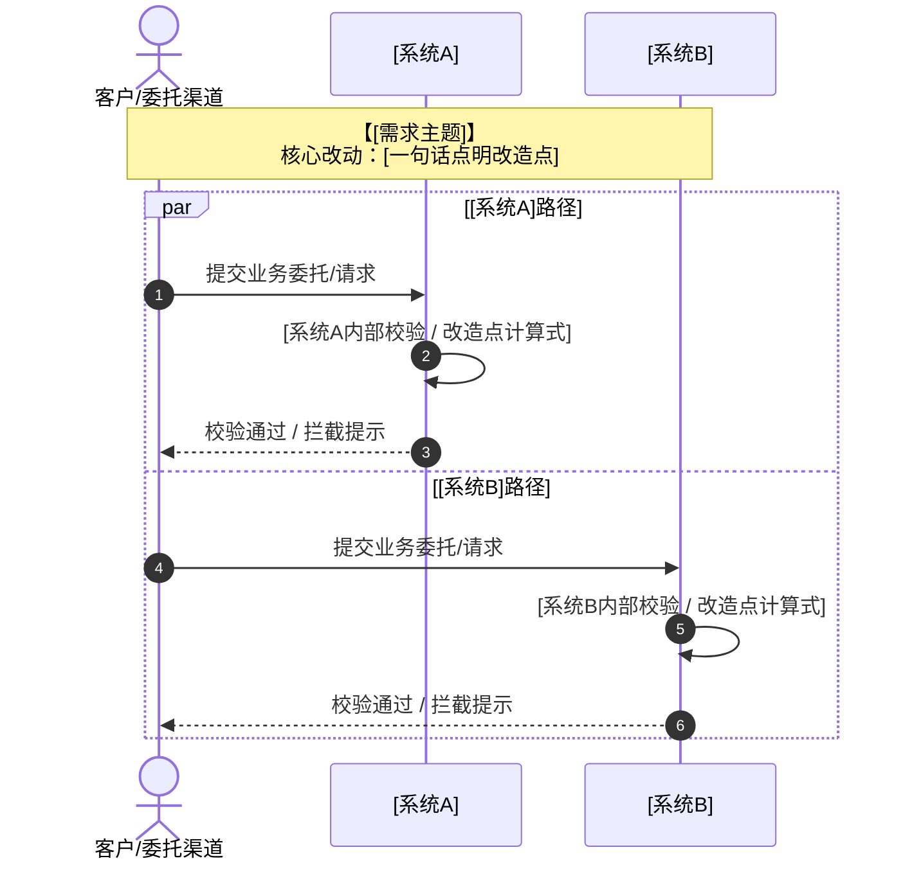
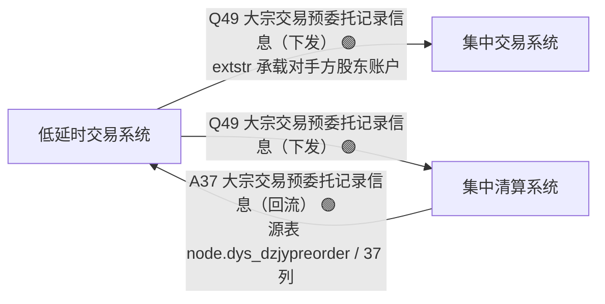

# ba-to-dev 研发 Markdown 标准输出模板

> 本文件承载 `SKILL.md`「📐 研发 Markdown 标准输出模板」的**完整带注释模板与范例**。撰写每份 BA 文档前**必须先对照本文件逐节落位**，严禁缺节漏项、增删改序。结构骨架与三道硬约束在主文件仍保留。

---

## 📐 研发 Markdown 标准输出模板

> ✏️ **生成前置（P0 第 18 条）**：以下模板中的 **「三、技术实现」**（核心业务逻辑/改造点/伪代码）与 **「评审纪要」**（9 项）必须基于 **openviking（业务规则/既有需求）→ 知识图谱（代码）→ 数据库（数据/参数）** 三域知识检索后的证据撰写，不得直接凭需求原文臆造规则口径、表名或接口号；三域检索结论按 Step 2 / P0 第 18 条融入对应章节。

```markdown
---
req_id: R26xxxxxxx
submitter: 姓名 (部门全称)
receiver: 姓名-工号
co_receiver: 姓名-工号
ndw: 0.5
created: YYYY-MM-DD
updated: YYYY-MM-DD
tags: [需求, 业务领域, CX-业务标签]
domain: 业务领域
system: [系统简称A, 系统简称B]
status: 需求分析
---

# [纯中文需求标题]

#### **一、需求背景**
[100% 原文照搬，过滤模板占位符]

#### **二、需求内容**
[100% 原文照搬，过滤模板占位符]

---

#### **三、技术实现**

##### （一）、核心业务逻辑
**1. 核心优化方案【现状→目标→边界】三段式**：
> ⚠️ **必写强制二元对比**：本小节必须显式区分**改造前（现状）** 与 **改造后（目标）**，用**「现状 vs 目标」对照表**呈现（见下表结构），让读者一眼看到改动前后差异；现有「原逻辑 vs 新逻辑」信息本就散落于业务主线/伪代码注释，此处集中呈现代替重复展开（P0#24 去冗余，勿再单独设「现状-目标对比」章节）。

| 维度 | 改造前（现状） | 改造后（目标） |
| :--- | :--- | :--- |
| [对照维度1，如预委托时效] | [原逻辑一句话，如"大宗交易预委托长期有效、不失效"] | [新逻辑一句话，如"仅当天有效、次日自动失效、需重新发起"] |
| [对照维度2，如实现方式] | [原实现] | [新实现，如"集中清算日终过滤信用账户预委托、不上场仅归档"] |

> **触发条件 / 业务边界**：[什么情况下走新逻辑；明确不改动的算法/流程/范围（如"普通账户逻辑不变"）]。

**2. 场景变动用例矩阵**：

| 上一状态 / 触发条件 | 核心校验规则 | 目标状态 / 处理动作 | 系统交互 / 资金影响 |
| :--- | :--- | :--- | :--- |
| [场景A] | [前置校验] | [目标状态] | [可用资金扣减/放行] |

> 💡 **避免重复**：现状对比/改造目标信息只在一处展开，勿再单独设与「核心优化方案 + 测试验收用例」重复的场景矩阵小节。

##### （二）、系统间协作与防重复机制
本需求由[相关系统数]个系统接力完成，同一笔操作重复提交不会被重复处理。
1. **处理时序（谁先谁后）**：[跨系统流转顺序 + 关键处理时序 + 结果回执路径，用通俗语言描述，说明客户侧可见结果口径一致]。
2. **防重复提交**：[业务唯一标识组成 + 各系统防重机制，拆分为柜台侧/清算侧等维度]。

**数据流转图**：
> 📐 **绘制原则（P1）**：参与者收敛为**客户 + 各改造系统**（3~N 个），删除网关/处理器/回报结构体等实现细节泳道；`Note` 点明**核心改动**，各系统内部 `sys->>sys` 高亮**本系统修改点**；**多系统平行独立改造用 `par ... and ... end` 并行块**逐系统展示，串行接力改造保留原时序链（详见 P0 第 6 条）。



**接口/文件数据流图**（仅当需求含接口号/文件编号且已按 P0#9 核对时输出；无编号交互则**整节省略**，P0#24）：
> 📐 **绘制原则（P0#26）**：节点只画业务系统（系统清单中文全称），DB 表写成节点注记或箭头标签；每条箭头带「编号 + 中文接口/文件名 + 方向」，补字段承载与下发口径；🟢/🟡/🔴 标实证状态；图下附证据出处与口径注记。**严禁进入评审纪要**。
> ⬇️ 实证范例（A37/Q49，实际使用时按 P0#9 核对结果替换编号与方向）



> **证据出处**：接口库 `.interface_store.db`（A37 39 字段 / Q49 35 字段）、`jzqs` 导出脚本 `node_dzjypreorder_out_file.sql`、`jzqs_sit` 抽样、需求 `R2610120043`。
> **口径注记**：集中交易日间预委托**不下场**给集中清算（非数据流口径，不画箭头）；`cjs_dzjypreorder` SIT 0 行、A37 回流通道暂无测试数据（🔴 待确认）→ 写入第四章审计。

##### （三）、代码溯源与改造点定位

> 溯源方式：codebase-memory-mcp（CBM）代码知识图谱检索（本地图谱：jzjy 38 万节点 / dys 6.5 万节点 / jzqs 42.4 万节点），BM25 语义检索 + 符号级 qn 定位 + 源码回读验证，非 grep。本节按需保留，无图谱系统（djgl/ssjs/jzyy）可整体省略。

**1. 溯源总览**：
> 多系统时推荐，单系统可省略。

| 系统 | 代码图谱 | 核心模块 / 入口 | 关键结论（与本需求关联） |
|------|---------|----------------|--------------------------|
| [系统名] | [节点数] 万节点 | [核心模块/入口路径] | [关键结论，标注改造点] |

**2. 各系统溯源小节**：

> 源路径：`[源码绝对路径]`（源码 GBK 编码；文件列超链接可直接跳转源码）

**核心模块**：`[模块路径]`

> 📌 **映射表精简原则（P1）**：只输出**直接支撑改造点**的文件/函数，每系统建议 **1-4 行**。保留：改造点所在核心交易处理、主校验/计算函数、查询/提示口径函数、需口径一致的外部入口。删除：网关层（AGW）委托解析/ER 回报处理、委托预处理器、业务执行器、辅助/外部/未处理管理器、纯回报/请求结构体（无字段增减时）、报文标签定义（BusTag.h 等，无字段增减时）、参照类、同构副本。详见 [`references/graph_lookup.md`](file:///Users/wujin/.chat/skills/ba-to-dev/references/graph_lookup.md) 第 6 节 ③。

| 文件 | 关键函数 | 职责 |
|------|---------|------|
| [文件名.cpp](file:///绝对路径/文件名.cpp) | `函数名`（:起始-结束行） | 核心职责描述（须写明与本需求改造点的直接关联） |

**关键结论**：
- [结论1]；
- [结论2]。

**数据库交叉验证**（「数据库查询」SKILL `dbq [profile]` → [表结构说明]）：
- [负债表/核心表] 为 `[表名]`（[字段说明]）；
- **实测有/无 `contract_date/contract_sno` 等关键字段**，[佐证改造点结论]。
- ⚠️ dys 字典表须查 `tradingconfigdb.t_dict`（完整版 48 条 BusinessType），非 `tradingdb.t_dict`（仅 17 条）；字段名为 `category_code`/`code`/`value`/`name`（详见 [`references/db_lookup.md`](file:///Users/wujin/.chat/skills/ba-to-dev/references/db_lookup.md) 第 7 节）。

**3. 核心表清单**：

**1. 负债表**：
> 还款对象核心表。

| 业务实体 | 集中交易 jzjy（run.dbo） | 低延时 dys | 集中清算 jzqs |
|---------|------------------------|-----------|--------------|
| 融资融券负债表（还款对象） | `creditdebts` | `t_credit_debts` | `node_creditdebts` |
| 负债明细 | `creditdebtsdetail` | `t_credit_debts_detail` | `node_creditdebtsdetail` |
| 已结清负债 | `creditdebtsclosed` | `t_credit_debts_closed` | `node_creditdebtsclosed` |
| 信用资金 | `creditfund` | `t_credit_fund` | `node_creditfund` |
| 锁券/持仓 | `DYS_fundstk_frzlog` | `t_credit_stk_lock` | `node_creditstklock` |
| 息费 | （`creditdebts` 内含 `debtskind`） | `t_credit_fee` | `node_creditfee` |

**2. 委托表**：
> 还款委托链路。

| 系统 | 委托表 | 说明 |
|------|--------|------|
| 集中交易 jzjy | `orderrec`（委托记录表） | [委托组装/导出/落库说明] |
| 低延时 dys | `t_order` / `t_orderrec` / `t_orderrec_ext` / `t_gw_entrusts` / `t_order_status` | [合约标识承载与落库映射说明] |
| 集中清算 jzqs | `node_orderrec` / `node_match` / `node_closeorder` / `node_entrustdebts` / `node_frzorderrec` / `cjs_credit_orderrec` | [委托记录与清算关联说明] |

**关键字段验证结论**：[跨系统委托主表是否含 `contract_date/contract_sno`，与改造点的一致性结论]。

**明确排除**：[易混淆表名（如 `zy_debts`=股票质押）及其排除理由]。

**4. 改造点与溯源映射清单**：

| 系统 | 改造点 | 说明 |
|------|--------|------|
| [系统名] | [改造点描述] | 图谱已定位：[文件.cpp](file:///绝对路径/文件.cpp) `函数名`（:行号，[关键说明]） |

**5. 接口核对与字段映射**：
> 需求明确含接口号/文件编号时必填，否则整节省略。
> 接口核对：调用 `接口查询` SKILL（`/Users/wujin/.chat/skills/接口查询/scripts/interface_query.py <接口号> [文件编号]`）核对方向/所属系统/入参出参；本地未命中（退出码 10）追加 `--source auto` 升级服务治理平台。

| 接口号/文件编号 | 接口名 | 方向（调用方→提供方） | 所属系统 | 入参关键字段 | 出参关键字段 | 与本需求改造点核对结论 |
|---------------|--------|---------------------|----------|-------------|-------------|------------------------|
| [7300780 / T13] | [中文接口名] | [系统A→系统B] | [系统B] | [字段1、字段2…] | [字段3、字段4…] | [字段是否真实存在、语义是否匹配改造点] |

##### （四）、核心伪代码与测试验收

> 🔑 **位置说明（P0）**：本小节必须置于（三）代码溯源**之后**撰写——先对现有代码做精准溯源分析，定位真实模块/函数/表结构，**伪代码才能贴近真实实现**；严禁在溯源前凭空臆造伪代码。无图谱系统（标注「待开发确认」）或纯界面/参数类需求可省略本小节。

> 📐 **精准性原则（P1，贴近实际代码）**：伪代码必须**逐一映射（三）溯源定位的真实代码**——真实函数签名（函数名/入参/返回类型）、核心计算式（变量名与业务语义一致）、校验分支（拦截条件与提示口径）均以溯源源码为准，**严禁泛化为「业务处理入口」「执行核心计算」等空泛占位**；与溯源文件/函数行号形成「溯源 → 伪代码 → 测试用例」三环呼应，测试验收的数值边界基于伪代码核心算式推导。

```cpp
// [改造系统A] 核心伪代码——紧接（三）溯源定位的真实模块 [文件.cpp] `真实函数名`（:行号）提炼
// === 改造点：XXX ===
// 原逻辑：[原行为一句话] / 新逻辑：[新行为一句话]

int64_t [真实函数名](
    string customerId,   // 客户号（语义同源码）
    int64_t holdQty,     // 持有数量
    int64_t finQty,      // 融资数量
    ...
) {
    // 核心计算式（与源码一致；改动行注释标注「改造后」）
    int64_t maxQty = holdQty - finQty - marginBuyQty;
    return max(0, maxQty);
}

// 校验主流程（[真实校验类/函数名]）
// 1. [校验1：改造后规则]：...
// 2. [校验2：与改造相关的拦截条件]：... → 拦截并提示「[真实提示文案]」
```

**Given / When / Then 测试验收用例**（数值基于伪代码核心算式推导，Then 给出精确数量边界）：
> - **场景 1（正向逻辑）**：[Given 真实业务数值] ➔ [When 动作] ➔ [Then 计算式代入结果 + 放行/拦截结论]。
> - **场景 2（异常/边界）**：[Given 边界数值（如全额负债）] ➔ [When 动作] ➔ [Then 精确边界（如 maxQty=0）+ 拦截提示]。

---

#### **四、需求矛盾与逻辑漏洞审计**
> 💡 **审计聚焦原则（P0）**：本审计**只输出存在风险的维度**——凡评估结果为「无 / 不涉及 / 无需 / 无风险 / 未发现」的维度**一律不列出**（含逻辑硬冲突为「无」、业务软缺失无风险、10 维扫描中无风险的维度），严禁为凑齐模板输出「✅ 无」「⚠️ 关注」等占位行；仅保留确有风险或有待澄清的维度，保持审计聚焦、可读。

**1. 逻辑硬冲突**：
> 仅当发现硬冲突时输出本小节；未发现硬冲突则本小节整节省略，严禁输出「经审计未发现」占位行。
- **【[冲突点]】**：[冲突现象精准描述] `[S1 高风险 / S2 建议优化]`
  - **技术风险**：[具体隐患]。
  - **BA 澄清建议**：推荐方案 A / 备选方案 B。

**2. 业务软缺失与风险归因**：
> 仅列出有风险的维度，无风险维度一律不列出。
- **【[维度名称]】**：[漏洞现象精准描述] `[S1 高风险 / S2 建议优化]`
  - **技术风险**：[具体隐患]。
  - **BA 澄清建议**：推荐方案 A / 备选方案 B。

**3. 影响范围分析**：
> P0#25 溯源定位改造点后必做。基于 `trace_path` 调用链扫描产出，用业务+开发两维评估改动点波及范围。多系统各扫一次；扫描失败/超时标注「(影响范围待实现阶段结合调用链复核)」，不阻塞落盘。

| 改造系统 | 核心改造函数 | 扫描方向 | 波及上游/下游模块 | 风险分级 | 需重点回归验证范围 |
| :--- | :--- | :--- | :--- | :--- | :--- |
| [系统A] | `[核心函数]` | callers(入口面) | [上游调用方模块清单，如 X 委托入口/Y 批量入口] | [CRITICAL/HIGH/MEDIUM/LOW] | [业务场景回归：如委托→清算→对账全链路] |

> 补充说明：[波及面收敛/确认无跨系统外溢的判断；涉及核心高频路径时提示灰度与逐步回归]。

**4. 风险维度扫描结果**：
> 只保留存在风险的维度行，无风险维度一律不列出。
| 维度 | 评估 | 说明 |
|------|------|------|
| [有风险维度1] | [S1 高风险 / S2 建议优化] | [风险说明] |
| [有风险维度2] | [评估] | [说明] |

---

#### **五、知识积累**
> **有则记录，无则整节省略**。本章节沉淀 BA 分析过程中经接口核对 / **openviking 业务规则检索** / 代码图谱溯源 / 数据库交叉验证 / 会议沟通确认的**高价值知识**——接口文件交互、跨系统数据链路、交易规则等——供同类需求复用。**不进入评审纪要、不参与下游工具链解析**；无沉淀内容时整节省略，严禁输出空模板占位。

##### 接口文件交互
| 接口号/文件编号 | 接口名 | 方向（调用方→提供方） | 关键字段承载 | 核对结论 |
|---------------|--------|---------------------|-------------|---------|
| [Q49 / A37 / 7300780 / T13] | [中文接口名] | [系统A→系统B] | [extstr 等字段承载方案] | [字段真实存在、语义匹配改造点] |

##### 跨系统数据链路
- [起点系统 → 中间系统 → 终点系统]：[数据流向、落库位置、是否下发/不下场说明]；

##### 数据字典
> 沉淀需求分析中经数据库交叉验证确认的关键枚举值/字典映射，供同类需求复用。有则记录、无则省略。

| 系统 | 字典表 | 分类 | 值 | 名称 | 说明 |
|------|--------|------|-----|------|------|
| [系统] | [库.表] | [category_code] | [value] | [name] | [业务含义] |

##### 交易规则
- [规则名]：[确认规则内容 + 适用场景 + 口径来源（如《北京证券交易所交易规则》第3.6.5条，经 openviking 交易所知识库检索确认）]；

---

#### **评审纪要**

[YYYY年MM月DD日]经**受理人姓名**与**[业务部门]**[提交人]和**技术研发部**[研发人员/×××]沟通评审通过

1. **需求补充说明**：
   无
2. **改造范围：**
   [系统中文全称A, 系统中文全称B]
3. **各系统改造功能：**
   (1) [系统中文全称A]：如涉口径一致可在系统首行声明一次（例如「功能行为与沪深一致」），分点内勿逐条重复。
       ① [改造功能点1：动词开头、一句话、句号结尾]；
       ② [改造功能点2]。
   (2) [系统中文全称B]：多系统功能点结构对称逐条对应，公共规则引用名称即可、不重复展开。
       ① [功能点1]；
       ② [功能点2]。
4. **前端界面**：
   [凡需求内容明确涉及具体菜单（含功能号）时必须填写，严禁写 `无`。若原文只给接口号未写菜单名，先跑 `python3 ~/.workbuddy/skills/ba-to-dev/scripts/menu_interface_query.py --extract "<第二章原文>"` 反查接口号对应的前台菜单（8 位综合理财号/外围号可反查，7 位低延时内部号无前台菜单属正常），命中即写 `(1) 集中营运系统：【菜单名】菜单（功能号 XXXXX）：[改造点]。`；确无前端交互才写 `无` 并留一句依据]
5. **接口交互：**
   [准确性第一：确有系统间接口/文件交互（含复用现有接口）必须填写：`系统A与系统B，[接口/文件名称] [接口号/文件编号]，[承载字段与交互内容]`，复用现有接口写明`复用`；平行系统各自独立改造、确无跨系统数据传递写`无`，严禁硬套/编造接口号。若原文只写菜单名需反查其接口：`python3 ~/.workbuddy/skills/ba-to-dev/scripts/menu_interface_query.py --menu <菜单名>`（或 `--menu-extract "<原文>"`）出接口号清单再核对；集中清算/营运 C++ 柜台菜单（6 位功能号）无 ESB 接口号，走 CBM 代码图谱]
6. **业务参数**：
   无
7. **灰度上线关注**：
   否
   具体以后续实际开发评估为准。
8. **联测涉及系统**：
   无
9. **业务关注点：**
   (1) [资金与头寸变动关注点]；
   (2) [事中风控与拦截关注点]；
   (3) [清算与切日对账关注点]；
   (4) [跨系统协同与口径一致关注点]。

预计上线日期：[YYYY年MM月上线]

##### **评审决策日志**
> - **决策 1**：[核心方案选项] ➔ [最终选择方案及推荐理由]。

---

#### **相关链接**
- **科技平台需求**：[R26xxxxxxx](https://fintech.gtht.com.cn/kjpt/DemandManage/details?demandId=R26xxxxxxx&templateId=8888&flag=1)
- **关联需求**：[[YYYYMMDD-R26xxxxxxx-需求标题]]（关联说明）
- **公司项目**：[项目编号-项目名称]
- **知识库关联**：[[领域标签1]]、[[领域标签2]]
```

> ⚠️ **科技平台需求链接格式（2026-11-09 固化）**：「相关链接」中科技平台需求**必须使用** `https://fintech.gtht.com.cn/kjpt/DemandManage/details?demandId=R26xxxxxxx&templateId=8888&flag=1` 格式（`demandId` 替换为实际需求编号）；**严禁使用** `https://fintech.gtht.com.cn/requirement/detail/R26xxxxxxx` 旧格式（该路径已失效）。

> ⚠️ **标题下严禁「需求概要/元信息」引用块（2026-10-21 用户固化）**：`# [标题]` 之后**直接进入** `#### **一、需求背景**`，禁止输出 `> **需求编号**：…`、`> **需求来源**：…`、`> **受理人**：…` 等 `>` 引用代码块——该类元信息已由 Front Matter 属性（`req_id`/`submitter`/`receiver`/`co_receiver`/`ndw`/`status`/`domain`/`system` 等）完整承载，重复输出冗余。清理存量文档时若存在此类代码块，一律删除（保留其后的 `---` 分隔线）。

---
